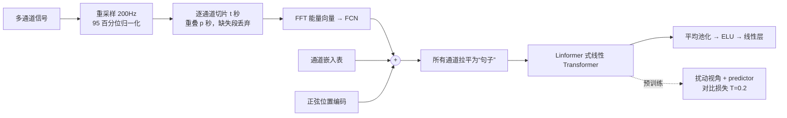

# BIOT：研究问题、架构与训练逻辑

> 版本：2026-11-14 / 论文笔记 v0.2。依据已保存的 arXiv v1 全文（NeurIPS 2023）：正文来自 `biot.txt`，附录 A–B 来自 `biot.html`（txt 版没有收录附录）。尚未核对代码，未本地复现。统一记号见[阅读约定](../process/文档维护与阅读约定.md)。

## 1. 作者要解决的问题

**问题陈述（作者观点）：** 生物信号（EEG、ECG、可穿戴传感器）在真实环境中格式五花八门：采样率不同、通道不匹配、时长不同、还有缺失段。现有深度模型大多针对固定格式，要用到别的数据集就需要截断、补零、插补，这些操作会引入噪声、改变分布。作者希望有一个能直接接收任意格式、并能跨数据集联合（预）训练的编码器。

一个典型例子（作者原文）：能否把“64 通道、5 s、256 Hz 的异常 EEG 检测”学到的知识迁移到“16 通道、10 s、200 Hz 的癫痫类型分类”上？

**对应设计：** 把每个通道**单独**切成固定长度的片段，所有通道的片段**拉平成一个“句子”**，再用线性复杂度的 Transformer 编码。缺失的片段直接从句子里删掉。

**哪些已被实验支持：**

| 主张 | 证据 | 强度 |
|---|---|---|
| 从零训练也优于专用基线 | Table 2：CHB-MIT BACC 0.664 vs 最强基线 0.639；IIIC 0.576 vs 0.562 | 提升不大；作者推测是频域特征对癫痫类任务更有用 |
| 对缺失通道/片段更鲁棒 | 图 3：在 TUEV、IIIC 上人为删掉通道或片段 | 基线用补零处理缺失，BIOT 直接删 token，比较方式本身对 BIOT 有利 |
| 无监督预训练有帮助 | Table 2：CHB-MIT 0.664 → 0.694（PREST 预训练） | 预训练数据 PREST 是**私有**数据 |
| 有监督预训练（跨任务）有帮助 | 图 4：在 IIIC、TUAB 上有监督预训练后微调 TUEV | 有时比无监督预训练更有效 |

## 2. 输入与输出

- 输入：$S\in\mathbb R^{I\times J}$（$I$ 个通道、$J$ 个采样点），外加**通道身份**（用于查通道嵌入表）。
- 输出：所有 token 表示**平均池化**后的一个向量（作者试过 [CLS] token，效果略差），接 ELU + 线性层分类。

## 3. 前向计算（逐步）

### 3.1 非参数预处理（4 步）

1. **重采样**：线性插值到统一采样率（EEG 用 200 Hz）。理由：EEG/ECG 关心的最高频率约 100 Hz，按奈奎斯特定理 200 Hz 足够。
2. **归一化**：每个通道除以其绝对值的第 95 百分位数：$S[i]/\mathrm{percentile}(|S[i]|,95\%)$。
3. **切片**：每个通道独立切成长 $t$ 秒的片段，相邻片段重叠 $p$ 秒（例如 $t=1$、$p=0.5$）。第 $k$ 个片段为 $S[i,(t-p)(k-1):(t-p)(k-1)+t]$。重叠对短信号很重要：3 s 信号在 $t=1,p=0$ 时只有 3 个 token，在 $t=1,p=0.5$ 时有 5 个。**缺失的片段直接丢弃**。
4. **拉平**：所有通道的片段拼成一个序列。

### 3.2 Token 嵌入（3 部分相加）

- **片段嵌入（频域）**：对每个片段做 FFT，取各频率的**能量向量**，经全连接网络得到嵌入。只用能量，**不用相位**，也不用时域波形。
- **通道嵌入（空间）**：可学习的查找表，每个通道一个向量。
- **位置嵌入（时间）**：正弦/余弦函数，不含可学习参数。作者称之为 “relative positional embedding”，但从描述看是按片段在通道内的序号计算的正弦编码。

### 3.3 线性 Transformer

一个 64 通道、20 s 的 EEG 在无重叠时就有 1,280 个 token，标准注意力的平方复杂度太高。BIOT 采用 Linformer 式的低秩近似：用投影矩阵 $E,F\in\mathbb R^{d\times N}$（$d\ll N$）先把 Key 和 Value 压缩到 $d$ 行：

$$H=\mathrm{softmax}\Big(\frac{(XW^Q)(EXW^K)^\top}{\sqrt k}\Big)\cdot FXW^V$$

注意力矩阵从 $N\times N$ 变成 $N\times d$。每个块含一层线性自注意力和一个全连接网络，前面加 LayerNorm，带残差和 dropout。

### 3.4 无监督预训练（BYOL / 对比式）

1. 对原始信号 $S$ 随机丢掉部分通道，再在剩余通道中丢掉部分 token，得到扰动信号 $\tilde S$；
2. 同一个 BIOT 编码 $S$ 和 $\tilde S$；扰动分支后接一个两层 predictor（仿照 BYOL）：$Z=\mathrm{BIOT}(S)$，$\tilde Z=\mathrm{predictor}(\mathrm{BIOT}(\tilde S))$；
3. 两者做样本级 L2 归一化后，用对比损失（温度 $T=0.2$）：

$$\mathcal L=\mathrm{CE}\big(\mathrm{softmax}(\langle Z,\tilde Z^\top\rangle/T),\ I\big)$$

即同一样本的两个视角互为正样本，batch 内其他样本为负样本。这与 MAE 类的“重建被遮内容”不同：目标是**样本级表示的一致性**，而不是逐 token 的重建。

### 3.5 有监督预训练与多数据集预训练

- 在一个任务上有监督训练，去掉预测层，换新的预测层后在另一任务上微调；
- “6 个 EEG 数据集”版本：先用 PREST+SHHS 无监督预训练，再在 CHB-MIT、IIIC、TUAB、TUEV 的训练集上做多任务有监督训练（每个任务一个分类层），最后在目标任务上微调。

## 4. 训练逻辑

### 4.1 预训练数据（Table 1）

| 数据 | 类型 | 规模 | 通道 / 时长 / 采样率 |
|---|---|---|---|
| SHHS | 睡眠 EEG（公开） | 5,445 段记录，约 509 万样本 | 2 通道（C3-A2、C4-A1）/ 30 s / 125 Hz |
| PREST | 静息 EEG（**私有**，医院睡眠实验室，主要用于癫痫与异常检测） | 6,478 段记录，约 511 万样本 | 16 个双极导联 / 10 s / 200 Hz |
| Cardiology | ECG | 约 50 万样本 | 6 或 12 导联 / 10 s / 500 Hz |

PREST 预训练：batch 2048，保存第 100 个 epoch 的模型。

**模型与超参数（附录 A.2）：** 4 层 Transformer、8 个头；EEG 的 FFT 长度 200 点（1 s @ 200 Hz）、hop 100 点，即默认 **token 长 1 s、重叠 0.5 s**；Adam，lr 1e-3，L2 正则 1e-5；最多 100 epoch。附录写对比预训练的温度 $T=2$，正文写 $T=0.2$，两处不一致。

### 4.2 下游数据与划分

| 数据集 | 任务 | 划分 |
|---|---|---|
| CHB-MIT | 癫痫检测（二分类，正例约 0.6%） | 病人 1–19 训练、20–21 验证、22–23 测试；再交换验证和测试重做一次，取平均 |
| IIIC Seizure | 6 类癫痫样模式 | 按病人 60:20:20 |
| TUAB | 正常/异常 | 数据集自带训练/测试，训练病人再按 80:20 切出验证集 |
| TUEV | 6 类事件 | 同 TUAB |
| PTB-XL | ECG 心律失常 | 按病人 80:10:10 |
| HAR | 人体动作（传感器） | 自带划分 |

EEG 任务都使用**常见的 16 个双极导联**（10-20 系统）。所有划分都是**先分病人、再切样本**，因此都是跨被试的。

**TUAB、TUEV 划分的影响**：LaBraM、CBraMod、REVE、EEGPT 都写明“沿用 BIOT 的 TUAB/TUEV 划分”，所以这套划分是后续论文中 TUAB/TUEV 结果可比的基础。

### 4.3 训练设置

CHB-MIT 用 focal loss（类别极度不平衡），TUAB 用 BCE，多分类用交叉熵。8 张 RTX A6000。Table 2–3 报告 5 个随机种子；图 3–4 报告 3 个种子。按验证集选模型和超参数。

## 5. 实验结果与可支持的结论

**Table 2（EEG，BACC）：**

| 模型 | CHB-MIT | IIIC Seizure |
|---|---|---|
| 最强专用基线 | 0.639（CNN-Transformer） | 0.562（FFCL） |
| BIOT（从零训练） | 0.664 | 0.576 |
| BIOT（PREST 预训练） | 0.694 | 0.579 |
| BIOT（PREST+SHHS 预训练） | 0.679 | 0.580 |
| BIOT（6 个 EEG 数据集） | **0.707** | 0.578 |

**TUAB / TUEV（附录 B.1 Table 4–5，BACC）：**

| BIOT 版本 | TUAB | TUEV |
|---|---|---|
| 从零训练 | 0.7925 | 0.4682 |
| PREST 无监督预训练 | 0.7907 | 0.5207 |
| PREST+SHHS 无监督预训练 | **0.8019** | 0.5149 |
| 在 TUAB 训练集上有监督预训练（16 ch、10 s） | — | 0.5256 |
| “6 个 EEG 数据集”（无监督 + 在 CHB-MIT、IIIC、**TUAB、TUEV 训练集**上有监督多任务训练） | 0.7959 | **0.5281** |

**引用提醒**：LaBraM、CBraMod、EEGPT、REVE 等论文表格里的 BIOT 数值（TUAB 0.7959、TUEV 0.5281）来自最后一行，即预训练阶段已经用过 TUAB 和 TUEV **训练集标签**的版本（测试集未用）。纯无监督预训练的 BIOT 在 TUEV 上是 0.52 左右，从零训练是 0.47。

**有监督预训练（图 4，微调 TUEV）**：用 IIIC 和 TUAB 做有监督预训练对 TUEV 有帮助；“16 通道、10 s”的预训练格式比与 TUEV 格式更一致的“16 通道、5 s”效果更好；有监督预训练有时比无监督预训练（SHHS、PREST）更有效。

**预处理超参数消融（附录 B.3，IIIC 与 TUAB，图 6–8，3 个种子）：**

- **采样率**：IIIC 上采样率越高略好（作者推测癫痫类型需要 γ 波段等高频线索）；TUAB 上各采样率差不多（50 Hz 以下的脑波可能就够）。作者结论：采样率应按任务选择。
- **token 长度**：0.75–5 s 中，IIIC 超过 1 s 后下降，TUAB 超过 2 s 后下降。作者解释为 token 越长，“句子”越短（10 s 样本在 $t=1,p=0.5$ 时有 19 个 token，$t=5$ 时只有 11 个），Transformer 的优势减弱。
- **重叠长度**：重叠越大（句子越长）效果略好。

**缺失数据（图 3）**：所有模型随缺失增多而下降，BIOT 下降较少；缺失通道比缺失片段影响更大。

**外部评测与他人的观察：**

- NeuralBench 整体平均排名 11.31，但帕金森诊断 77.247%，高于 REVE 的 69.340%。
- EEGPT 论文附录 F：BIOT 在 PhysioP300（P300）上只有约 54% 的二分类准确率，作者分析原因是 BIOT 只用 1 s 片段的 FFT 能量、**丢掉了相位和时域波形**，而 P300 是集中在 300 ms 附近的时域成分；KaggleERN（ERN）上也有类似情况。
- CBraMod、CSBrain 论文提到：公开的预训练 BIOT **最多接受 18 个通道**；通道更多时，CBraMod 用多个 BIOT 分别处理不同的通道组，CSBrain 用 1×1 卷积投影到 18 个通道。这一限制大概来自预训练时通道嵌入表的大小（16 个双极导联 + SHHS 的 2 个导联），需查代码确认。

协议见[评测证据](../benchmarks/评测证据与可比性.md)。

## 6. 局限、疑点与未读懂的部分

1. **只用 FFT 能量作为 token 内容**：丢弃相位和时域形态，依赖时域波形的任务（ERP、P300、ERN）表现差（他人观察）。
2. **通道嵌入是查找表**：只能处理预训练见过的通道；双极导联与单极电极是不同的“通道”。
3. **关键预训练数据私有**（PREST），无法复现。
4. **缺失数据实验对基线不利**：基线用补零，BIOT 直接丢 token。
5. **线性注意力的近似**：Linformer 的投影矩阵 $E,F$ 维度依赖序列长度 $N$，对变长输入如何处理需查代码。
6. **温度参数前后不一致**（正文 0.2，附录 2）。
7. **常被引用的 TUAB/TUEV 数值来自“用过下游训练集标签预训练”的版本**（见 §5）。

## 7. 与本赛题规格的事实对照

此节只列事实，不构成方案选择。

| 方面 | BIOT 的情况 | 赛题情况 |
|---|---|---|
| 采样率 | EEG 重采样到 200 Hz | 统一 200 Hz |
| 片段 | 逐通道切片，可重叠；1 s 片段的频率分辨率为 1 Hz | 1–30 s；SSVEP 依赖精确频率 |
| 通道 | 查表，公开权重最多 18 个通道 | 4–128 通道；接口是否提供导联名称**待确认** |
| token 内容 | 只有 FFT 能量 | 7 类任务中有依赖时域波形的（如 ERP 类）也有依赖频率的（如 SSVEP、睡眠） |
| 预训练目标 | 样本级对比（BYOL 式） | — |
| 权重 | 公开（github.com/ycq091044/BIOT） | 手册未点名 BIOT；复赛允许公开可下载权重 |

## 8. 留给讨论的问题

- BIOT 是这批模型中唯一用“样本级对比”而不是“token 级重建/预测”做预训练的（BENDR 也是对比，但在时间步级别）。两种目标让表示保留的信息有什么不同？
- BIOT 只用 FFT 能量，FAME 也重建频段能量（对数功率），两者都不显式保留相位。这对赛题中的不同任务意味着什么？
- 图 4 显示有监督预训练有时比无监督预训练更有效。这与决赛“从零预训练”的规定是什么关系（决赛语料是否有标签）？

## 原文与证据

- [BIOT（NeurIPS 2023，arXiv v1）](https://arxiv.org/abs/2305.10351)：§2（式 1–4，图 1–2）、§3（Table 1–3，图 3–4）；附录 A.2（实现与超参数）、B.1（Table 4–5，TUAB/TUEV）、B.2（CHB-MIT 有监督预训练）、B.3（采样率、token 长度、重叠消融）。本地副本：`research/reve_route_20261113/sources/biot.txt`（正文）、`biot.html`（含附录）。
- 代码与预训练模型：github.com/ycq091044/BIOT。
- [NeuralBench 官方逐任务结果，固定提交 fe31393](https://github.com/facebookresearch/neuroai/blob/fe31393affab2590e59b0a7e1457aad1a1da908e/docs/_static/neuralbench-results-data.json)。
- EEGPT 附录 F（BIOT 在 P300 上的分析）；CBraMod 附录 D.1、CSBrain 附录 C.2（18 通道限制）。

- [原始资料目录](../../research/reve_route_20261113/sources/)
- [返回论文索引](README.md)
