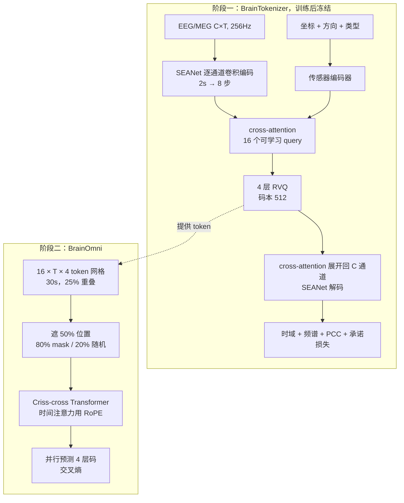

# BrainOmni：研究问题、架构与训练逻辑

> 版本：2026-11-14 / 论文笔记 v0.2。依据已保存的 arXiv v1 全文（2025-05，含附录 A–J）；尚未核对代码，未本地复现。作者写明“代码与 checkpoint 将在论文接收后发布”，阅读时未确认。统一记号见[阅读约定](../process/文档维护与阅读约定.md)。

## 1. 作者要解决的问题

**问题陈述（作者观点）：** EEG 与 MEG 来自同一生物物理过程（树突电流产生的电磁场），但信号形态不同，设备之间的传感器配置差异更大：数量、类型（EEG 电极 / MEG 梯度计 / 磁力计）、位置、方向，以及命名方式都不统一，MEG 尤其严重。现有模型通常按模态、按数据集分开训练，限制了性能和扩展性。

两个挑战：(1) **跨模态整合**：EEG 与 MEG 的信号特点不同；(2) **跨设备泛化**：传感器配置缺乏标准化。

**对应设计（两阶段）：**

- **阶段一 BrainTokenizer**：借鉴“源活动估计”的思想，用一个**传感器编码器**把每个传感器的物理属性（三维坐标、方向、类型）编码成向量，再用 cross-attention 把**任意数量的通道压缩成固定 16 个“潜在源变量”**，然后用残差向量量化（RVQ）离散化；
- **阶段二 BrainOmni**：在离散 token 网格上做 mask token 预测（与 LaBraM 的第二阶段思路相同），主干用 CBraMod 的 criss-cross Transformer。

**哪些已被实验支持：**

| 主张 | 证据 | 强度 |
|---|---|---|
| 传感器编码器有用 | Table 6：去掉传感器嵌入，AD65 0.800 → 0.730，ASD74 0.606 → 0.549，SomatoMotor 0.787 → 0.643 | 较强；但 TUEV 上去掉后反而略升（0.597 → 0.604） |
| EEG+MEG 联合预训练优于单模态 | Table 5：TUEV 0.555 → 0.596（仅 EEG → 联合） | 4 个数据集，结果一致，较可信 |
| 通道压缩（16 个源）优于电极级建模 | 附录 H.1 Table 7 | 结果混合：PD31 明显更好（0.595 → 0.658），SomatoMotor 反而更差（0.805 → 0.787），其余接近 |
| 能泛化到未见设备 | Table 4：tokenizer 在未见的 EEG/MEG 设备上的**重建误差**与已见设备相近 | 只是重建指标，不是下游任务表现 |
| 冻结也能用 | 附录 H.2 Table 8：冻结的 BrainOmni 在 TUAB、AD65 上接近或超过全量微调的基线 | TUEV 上冻结仍大幅下降（0.618 → 0.489） |

## 2. 输入与输出

- 输入样本 $\Omega=(X,L,S)$：
  - $X\in\mathbb R^{C\times T}$：原始信号；
  - $L\in\mathbb R^{C\times6}$：每个传感器的**三维坐标和方向**（笛卡尔坐标）；
  - $S$：每个传感器的类型（0 = EEG，1 = 梯度计，2 = 磁力计）。
- 坐标来源：数据集提供的位置，或该设备的标准 montage。对 EEG 电极，“方向”如何设定，论文未说明。
- 采样率：**256 Hz**。
- 输出：阶段一输出离散 token 网格 $Q\in\mathbb R^{C'\times W\times4}$（$C'=16$ 个源、$W$ 个时间步、4 层 RVQ 码）；阶段二输出每个位置的上下文表示。

## 3. 前向计算（逐步）

### 3.1 阶段一：BrainTokenizer

**(a) SEANet 时间编码器（逐通道）**：多层残差 1D 卷积 + 带步长的卷积（来自音频编解码器）。附录 Table 9：窗口长度 512 点（2 s @ 256 Hz），下采样比 [8, 4, 2]，即总下采样 64 倍，每 2 s 窗口得到 $W=8$ 个时间步（按下采样比推算，约 62.5 ms 一步），隐藏维 256。输出 $Z_{time}\in\mathbb R^{C\times W\times D}$。

**(b) 传感器编码器**：位置嵌入层编码 $L$（坐标 + 方向），类型嵌入层编码 $S$，融合成传感器嵌入 $V\in\mathbb R^{C\times D}$。命名方式完全不参与。

**(c) 通道压缩（cross-attention）**：

- Query：**16 个可学习向量**（对应 16 个潜在源变量）；
- Key：$Z_{time}+V$（时间特征 + 传感器嵌入）；
- Value：$Z_{time}$；
- 在每个时间步上，16 个 query 从 $C$ 个通道中加权汇聚信息，得到 $Z_{src}\in\mathbb R^{16\times W\times D}$。

不论输入有 4 个通道还是 306 个通道，输出都是 16 个“源”。附录 B 把这一步类比为源估计中的**逆解**（inverse operator），cross-attention 的权重可以理解为一个参数化的线性逆矩阵；附录 J 的可视化显示，每个源变量主要关注特定的头皮区域。图 3(c)：源数量超过 16 后，重建损失下降变缓，因此取 16。

**(d) 残差向量量化（RVQ）**：4 层，每层码本 512 个、维度 256；EMA 更新码本，用 rotation trick 估计梯度。第 1 层量化 $Z_{src}$，第 2 层量化剩余的残差，依此类推，得到 4 个码。

**(e) 重建器（只用于训练 tokenizer）**：RVQ 解码 → 另一个 cross-attention 把 16 个源**展开回原来的 $C$ 个通道**（类比源估计中的**正解**）→ SEANet 解码器（转置卷积）重建波形。

**(f) 训练**：随机丢掉 **25% 的输入通道**，要求从离散 token 重建**全部原始通道**。损失：

$$\mathcal L_{token}=\underbrace{\|X-\hat X\|_1}_{\text{时域 L1}}+\underbrace{\|A-\hat A\|_1+\|\Phi-\hat\Phi\|_1}_{\text{幅值谱与相位谱 L1}}+\underbrace{e^{-\mathrm{PCC}(X,\hat X)}}_{\text{波形相关性}}+\underbrace{\sum_i\|z_i-z_{q_i}\|^2}_{\text{RVQ 承诺损失}}$$

### 3.2 阶段二：BrainOmni

1. 把较长的连续数据（**30 s**）按 2 s 窗口、**25% 重叠**切开，逐窗用冻结的 tokenizer 得到 token，拼成形状 $(C'=16,\ T,\ N_q=4)$ 的 token 网格；
2. 随机遮盖网格中 **50% 的位置**（每个位置的 4 层码全部遮盖）。被遮位置中 80% 换成 mask token，20% 换成从序列中随机抽取的 token（BERT 做法，防止模型过度依赖 mask token）；
3. 嵌入层把 4 个码映射为 $D$ 维表示；
4. **Criss-cross Transformer**（来自 CBraMod）：特征维度一半做空间注意力（16 个源之间），一半做时间注意力（时间步之间），拼接后过 FFN；时间注意力上加 **RoPE**；
5. 对每个被遮位置，**并行（非自回归）**预测 4 层 RVQ 码，交叉熵损失：

$$\mathcal L_{model}=\frac1M\sum_{i=1}^M\sum_{j=1}^{4}\mathcal L_{ce}(q_{ij},y_{ij})$$

图 3(b)：第 1 层码的预测准确率最高，越往后的残差层越难预测。

### 3.3 下游

全量微调。论文正文没有说明分类头的结构（是否池化等），需查代码。

## 4. 训练逻辑

### 4.1 预训练数据（§3.1、附录 D）

- **1,997 小时 EEG + 656 小时 MEG**，全部来自公开数据集；EEG 设备 19–128 通道，MEG 157–306 通道；
- 包括：HBN EO/EC（儿童静息，129 ch）、SRM（静息，64 ch）、RestCog（64 ch）、Go-Nogo、MusicEEG、HFO 等 EEG 数据；OMEGA、Cam-CAN（CC700）、MEG-MASC、THINGS-MEG、SMN4Lang 等 MEG 数据；
- 按 85/10/5 切分为训练/验证/测试；另外各留出一个**全新设备**的 EEG 数据集（PerceiveImagine，SynAmps2 系统）和 MEG 数据集（Gloups-MEG）只用于测试跨设备泛化；
- 所有下游数据集都**排除**在预训练之外。

注意：附录 D 中的 MusicEEG、HFO、RestCog 也出现在 FAME 的下游任务列表中；跨论文比较时要留意这种数据角色的交叉。

### 4.2 预处理

0.1–96 Hz 带通，50/60 Hz 陷波（MEG 还滤除 HPI 线圈频率），重采样 **256 Hz**；基于功率谱检测坏道并插值；**每个样本内**先对同类型传感器减去参考值（相当于按类型做平均参考），再对每个通道做零均值、单位方差标准化。

### 4.3 超参数与算力（附录 G、I）

| 项目 | BrainTokenizer | BrainOmni-tiny | BrainOmni-base |
|---|---|---|---|
| 隐藏维 | 256 | 256 | 512 |
| 层数 / 头数 | — / 4 | 12 / 8 | 12 / 16 |
| 参数 | — | 8.4M | 33M |
| 输入长度 | 2 s | 30 s（25% 重叠切窗） | 同左 |
| epoch / batch / 峰值 lr | 16 / 512 / 2e-4 | 32 / 256 / 5e-4 | 32 / 256 / 4e-4 |

16 张 A100；AdamW，warmup + 余弦衰减。论文未给总训练时长。

## 5. 下游评测设置

| 模态 | 任务 | 数据集 | 通道 | 时长 | 类别 |
|---|---|---|---|---|---|
| EEG | 阿尔茨海默病 | AD65 | 19 | 10 s | 2 |
| EEG | 抑郁 | MDD | 20 | 10 s | 2 |
| EEG | 帕金森 | PD31 | 32 | 10 s | 2 |
| EEG | 异常 | TUAB | 21 | 10 s | 2 |
| EEG | 事件 | TUEV | 21 | 5 s | 6 |
| EEG | 情绪 | FACED | 30 | 10 s | **3**（其他论文多用 9 类） |
| EEG | 运动想象 | WBCIC_SHU | 58 | 4 s | 2 |
| EEG | 运动想象 | PhysioNet-MI | 64 | 4 s | 4 |
| MEG | 自闭症 | ASD74 | 306 | 10 s | 2 |
| EEG+MEG | 运动反应 | SomatoMotor | 372 | 2 s | 2 |

- **跨被试 3 折交叉验证**，报告 3 次的均值和标准差；
- 固定随机种子 42，训练 30 epoch，按验证集 BACC 选 checkpoint；
- 学习率在 {3e-6, 1e-5, 3e-5} 中按验证集选最优，对**所有模型**都这样做；
- 所有基线用同一预处理和训练流程；唯一例外是 LaBraM、CBraMod 使用它们各自原本的采样率和带通设置。

这是本文的优点：所有模型在同一个跨被试流程下重新训练。但学习率网格很窄、而且都很小，对某些模型可能不合适（见 §6 中 CBraMod 的结果）。

## 6. 实验结果与可支持的结论

**Table 2（EEG，BACC）：**

| 数据集 | LaBraM | CBraMod | BrainOmni-tiny | BrainOmni-base |
|---|---|---|---|---|
| AD65 | 0.715 | 0.649 | 0.800 | 0.806 |
| MDD | **0.843** | 0.811 | 0.834 | 0.841 |
| PD31 | 0.600 | 0.617 | 0.658 | 0.733 |
| TUAB | 0.807 | 0.773 | **0.816** | 0.813 |
| TUEV | 0.596 | 0.416 | 0.597 | 0.618 |
| FACED（3 类） | 0.444 | 0.430 | 0.454 | 0.466 |
| WBCIC_SHU | 0.819 | **0.532** | 0.818 | 0.819 |
| PhysioNet-MI | 0.372 | 0.313 | 0.434 | 0.439 |

- CBraMod 在本文流程下明显偏弱（WBCIC_SHU 0.532，几乎接近随机；TUEV 0.416，而 CBraMod 原论文报告 0.667）。这更可能反映**微调流程与 CBraMod 不匹配**（例如学习率网格），而不是 CBraMod 本身的能力。
- PhysioNet-MI 上所有模型都只有 0.31–0.44，远低于 CBraMod/REVE 论文中的约 0.64，说明本文的跨被试 3 折设置更难，或预处理不同。

**MEG / EMEG（Table 3）：** ASD74 BACC 0.624（最强基线 0.565）；SomatoMotor 0.801（最强基线 ST-Transformer 0.624）。

**联合预训练（Table 5，tiny）：** TUAB 仅 EEG 0.807 → 联合 0.816；TUEV 0.555 → 0.596；ASD74 仅 MEG 0.530 → 联合 0.606；SomatoMotor 的 MEG 输入 0.683 → 0.786。

**冻结骨干（附录 H.2 Table 8）：**

| | TUAB 冻结 / 微调 | TUEV 冻结 / 微调 | AD65 冻结 / 微调 |
|---|---|---|---|
| LaBraM | 0.788 / 0.807 | 0.394 / 0.596 | 0.699 / 0.706 |
| CBraMod | 0.768 / 0.773 | 0.398 / 0.416 | 0.633 / 0.649 |
| BrainOmni-base | 0.811 / 0.813 | 0.489 / 0.618 | 0.780 / 0.806 |

TUAB、AD65 上冻结与微调差距很小；TUEV 上所有模型冻结后都大幅下降。

**外部评测：** OmniEEG-Bench 的跨被试线性探测正文中，BrainOmni 平均排名第一；NeuralBench 首版未纳入 BrainOmni。协议见[评测证据](../benchmarks/评测证据与可比性.md)。

## 7. 局限、疑点与未读懂的部分

1. **作者承认的局限**：预训练数据规模有限，MEG 仅 656 小时；MEG/EMEG 下游缺少标准化的评测范式。
2. **依赖传感器物理信息**：需要每个通道的三维坐标、方向和类型；没有这些信息时无法使用传感器编码器（去掉后性能明显下降）。
3. **16 个源的固定压缩**：对 4–6 个通道的输入，压缩反而变成“扩展”；论文最少只测过 19 通道（AD65）。
4. **未见设备的证据只是重建误差**，没有下游任务的跨设备实验。
5. **基线在本文流程下可能被低估**（CBraMod 在 WBCIC_SHU 上 0.532）。
6. **FACED 用 3 类**，不能与其他论文的 9 类结果直接比较。
7. **未读懂/待核**：EEG 电极的“方向”字段如何设定；下游分类头结构；附录 H.1 Table 7 中 “NAE” 应为 “LSAE”（笔误）。

## 8. 与本赛题规格的事实对照

此节只列事实，不构成方案选择。

| 方面 | BrainOmni 的情况 | 赛题情况 |
|---|---|---|
| 采样率 | 256 Hz | 统一 200 Hz |
| tokenizer 窗口 | 2 s（512 点 @ 256 Hz） | 1 s 的 SSVEP 不足一个窗口；其余时长均 ≥ 2 s |
| 通道信息 | 需要坐标、方向、类型 | 接口是否提供导联名称或坐标**待确认** |
| 通道数 | 任意，压缩为 16 个源 | 4–128 通道 |
| 划分 | 跨被试 3 折 | 跨被试 8:1:1，3 个种子 |
| 模型选择 | 验证集 BACC | 验证集 BACC |
| 权重 | 论文写“接收后发布”，未核实 | 复赛只能用公开可下载的权重 |
| 算力 | 16 × A100 | 决赛官方算力 |

## 9. 留给讨论的问题

- BrainOmni 用“16 个源”统一任意通道数；REVE 用 4D 坐标位置编码保留所有通道；CBraMod 用卷积位置编码依赖通道顺序。三者对“通道异构”的处理思路有什么本质区别？各自需要接口提供什么信息？
- 联合 EEG+MEG 预训练有效（Table 5），这是因为数据更多，还是因为跨模态本身带来了什么？论文的实验能区分这两种解释吗？
- 同一个 CBraMod，在不同论文的流程下结果差异极大（TUEV 0.667 vs 0.416）。这对我们在复赛中设计基线对比有什么启示？

## 原文与证据

- [BrainOmni（arXiv v1，2025-05）](https://arxiv.org/abs/2505.18185)：§2（式 1–6，图 1–2）、§3（Table 1）、§4（Table 2–6）、§5（图 3–4）；附录 A（局限）、B（源估计背景）、D（预训练数据）、G（实现）、H（Table 7 源压缩消融、Table 8 冻结骨干）、I（Table 9–11 超参数）、J（cross-attention 可视化）。本地副本：`research/reve_route_20261113/sources/brainomni.txt`。
- [OmniEEG-Bench（arXiv v1，预印本）](https://arxiv.org/html/2606.00815v1)：跨被试线性探测结果。

- [原始资料目录](../../research/reve_route_20261113/sources/)
- [返回论文索引](README.md)
