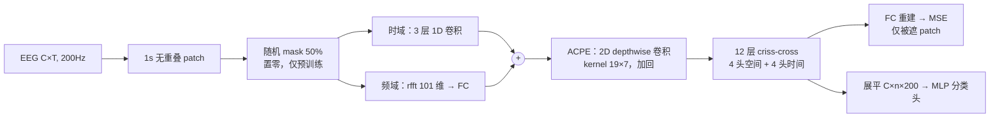

# CBraMod：研究问题、架构与训练逻辑

> 版本：2026-11-14 / 论文笔记 v0.2。依据已保存的 arXiv v1 全文（ICLR 2025，含附录 A–S）；尚未核对代码逐层实现，未本地复现。统一记号见[阅读约定](../process/文档维护与阅读约定.md)。

## 1. 作者要解决的问题

**问题陈述（作者观点）：**

1. **结构特性被忽略。** 已有模型（如 LaBraM）把所有“通道×时间”patch 拉平后做全注意力（full EEG modeling）。作者认为 EEG 的空间依赖与时间依赖是**异质的**：同一通道内或同一时刻内的 patch 之间依赖更强，这种先验在图像里不成立。
2. **通道含义会变。** 通道不只由电极位置决定，还受参考方式影响（耳垂、平均、REST、双极）。LaBraM 按电极编号查表的绝对位置编码，默认“通道 ↔ 电极位置”的关系固定，因此难以迁移。

**对应设计：** 用并行的空间注意力与时间注意力（criss-cross）替代全注意力；用卷积生成的条件位置编码（ACPE）替代查表位置编码。

**哪些已被实验支持：**

| 主张 | 证据 | 强度 |
|---|---|---|
| criss-cross 优于 full / axial / CCNet 注意力 | 图 4（4 个数据集，只有柱状图，正文未给数值） | 同设置下重新预训练比较，较可信；但只覆盖情绪和 MI 两类任务 |
| ACPE 优于无 PE / 绝对 PE / 对称 CPE | 图 5（同上 4 个数据集） | CPE 与 ACPE 差距“slightly”，非对称性的贡献很小 |
| 架构贡献大于数据量 | 附录 G：把 BIOT、LaBraM 架构放在 CBraMod 的数据上预训练，CBraMod 仍明显更好 | 较有说服力；只有图，没有表格数值 |
| 预训练有用 | Table 4：clean > dirty > 无预训练 | 提升幅度不大（PhysioNet-MI 0.620 → 0.642；FACED 0.523 → 0.551） |
| 可做冻结特征提取器 | 附录 J：**不能**。冻结后 PhysioNet-MI 只有 0.385 | 作者自己承认需要全量微调 |

## 2. 输入与输出

- 输入：$S\in\mathbb R^{C\times T}$，200 Hz。**不需要电极坐标或电极名**，只需要按某种固定顺序排列的通道。
- patch：1 s（200 点），无重叠，$n=\lfloor T/200\rfloor$，得 $X\in\mathbb R^{C\times n\times200}$。
- 输出：预训练时重建被 mask 的 patch；下游时输出 $E^r\in\mathbb R^{C\times n\times d}$（$d=200$），**展平后**接 MLP 分类头。

## 3. 前向计算（逐步）

### 3.1 Mask（仅预训练，在 patch 编码之前）

按 Bernoulli(0.5) 随机选 patch，把**原始波形 patch** 替换为全零 mask token（附录 N：全零与可学习 mask token 结果几乎一样）。与 MAE 不同，**所有 patch（含被遮的）都进入编码器**，属于 BERT 式做法，不是 MAE 式只编码可见 token。

### 3.2 时频双分支 patch 编码

对每个 200 点 patch 独立处理（附录 Table 5）：

- **时域分支**：3 层 1D 卷积 + GroupNorm + GELU。第一层 1→25 通道、kernel 49、stride 25、padding 24，把 200 点压到 8 个位置；后两层 25→25、kernel 3。输出 25 通道 × 8 位置 = 200 维，即 $e^t_{i,j}\in\mathbb R^{200}$（展平方式需以代码为准）。
- **频域分支**：`torch.fft.rfft` 取 101 个频率的能量（1 s 窗口、200 Hz，频率分辨率 1 Hz，覆盖 0–100 Hz），经全连接层 101→200 得 $e^f_{i,j}$。
- 两者**相加**：$e_{i,j}=e^t_{i,j}+e^f_{i,j}$。

附录 I：只用时域 > 只用频域，两者相加最好，但相加比只用时域的提升很小（PhysioNet-MI 0.632 → 0.642）。

### 3.3 ACPE（非对称条件位置编码）

把 $E\in\mathbb R^{C\times n\times d}$ 当作一张 $C\times n$ 的“图”，做**一层 2D depthwise 卷积**，kernel $(k_s,k_t)=(19,7)$、padding $(9,3)$，输出与 $E$ 同形状的 $E^p$，再加回：$E^o=E+E^p$。

- 空间（通道）方向 kernel 长、时间方向短，作者称为编码“长程空间、短程时间”的位置信息。
- 位置信息由**邻近 patch 的内容**和 zero padding 的边界效应产生（来自 CPE 的思想），而不是由坐标计算出来。
- **含义上需注意**：通道轴上的“邻近”是**通道在列表中的顺序**，不是头皮上的物理邻近。预训练固定 19 通道，kernel 19 正好覆盖全部通道；下游换成 128 通道时，kernel 只覆盖列表里相邻的 19 个；只有 4 个通道时，大部分 kernel 落在 padding 上。论文没有检验通道顺序被打乱时的影响。

### 3.4 Criss-cross Transformer（12 层）

每个 block：pre-norm LayerNorm → criss-cross 注意力 → 残差 → LayerNorm → FFN（200→800→200）→ 残差；Q、K 在注意力前额外做 LayerNorm（QK-norm），以稳定注意力 logits。

**criss-cross 注意力**：8 个头中，

- 4 个头做 **S-Attention**：对每个时间位置 $j$，在 $C$ 个通道之间做注意力（$n$ 个“空间条带”）；
- 4 个头做 **T-Attention**：对每个通道 $i$，在 $n$ 个时间 patch 之间做注意力；
- 8 个头的输出拼接后投影回 $d$。

同一层内，一个 token 只能直接看到同一时刻的其他通道和同一通道的其他时刻；**斜向**（不同通道、不同时刻）的关系需要堆两层以上才能间接传递。

复杂度从全注意力的 $O(C^2n^2)$ 降到 $O(nC^2+Cn^2)$。附录 O 在 CHB-MIT（16 ch × 10 s）上实测 FLOPs：criss-cross 318.9M，full 469.4M，axial 334.7M。

附录 L：S:T 头数比 4:4 优于 2:6 和 6:2。

### 3.5 重建头（仅预训练）

一个全连接层把每个 token 映射回 200 点波形，**只在被遮 patch 上**计算 MSE：

$$\mathcal L=\|\hat X^M-X^M\|^2$$

### 3.6 下游

去掉重建头；所有 token 表示 $C\times n\times200$ **展平**后送入多层 MLP 分类头。因此分类头的输入维度随 $C\times n$ 变化，每个数据集要单独建头；也没有池化步骤。

## 4. 训练逻辑

### 4.1 预训练数据与预处理

- 只用 **TUEG**（TUH EEG Corpus）：69,652 段临床记录、14,987 名被试、约 27,062 小时、40 多种通道配置，多数 256 Hz；
- 剔除不超过 5 分钟的记录，每段去掉开头和结尾各 1 分钟；
- **固定选 19 个 10-20 通道**（Fp1, Fp2, F7, F3, Fz, F4, F8, T3, C3, Cz, C4, T4, T5, P3, Pz, P4, T6, O1, O2）；
- 带通 0.3–75 Hz，60 Hz 陷波，重采样 200 Hz，切成 **30 s 无重叠**样本；
- 任一点绝对幅值 > 100 μV 的样本整段丢弃；以 100 μV 为单位缩放（与 LaBraM 一致）；
- 最终 1,109,545 个样本，约 9,000 小时。

“TUEG 有 27k 小时”与“实际训练 9k 小时”是两个数，引用时要区分。

### 4.2 预训练超参数（附录 Table 5）

12 层、$d=200$、8 头、FFN 800，约 4.0M 参数；mask 50%；batch 128，40 epoch；AdamW（lr 5e-4，wd 5e-2），余弦退火到 1e-5；梯度裁剪 1；Kaiming 初始化。硬件：4 张 RTX A5000，约 5 天（约 480 GPU 小时）。

### 4.3 下游微调（附录 Table 6）

全量微调 50 epoch，batch 64，AdamW lr 1e-4，余弦退火到 1e-6，dropout 0.1，多分类加 label smoothing 0.1；二分类 BCE、多分类 CE、回归 MSE。**5 个随机种子**取均值±标准差。模型选择指标：二分类 AUROC，多分类 Cohen's Kappa，回归 R²。

## 5. 下游评测设置与可比性要点

10 类任务、12 个数据集（Table 1）。划分方式**并不统一**，对照“被试隔离”的赛题规则时尤其要注意：

| 数据集 | 划分 | 是否跨被试 |
|---|---|---|
| FACED、PhysioNet-MI、SHU-MI、MAT、SEED-VIG、BCIC-IV-2a、CHB-MIT、ISRUC | 按被试编号切分 | 是 |
| TUEV、TUAB | 数据集自带 train/test，再按 8:2 从训练被试中切出验证集 | 是 |
| SEED-V | 每个 session 的 15 个 trial 按 5:5:5 切分 | **否**（同一被试同时出现在训练集和测试集） |
| BCIC2020-3 | 数据集自带的 trial 划分 | **否** |

**睡眠分期的特殊设置（附录 E.1）：** ISRUC 实验中，所有模型都被当作“单个 30 s 片段的编码器”，再接一个 1 层 Transformer 作为**序列编码器**，一次处理 **20 个连续的 30 s 片段**（seq2seq）。也就是说，ISRUC 的 0.7865 用到了前后约 10 分钟的上下文，不能与“单个 30 s 片段独立分类”的结果直接比较。

**数据泄漏的处理：** TUEV、TUAB 是 TUEG 的子集。作者另做了把它们剔除后重新预训练的版本：TUEV 0.6671 → 0.6659，TUAB 0.8289 → 0.8249，变化很小。

## 6. 实验结果与可支持的结论

**主结果（全量微调，BACC）：** FACED 0.551、SEED-V 0.409、PhysioNet-MI 0.642、SHU-MI 0.637、ISRUC 0.787（序列设置）、CHB-MIT 0.740、BCIC2020-3 0.537、Mumtaz 0.956、MAT 0.726、TUEV 0.667、TUAB 0.829、BCIC-IV-2a 0.514。各项都高于 BIOT 和 LaBraM-Base。基线中 BIOT、LaBraM 由作者用公开代码和权重微调（已报告的数值则直接引用）；LaBraM 只公开了 Base 权重，因此只比较 Base。

**消融汇总：**

| 附录/表 | 对照 | 主要结果 |
|---|---|---|
| Table 4 | 预训练：clean / dirty / 无 | FACED 0.551 / 0.532 / 0.523；PhysioNet-MI 0.642 / 0.625 / 0.620 |
| H（Table 16） | 预训练片段长度 4 / 8 / 30 s | 30 s 略好，差距很小（PhysioNet-MI 0.636 / 0.639 / 0.642） |
| I（Table 17） | 时域 / 频域 / 相加 | 相加 > 时域 >> 频域 |
| J（Table 18） | 冻结 vs 全量微调 | 冻结后大幅下降（FACED 0.315，PhysioNet-MI 0.385）；但仍略好于冻结的 BIOT、LaBraM |
| K（Table 19） | 30% 标注数据 | FACED 0.404（全量 0.551）；SHU-MI 0.623（全量 0.637），下降幅度依任务差别很大 |
| F（图 7） | 数据量 1 h → 9000 h；参数 0.1M → 4M | 都单调提升；超过 1000 h 后增速变缓 |
| M（图 9） | mask 比例 | 0.3–0.7 都不错；最佳比例依数据集而异（PhysioNet-MI 是 0.2） |
| R（Table 23） | BCIC-IV-2a 留一被试，对比 EEG-SimpleConv | 加入 Euclidean Alignment、session 统计量、Mixup 等“关键技巧”后两者都从约 0.57–0.60 升到约 0.72–0.74；**这些训练技巧带来的提升远大于两模型之间的差距** |

**外部评测：** 旧版笔记记录的 NeuralBench 数字：睡眠分期 72.926% vs REVE 71.181%，睡眠觉醒 59.458% vs 55.725%；SSVEP 上远弱于 REVE 且离散度大。OmniEEG-Bench 的部分情绪/SSVEP 线性探测条目也较强，但与 NeuralBench 设置不同。协议见[评测证据](../benchmarks/评测证据与可比性.md)。

## 7. 局限、疑点与未读懂的部分

1. **冻结表示弱**（附录 J），依赖全量微调；这与 REVE 的 Table 4 结论一致（REVE 作者复现的 CBraMod 线性探测平均 0.37–0.50）。
2. **ACPE 依赖通道顺序**而非物理位置（§3.3）；论文没有通道打乱或通道子集的实验。
3. **预训练只见过 19 通道、单一来源（TUH 临床数据）**，但下游最多到 64 通道，靠 ACPE 和全量微调去适配。
4. **展平式分类头**：参数量随 $C\times n$ 线性增长，对 128 ch × 2 s 或 62 ch × 10 s 这类输入会变得较大，论文未讨论。
5. **部分对比不可比**：SEED-V、BCIC2020-3 非跨被试；ISRUC 使用了 20 个片段的序列上下文。
6. **未读懂/待核**：时域分支输出如何展平成 200 维；注意力与 PE 消融（图 4、5）的具体数值；预训练是否对 TUEG 中不同参考方式的记录做了统一。
7. **复杂度优势是相对的**：$O(nC^2+Cn^2)$ 在 128 通道时，空间注意力的 $C^2$ 项仍然很大。

## 8. 与本赛题规格的事实对照

此节只列事实，不构成方案选择。

| 方面 | CBraMod 的情况 | 赛题情况 |
|---|---|---|
| 采样率 / patch | 200 Hz，1 s 无重叠 patch | 200 Hz；时长 1/2/4/10/30 s，都能整除 |
| 通道信息 | 只需要固定的通道顺序，不需要坐标 | 接口是否提供导联名称或坐标**待确认** |
| 预训练配置 | 19 ch × 30 s，单一 TUH 来源 | 决赛语料为 21 个 OpenNeuro 数据集，32/64/76/128 ch |
| 极少通道 | 下游最少测过 6 ch（ISRUC，且用序列上下文） | 4、6 ch 睡眠数据，单个 30 s 窗口 |
| 1 s 输入 | SEED-V 是 1 s，但非跨被试划分 | SSVEP 有 1 s × 60 ch |
| 规模与算力 | 4M 参数，4×A5000 约 5 天 | 决赛使用官方算力，配额待确认 |
| 权重 | 作者仓库 github.com/wjq-learning/CBraMod；公开下载渠道与许可**未核** | 手册点名了 OmniEEG、LaBraM、CodeBrain，没有点名 CBraMod |

## 9. 留给讨论的问题

- REVE 与 CBraMod 在“冻结表示”和“随机初始化后训练”两个维度上正好相反（REVE Table 3：随机初始化时 CBraMod 0.620 > REVE 0.541；冻结时 REVE 0.537 > CBraMod 0.385）。这说明两者的优势分别来自哪里？
- ACPE 用通道顺序代替物理位置。如果赛题不提供坐标，这是缺点还是优点？
- 附录 R 显示，训练技巧（对齐、Mixup 等）带来的提升可能比架构差异大。这对复赛的方案意味着什么？

## 原文与证据

- [CBraMod（ICLR 2025，arXiv v1）](https://arxiv.org/html/2412.07236v1)：§2（方法）、§3（Table 1–4，图 4–5）；附录 B Table 5（预训练超参数）、D Table 6（微调）、E Table 7–15（各任务）、F–O（数据/模型规模、架构对比、片段长度、时频、冻结、低资源、头数比、mask 比例、mask token、FLOPs）、R（LOSO）。本地副本：`research/reve_route_20261113/sources/cbramod.txt`。
- [NeuralBench 官方逐任务结果，固定提交 fe31393](https://github.com/facebookresearch/neuroai/blob/fe31393affab2590e59b0a7e1457aad1a1da908e/docs/_static/neuralbench-results-data.json)。
- [OmniEEG-Bench（arXiv v1，预印本）](https://arxiv.org/html/2606.00815v1)：§3–4；Supplementary Tables 4、5、7；附录 E、H。

- [原始资料目录](../../research/reve_route_20261113/sources/)
- [返回论文索引](README.md)
