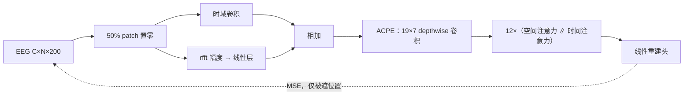

# CBraMod：研究问题、架构与训练逻辑

> 版本：2026-11-13 / 论文笔记 v0.2（重写）。论文已读（ICLR 2025，arXiv v1）；官方代码已对照阅读（wjq-learning/CBraMod，提交 b9e9610）；未运行、未复现。统一记号见[阅读约定](../process/文档维护与阅读约定.md)。
>
> 为什么要读：CSBrain、CodeBrain 都沿用它的语料、输入嵌入和下游协议，并把它当作最强基线。读懂它，后两篇的比较才有意义。

## 一句话

CBraMod 是一个 4M 参数的掩码波形重建模型。它把 patch 排成“通道×时间”的网格，每层注意力一半的头只在同一时刻的通道之间算，另一半只在同一通道的时间上算；位置信息由一层卷积从邻域里现算，不查表。

## 研究出发点

作者对 LaBraM 这类模型提出两条批评（论文 §1）：

1. **把所有 patch 拉平做全连接注意力，等于假设空间依赖和时间依赖是同一种关系。** 作者认为两者性质不同，应当分开建模。
2. **绝对位置嵌入不适应多变的通道配置。** 查表式的通道嵌入要求下游通道在表里出现过。

对应的设计是 criss-cross 注意力和非对称条件位置编码（ACPE）。此外，作者没有采用 LaBraM 的离散码目标，直接重建波形。

## 输入与数据

- 语料：TUEG。原始 27,062 小时，清洗后 1,109,545 个 30 秒样本，约 9,000 小时。
- 清洗步骤：丢弃不足 5 分钟的记录，去掉每段首尾各 1 分钟，只保留 19 个 10–20 导联，0.3–75 Hz 带通，60 Hz 陷波，重采样到 200 Hz，切成 30 秒，丢弃任何采样点绝对值超过 100 μV 的样本，以 100 μV 为单位归一化。
- 样本形状 $19\times30\times200$，共 570 个 1 秒 patch。
- 预训练只见过这一种配置：19 通道、30 秒、临床静息脑电。

## 架构：一次前向计算

记输入为 $X\in\mathbb R^{C\times N\times 200}$（表5、`models/cbramod.py`）。

1. **遮挡。** 按伯努利分布以 0.5 的比例选 patch，把原始波形整段置零。遮挡发生在嵌入之前。
2. **Patch 嵌入，两路相加。**
   - 时域：三层一维卷积（核 49/3/3，首层步长 25），输出 25 个通道 × 8 个时间点，展平为 200 维。
   - 频域：对 patch 做 rfft 取幅度，得 101 维，过一个全连接层到 200 维。
3. **ACPE。** 在 $C\times N$ 网格上做一次 depthwise 二维卷积，核为通道轴 19、时间轴 7，零填充，输出加回嵌入。位置信息来自“邻居是谁”和边界处的零填充，没有任何通道名称或坐标。
4. **12 层 criss-cross Transformer。** 隐藏维 200，前馈 800，8 个头。每层里：
   - 前 4 个头做空间注意力：固定时刻 $j$，在该时刻的 $C$ 个 patch 之间计算。
   - 后 4 个头做时间注意力：固定通道 $i$，在该通道的 $N$ 个 patch 之间计算。
   - 两组输出拼接，再过前馈层。
   
   单层之内，一个 patch 只能看到同一行和同一列，形如十字。不同通道、不同时刻的 patch 要经过两层才能互相影响。
5. **重建头。** 一个全连接层把每个 200 维表示映回 200 个采样点。

**损失**：只在被遮 patch 上计算的 MSE（式12）。

**复杂度**：两组注意力的规模是 $O(N C^2 + C N^2)$，全连接注意力是 $O(C^2N^2)$。这是结构上的估计。作者实测的 FLOPs（表22，CHB-MIT 16 通道×10 秒）：criss-cross 318.9M，全连接 469.4M，LaBraM-Base 483.0M。

## 规模与算力

- 骨干 4.0M 参数。
- 预训练 40 个 epoch，batch 128，4 张 RTX A5000 约 5 天，折合约 480 GPU 小时。
- 作者只训练了这一档规模，规模实验的范围是 0.1M 到 4M（附录 F）。

## 下游适配

- 全参数微调，50 个 epoch，统一超参（表6）。
- 默认分类头：把全部 patch 表示展平，接三层 MLP。代码里以 FACED 为例，第一层是 64,000 维到 2,000 维，约 1.28 亿参数。论文各表里写的 4.0M 是骨干参数量，不含这个头。
- 代码还提供平均池化加线性层等更小的头，但论文结果用的是展平版本。
- 五个种子；多分类按 Kappa、二分类按 AUROC 选权重。

## 实验告诉了我们什么

**主结果**：12 个数据集，基线为作者按相同划分重跑或沿用原文数字。平衡准确率：

| 数据集 | 任务 | 通道/时长 | BIOT | LaBraM-Base | CBraMod |
|---|---|---|---|---|---|
| FACED | 情绪 9 类 | 32 / 10s | 0.5118 | 0.5273 | 0.5509 |
| SEED-V | 情绪 5 类 | 62 / 1s | 0.3837 | 0.3976 | 0.4091 |
| PhysioNet-MI | 运动想象 4 类 | 64 / 4s | 0.6153 | 0.6173 | 0.6417 |
| SHU-MI | 运动想象 2 类 | 32 / 4s | 0.6179 | 0.6166 | 0.6370 |
| BCIC-IV-2a | 运动想象 4 类 | 22 / 4s | 0.4748 | 0.4869 | 0.5138 |
| ISRUC | 睡眠 5 类 | 6 / 30s | 0.7527 | 0.7633 | 0.7865 |
| CHB-MIT | 癫痫 2 类 | 16 / 10s | 0.7068 | 0.7075 | 0.7398 |
| BCIC2020-3 | 想象言语 5 类 | 64 / 3s | 0.4920 | 0.5060 | 0.5373 |
| Mumtaz2016 | 抑郁 2 类 | 19 / 5s | 0.9358 | 0.9409 | 0.9560 |
| MentalArithmetic | 应激 2 类 | 20 / 5s | 0.6875 | 0.6909 | 0.7256 |
| TUEV | 事件 6 类 | 16 / 5s | 0.5281 | 0.6409 | 0.6671 |
| TUAB | 异常 2 类 | 16 / 10s | 0.7959 | 0.8140 | 0.8289 |

CBraMod 在全部 12 个数据集上领先，幅度多在 2–3 个点。大多数是按被试划分；SEED-V 是 session 内按 trial 划分。

**这篇论文里最值得注意的一张表是表4**（预训练消融，平衡准确率）：

| 设置 | FACED | SEED-V | PhysioNet-MI | SHU-MI |
|---|---|---|---|---|
| 清洗后预训练 | 0.5509±0.0089 | 0.4091±0.0097 | 0.6417±0.0091 | 0.6370±0.0151 |
| 未清洗预训练 | 0.5319±0.0245 | 0.3914±0.0217 | 0.6245±0.0153 | 0.6301±0.0189 |
| 不预训练 | 0.5232±0.0216 | 0.3902±0.0241 | 0.6196±0.0143 | 0.6289±0.0179 |

读法：

- 9,000 小时预训练带来的增益是 1–3 个点。同一个骨干和分类头从随机初始化直接在下游训练，FACED 上是 0.5232，与微调后的 LaBraM-Base（0.5273）基本相同。
- 也就是说，CBraMod 相对 LaBraM 的优势里，相当一部分来自架构加展平分类头本身，而不是预训练学到的表示。
- 不做坏样本剔除的预训练，结果只比不预训练略好。数据清洗的作用与预训练本身的作用在量级上相当。

**冻结骨干**（表18）：FACED 上 0.3146，PhysioNet-MI 上 0.3845，离全微调差 20 多个点。作者自己的结论是 CBraMod 目前不能当作固定特征提取器用。CodeBrain 论文报告的 CBraMod 线性探测数字（FACED 0.4146）与此不同，两篇的冻结协议不一样，不能直接对照。

**其它消融**：

- 注意力形式（图4，只有图没有表）：全连接注意力在四个数据集上都最差，轴向注意力（前 6 层空间、后 6 层时间）居中，criss-cross 最好。
- 位置编码（图5）：无位置编码最差，绝对位置嵌入次之，对称卷积 CPE 与非对称 ACPE 差距很小，作者用的词是“slightly”。
- 时域与频域输入（表17）：只用时域 FACED 0.5435，只用频域 0.5205，两者相加 0.5509。频域支路的增益不到 1 个点。
- 头数分配（表20）：4:4 优于 2:6 和 6:2，差约 1 个点。
- 遮挡比例 0.3–0.7 都可以；全零 mask 与可学习 mask 无差别（表21）。
- 预训练片段长度 4 秒、8 秒、30 秒差别很小（表16）。
- 数据量超过 1,000 小时后增益变缓（附录 F）。
- 附录 G：把 BIOT 和 LaBraM 的架构放到同一份语料上重新预训练，结果与原版接近，仍低于 CBraMod。作者据此认为架构比语料更重要。这个对照和表4指向同一件事。

## 代码与论文的差异

读自提交 b9e9610，没有运行。

1. **ACPE 的通道轴卷积依赖通道排列顺序。** 核长 19 正好覆盖预训练的全部 19 个通道。下游通道数更多时，一个 patch 只能从排列上相邻的 19 个通道获得位置信息；通道顺序换了，位置编码就变了。论文没有测试通道顺序的影响。
2. **“位置”是相对的。** 只有靠近网格边界的 patch 能通过零填充感知自己的绝对位置。
3. 时域卷积首层步长 25，1 秒 patch 内只保留 8 个时间位置，再展平成一个向量。patch 内部的时间结构在这一步就被压进单个 token。

## 局限与尚未读懂的部分

- 作者自述（附录 Q.2）：TUEG 脏数据多，清洗方法粗糙并丢掉了大量数据；计算量仍高于非基础模型；没有探索更大规模；没有利用其它领域的预训练模型。
- 预训练只有 19 通道临床 EEG。下游包含 6 到 64 通道的数据集并取得领先，但表4说明这不能主要归功于预训练。
- 注意力和位置编码的对比只给了图，没有数值表，我没有读出具体差距。
- 我没有逐行读 `criss_cross_transformer.py`，注意力的描述以论文为准。

## 与本赛事有关的事实

- 公开权重可下载；手册点名的是 LaBraM、CodeBrain 和全域智能的 OmniEEG 权重，并写了“等”。CBraMod 是否在复赛可用权重之列，按“公开可下载”的标准应当可以，但最好向主办方确认。
- 论文评测的输入规格与赛题高度重合：6 通道×30 秒睡眠、62 通道情绪、64 和 22 通道×4 秒运动想象、16–20 通道临床数据。
- 决赛从随机初始化训练。表4给出的是“同一架构不预训练”的直接参照。
- 赛题按验证集平衡准确率选权重，论文按 Kappa 或 AUROC 选。

## 留给讨论的问题

1. 如果预训练只贡献 1–3 个点，决赛两周的算力应该花在预训练上，还是花在下游适配和分类头上？这取决于决赛语料与 TUEG 的差别，论文回答不了。
2. 展平分类头有上亿参数，而且按数据集定尺寸。CBraMod、CSBrain、CodeBrain 三篇的“骨干比较”都带着这个头。换成小头之后排序还成立吗？代码里有现成的选项，但论文没有报告。
3. Criss-cross 相对全连接注意力的优势，作者解释为“全连接忽略了 EEG 的结构”，同时又说 570 个 patch 超出了全连接注意力的合适范围。这是两个不同的原因，论文没有区分。

## 原文与证据

- [CBraMod（ICLR 2025，核对 arXiv v1）](https://arxiv.org/html/2412.07236v1)：§2 方法；§3.1 预训练设置；§3.3、表2–4、图4–5；附录 B（表5）、D.3（表6）、E（表7–15）、F–O、Q。
- [官方代码 wjq-learning/CBraMod，提交 b9e9610](https://github.com/wjq-learning/CBraMod)：`models/cbramod.py`、`models/model_for_faced.py`、`finetune_main.py`。
- 对照阅读：[LaBraM](LaBraM.md)、[CodeBrain](CodeBrain.md)、[CSBrain](CSBrain.md)。

- [原始资料目录](../../research/reve_route_20261113/sources/)
- [返回论文索引](README.md)
