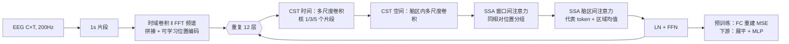

# CSBrain：研究问题、架构与训练逻辑

> 版本：2026-11-14 / 论文笔记 v0.2。依据已保存的 arXiv v1 全文（2025-06，含附录 A–G）；尚未核对代码，未本地复现。作者写明“代码和模型将会发布”，阅读时未确认是否已发布。统一记号见[阅读约定](../process/文档维护与阅读约定.md)。

## 1. 作者要解决的问题

**问题陈述（作者观点）：** 现有 EEG 基础模型照搬 NLP/CV 的“固定尺度切 token + 全部 token 稠密注意力”，忽略了 EEG 的**跨尺度时空结构**：

- **时间上**：不同任务的关键模式尺度不同。运动想象、想象语音是短暂的活动爆发；睡眠分期依赖较慢的节律；
- **空间上**：运动想象是局部的皮层激活；情绪识别需要广泛分布的脑区协同。

作者归纳出三个问题：(1) **尺度无关的 token 化**：一次性的固定尺度切分，token 与任务需要的尺度不匹配，语义被稀释；(2) **结构无关的稠密注意力**：在高噪声信号上对所有 token 做注意力，容易学到虚假依赖，计算量也大；(3) 两者合起来限制了跨任务泛化。

**对应设计：** 每一层都交替做两件事：

- **CST（跨尺度时空 token 化）**：在局部时间窗口内用多个不同大小的卷积核，在解剖脑区内用多尺度空间卷积，把多尺度信息聚合到每个 token；
- **SSA（结构化稀疏注意力）**：只在“跨时间窗口”和“跨脑区”的结构化分组内做注意力，而不是对所有 token 做注意力。

**哪些已被实验支持：**

| 主张 | 证据 | 强度 |
|---|---|---|
| 多尺度 token 优于单尺度 | 图 4：K=1/2/3、每层堆叠 vs 只用一次 | 只有图；且所有变体都只用 **30% 训练数据**做预训练和微调；4 个任务 |
| SSA 优于稠密注意力和 criss-cross 注意力 | 图 5：TUEV 上比 criss-cross 高 8.1% BACC | 只有图；具体数值只给了 TUEV 一项 |
| 整体优于 CBraMod 等 | Table 2：16 个数据集宏平均 0.710 vs CBraMod 0.676 | CBraMod 在本表的部分数值与 CBraMod 原论文不同（见 §6）；CHB-MIT 上低于 CBraMod |
| 预训练有用 | 附录 E.1 图 8 | BCIC-IV-2a 从 0.39 升到 0.57；TUAB 上提升较小 |

## 2. 输入与输出

- 输入：$E\in\mathbb R^{|\mathcal C_x|\times T}$，电极属于 10-20 系统电极全集 $\mathcal C$。需要**电极名**，以便把电极划分进解剖脑区。
- 预处理：带通、陷波、重采样 200 Hz、以 100 μV 为单位缩放，切成长度 $t$ 的无重叠片段（预训练设置与 CBraMod 一致，即 1 s），得到 $E_p\in\mathbb R^{C\times n\times t}$。
- 输出：每个“通道 × 时间段”位置一个 $d$ 维表示；下游时**展平**后接 MLP 头（与 CBraMod 相同）。

## 3. 前向计算（逐步）

### 3.1 初始特征编码

与 CBraMod 的 patch 编码类似：每个片段分别用 1D 卷积（带归一化）提取时域特征、用 FFT + 全连接层提取频谱能量特征，两者**拼接**（CBraMod 是相加），再加一个可学习的位置编码（引用 CBraMod），得到 $x^{(0)}\in\mathbb R^{C\times n\times d}$，$d=200$。

### 3.2 CST：跨尺度时空 token 化（每层都做）

**时间 token 化（窗口内）：** 对每个位置 $(i,j)$（$i$ 为时间段，$j$ 为通道），用 $K$ 个不同大小的时间卷积核 $\{s_t^{(k)}\}$，分别在以 $i$ 为中心的局部时间窗口上卷积，输出拼接，并加上残差投影：

$$\hat x^{(l)}_{i,j}=\mathrm{Concat}\big(\{\mathrm{Conv}^{(k)}_t(\mathcal W^{(k)}_t(i))\}_{k=1}^K\big)+\mathrm{Proj}_t(x^{(l-1)}_{i,j})$$

**空间 token 化（脑区内）：** 先按 10-20 系统把电极划分成若干**解剖脑区** $\{R_r\}$；对每个电极 $j\in R_r$，在**同一脑区内**的邻域 $\mathcal W^{(k)}_s(j)$ 上做多尺度空间卷积，同样拼接加残差：

$$\tilde x^{(l)}_{i,j}=\mathrm{Concat}\big(\{\mathrm{Conv}^{(k)}_s(\mathcal W^{(k)}_s(j))\}_{k=1}^K\big)+\mathrm{Proj}_s(\hat x^{(l)}_{i,j})$$

**维度分配：** $K$ 个尺度的输出维度按 $d_k\propto 1/2^k$ 指数递减、总和为 $d$。小卷积核分到更多维度（保留细节），大卷积核分到较少维度（概括上下文）。默认 $K=3$，卷积核大小 $\{1,3,5\}$（附录 Table 3）。

注意：时间卷积作用在“时间段”这一层级上（每个时间段 = 1 s），所以核大小 1/3/5 对应的是 1/3/5 秒的上下文，而不是采样点级别的多尺度。

### 3.3 SSA：结构化稀疏注意力（每层都做）

**窗口间注意力（时间）：** 把时间轴分成若干窗口；对窗口内的每个相对位置 $g$，取出所有窗口中处于位置 $g$ 的 token 组成一组 $\mathcal G^{(g)}_t$，只在组内做自注意力（类似“空洞/跨步”的注意力），加残差：

$$\tilde x^{(l,\mathrm{win})}=\mathrm{Attn}(\mathcal G^{(g)}_t)+\tilde x^{(l)}$$

**脑区间注意力（空间）：** 构造多个空间分组。每组从每个脑区**按顺序**取一个代表 token，加上该脑区的平均池化特征经过线性变换后的结果，形成脑区描述子：

$$\tilde x_r=\tilde x^{\mathrm{rep}}_r+\phi(\mathcal P(R_r)),\quad r=1..R$$

再在这 $R$ 个描述子之间做自注意力，加残差；最后接 LayerNorm + FFN + 残差。

复杂度：作者称稠密注意力 $O(N^2)$，criss-cross 约 $O(N^{1.5})$，SSA 约 $O(N\cdot k)$（$k\ll\sqrt N$）。

**未说清的细节：** 窗口大小 $w$ 如何确定；脑区如何划分（几个脑区、包含哪些电极）；脑区间注意力的输出如何写回脑区内的每一个 token。这些需要看代码。

### 3.4 预训练：mask 重建

以 50% 比例随机遮盖片段（mask token 为全零向量），被遮位置和可见位置**一起**进入编码器（BERT 式），轻量全连接重建头输出原始波形，只在被遮位置算 MSE：

$$\mathcal L_{\mathrm{rec}}=\|\hat E_m-E_m\|^2$$

**不一致之处**：§2.4 写“沿时间轴遮盖片段”（$E_v\in\mathbb R^{C\times n_v\times t}$，意味着整列时间段在所有通道上同时被遮），§3.1 写“随机遮盖 EEG patch”。两者含义不同，需查代码。

## 4. 训练逻辑

### 4.1 预训练（§3.1、附录 Table 3）

- 数据与 CBraMod **完全相同**：TUEG，19 通道、30 s 样本、0.3–75 Hz 带通、60 Hz 陷波、200 Hz、100 μV 缩放，1,109,545 个样本（9,000 多小时）；
- 12 层、隐藏维 200、8 头、FFN 800；按附录 E.2，12 层对应约 **4.9M 参数**；
- mask 50%；AdamW lr 5e-4、wd 5e-2，余弦退火；batch 128，40 epoch；梯度裁剪 1；
- 4 张 A100，约 **101 小时**（约 400 GPU 小时）。

除了主干结构，预训练数据、预处理和超参数几乎照搬 CBraMod，因此 CSBrain 与 CBraMod 的对比接近于“同数据、同目标、不同架构”的对照。

### 4.2 下游微调（附录 Table 4）

全量微调 50 epoch，batch 64，AdamW lr 1e-4、wd 1e-2，余弦退火，dropout 0.1，多分类 label smoothing 0.1；展平所有 token 表示后接 MLP 头。5 个随机种子。BIOT 基线在通道超过 18 个时，用 1×1 卷积投影到 18 个通道。

## 5. 下游评测设置

11 类任务、16 个数据集（Table 1）：在 CBraMod 的 12 个数据集基础上增加了 Siena（癫痫，29 ch）、HMC（睡眠，4 ch）、TUSL（慢波事件，23 ch，只有 245 个样本）。作者写明“严格遵循训练/验证/测试划分”，但没有逐一列出；推测沿用 CBraMod 的划分，**所以 CBraMod 笔记中提到的问题同样存在**：SEED-V、BCIC2020-3 不是跨被试划分；ISRUC 的睡眠设置是否也用了 20 个片段的序列上下文，论文未说明。

## 6. 实验结果与可支持的结论

**Table 2（BACC，节选）：**

| 数据集 | LaBraM | CBraMod（本表） | CSBrain |
|---|---|---|---|
| BCIC-IV-2a | 0.487 | 0.514 | **0.566** |
| PhysioNet-MI | 0.617 | 0.617 | 0.630 |
| BCIC2020-3 | 0.506 | 0.537 | **0.600** |
| FACED | 0.527 | 0.551 | 0.575 |
| SEED-V | 0.398 | 0.409 | 0.420 |
| TUEV | 0.641 | 0.667 | 0.690 |
| TUAB | 0.814 | 0.789 | 0.817 |
| CHB-MIT | 0.708 | **0.740** | 0.726 |
| Siena | 0.708 | 0.732 | 0.766 |
| ISRUC | 0.763 | 0.787 | 0.793 |
| HMC | 0.728 | 0.727 | 0.735 |
| TUSL | 0.763 | 0.739 | **0.857** |
| MentalArithmetic | 0.691 | 0.726 | 0.756 |
| Mumtaz | 0.941 | 0.956 | 0.964 |
| 宏平均（所有指标） | 0.670 | 0.676 | **0.710** |

**可比性提醒：**

- 本表中 CBraMod 的部分数值与 CBraMod 原论文不同：TUAB 0.789（原文 0.829）、PhysioNet-MI 0.617（原文 0.642）、SEED-VIG Pearson 0.550（原文 0.646）。论文没有说明哪些是重新跑的、哪些是引用的。
- TUSL 只有 245 个样本，0.857 与 0.739 的差距波动可能很大。
- 宏平均混合了 BACC、F1、AUROC、Pearson、R² 等不同指标。

**消融：**

| 附录/图 | 对照 | 结论 |
|---|---|---|
| 图 4 | K=1 / K=2 / K=3（每层）/ K=3（只在第一层） | K=3 每层最好；MI 任务上比 K=1 高 10.8% BACC。所有变体只用 30% 数据 |
| 图 5 | 稠密 / criss-cross / SSA | SSA 最好；TUEV 上比 criss-cross 高 8.1% BACC |
| E.1 图 8 | 有 / 无预训练 | BCIC-IV-2a 0.39 → 0.57；TUAB 提升较小 |
| E.2 图 9 | 预训练数据 10 h → 9000 h | 500–5000 h 之间提升明显，5000 h 后趋于平缓 |
| E.2 图 10 | 2 → 12 层（1.4M → 4.9M） | 单调提升 |
| E.3 图 11 | 脑区描述子：只用代表 token / 只用均值 / 随机取样 / 顺序取样 + 均值 | 默认设计最好 |

## 7. 局限、疑点与未读懂的部分

1. **依赖解剖脑区划分**：需要电极名或位置才能分区，具体分区方案论文未给出；对只有 4 或 6 个通道的数据，“脑区内多尺度空间卷积”还剩多少作用，论文没有讨论。
2. **“多尺度”的粒度**：时间卷积核 1/3/5 作用在 1 s 片段的序列上，并不处理 1 s 内部的多尺度结构。
3. **消融都只有图**，而且在 30% 数据上完成，不能直接推到全量设置。
4. **对比数值来源不清**：CBraMod 的部分数值与原论文不一致。
5. **mask 方式前后不一致**（§3.4）。
6. **代码和权重**：论文写“将会发布”，阅读时未核实。

## 8. 与本赛题规格的事实对照

此节只列事实，不构成方案选择。

| 方面 | CSBrain 的情况 | 赛题情况 |
|---|---|---|
| 采样率 / 片段 | 200 Hz，1 s 片段 | 200 Hz；1/2/4/10/30 s |
| 通道信息 | 需要电极名来划分脑区 | 接口是否提供导联名称**待确认** |
| 短输入 | 时间卷积核最大 5 个片段；1 s 输入只有 1 个片段，时间方向的多尺度不起作用 | SSVEP 有 1 s × 60 ch |
| 极少通道 | HMC（4 ch）BACC 0.735，与 LaBraM、CBraMod 相近 | 4、6 ch 睡眠数据 |
| 预训练 | TUEG 19 ch × 30 s，4×A100 约 101 h | 决赛 21 个 OpenNeuro 数据集，32/64/76/128 ch |
| 权重 | 未确认是否公开 | 复赛只能用公开可下载的权重 |

## 9. 留给讨论的问题

- CSBrain 和 CBraMod 用同样的数据和训练目标，只换了主干。宏平均差约 3.4 个点。在“同数据、同目标”的对照下，这个差距说明了什么，又因为数值来源不清而说明不了什么？
- 作者认为不同任务需要不同的时空尺度。这个论点与赛题的 7 类任务（1 s 的 SSVEP 到 30 s 的睡眠）是什么关系？
- “结构化稀疏”减少了虚假依赖，这是论文的解释。有没有其他解释（例如正则化效应）也能说明同样的结果？

## 原文与证据

- [CSBrain（arXiv v1，2025-06）](https://arxiv.org/abs/2506.23075)：§2（式 1–7，图 2–3）、§3（Table 1–2，图 4–6）；附录 B Table 3（预训练超参数）、C Table 4（微调）、E（预训练有效性、规模、脑区描述子消融）、F（可视化）、G（局限）。本地副本：`research/reve_route_20261113/sources/csbrain.txt`。

- [原始资料目录](../../research/reve_route_20261113/sources/)
- [返回论文索引](README.md)
