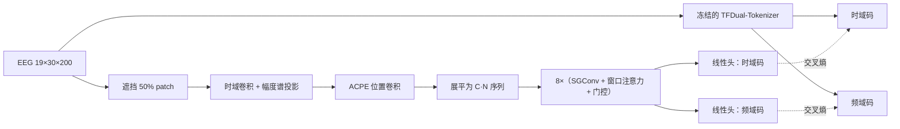

# CodeBrain：研究问题、架构与训练逻辑

> 版本：2026-11-13 / 论文笔记 v0.1。论文已读（arXiv v4，2026-05-11，ICLR 2026）；官方代码已对照阅读（jingyingma01/CodeBrain，提交 22d350c）；未运行、未复现。统一记号见[阅读约定](../process/文档维护与阅读约定.md)。
>
> 为什么要读：参赛手册第5页和第12页两次把 CodeBrain 与 LaBraM 并列为复赛可用的公开权重。

## 一句话

CodeBrain 是“LaBraM 的两阶段离散码预训练”加“CBraMod 的输入嵌入与数据管线”，再把骨干从 Transformer 换成卷积型状态空间模型。它自己提出的两处新设计是：时域、频域各一本码本的 tokenizer，以及 SGConv 骨干。

## 研究出发点

作者对已有 EEG 基础模型提出三条批评（论文 §1）。这三条是作者的问题陈述，不是已证明的事实。

1. **单一码本混合了时域和频域信息。** LaBraM 把图像 VQ-VAE 的单码本做法直接搬来，并且因为原始波形重建不收敛，只用频域重建训练 tokenizer。作者认为时域波形事件（如 K 复合波）和频域节律（如 α）是两类异质信息，混在一本码本里会削弱表示能力，也难以解释。
2. **全连接自注意力与脑的稀疏长程连接不匹配，且随序列长度平方增长。** 作者以“小世界拓扑”为依据：局部强相关、全局稀疏相关。
3. **一个 patch 只当一个 token，忽略了 patch 内部的局部波形结构。**

对应的三个设计是：TFDual-Tokenizer、SGConv 全局卷积、滑动窗口注意力（SWA）。其中第三条在公开代码里的实现与论文叙述有出入，见“代码与论文的差异”。

## 输入与数据

- 预训练语料：TUEG，沿用 CBraMod 的清洗流程。保留 19 个 10–20 导联，0.3–75 Hz 带通，60 Hz 陷波，重采样到 200 Hz，切成 30 秒不重叠片段，丢弃绝对幅值超过 100 μV 的片段，再除以 100 归一化。
- 清洗后 1,109,545 个样本，约 9,246 小时（§3.1）。这与 CBraMod、CSBrain 报告的样本数相同，即三者用的是同一份清洗后语料。
- 每个样本形状 $C\times N\times L = 19\times30\times200$：19 通道、30 个 1 秒 patch、每 patch 200 点，共 570 个 patch。

## 第一阶段：TFDual-Tokenizer

目标：把每个 1 秒 patch 映射成两个离散码，一个时域码、一个频域码。

前向顺序（论文 §2.2，超参见表9）：

1. **TFConv。** 对 patch 做 DFT，原始波形与频谱各自经过三层卷积（首层核 15、步长 8），拼接成时频嵌入。
2. **TF-Encoder。** 12 层 Transformer，隐藏维 200。位置嵌入只含时间位置，不含通道身份，作者以此说明 tokenizer 与通道无关。
3. **双码本量化。** 两本码本各 4096 个码、每码 32 维。编码器输出分别在两本码本里找最近的码。
4. **两个解码器（各 3 层 Transformer）。**
   - 频域码送入 F-Decoder，回归该 patch 的幅度谱和相位谱（z-score 后的 MSE）。这一支与 LaBraM 相同。
   - 时域码送入 T-Decoder，回归原始波形（MSE）。

**对比损失。** 作者复现了 LaBraM 报告的现象：直接重建原始波形时损失停在 0.128–0.131 不下降（附录 F）。他们的处理是加一个 SimCLR 式对比项：把同一段 EEG 切成前后两半，两半的编码互为正样本，其它样本为负样本。作者称这能改善收敛并减少未使用的时域码。

**总损失**（式10）是六项直接相加：时域重建、幅度重建、相位重建、对比损失、两本码本各自的 codebook/commitment 损失。论文和代码都没有给各项加权。

**“表示空间平方级扩张”是什么意思。** 一个 patch 由（时域码, 频域码）这对码描述，组合数是 $4096\times4096$，而总码数只有 8192。附录 D 用率失真理论论证“解耦不差于混合”，但作者自己在备注里承认时域与频域经傅里叶变换耦合，“近似独立”只是潜在空间里的功能性假设。

**码本利用率**（表13）：两本都取 4096 时，未使用的时域码 225 个、频域码 165 个；都取 8192 时，未使用的时域码达 3401 个。作者据此选 4096。

## 第二阶段：EEGSSM 骨干

目标：输入被部分遮挡的 EEG，预测被遮 patch 的两个码。此阶段 tokenizer 冻结，只提供标签。

前向顺序（论文 §2.3，结合代码 `Models/SSSM.py`）：

1. **Patch 嵌入。** 与 CBraMod 相同的结构：时域三层卷积（首层核 49、步长 25）得到 200 维向量，加上该 patch 幅度谱（rfft，101 维）的线性投影。被遮 patch 在进入嵌入前整体置零。
2. **动态位置编码。** 在通道×时间网格上做一次 depthwise 二维卷积，核大小为通道轴 19、时间轴 7，结果加回嵌入。这是 CBraMod 的 ACPE，论文明确说明沿用。
3. **展平。** 把 $C\times N$ 网格按“先通道、后时间”展平为一条长 $C\cdot N$ 的序列，200 维嵌入作为卷积的通道维。预训练时序列长 570。
4. **8 个残差块。** 每块依次是：归一化；一维卷积把宽度扩到 400；SGConv；窗口注意力；门控；一路残差送下一块，一路 skip 汇总到输出。每块还会把最初的嵌入再加回一次。
5. **输出。** 所有块的 skip 求和，经卷积映回 200 维，得到每个 patch 的表示 $B\times C\times N\times200$。
6. **预测头。** 两个线性层分别输出 4096 类的时域码和频域码 logits。

**SGConv 是什么。** 它是结构化状态空间模型（S4）的卷积形式：整条序列与一个长卷积核做卷积，用 FFT 实现，复杂度 $O(L\log L)$。卷积核由若干子核拼成，子核数约为 $\log_2(L/d)+1$，越靠后的子核覆盖越长的距离、权重按 $\alpha^i$ 衰减（默认 $\alpha=0.5$）。效果是近处精细、远处粗糙且弱。代码中为双向，状态数 64。

**预训练目标。** 按伯努利分布以 0.5 的比例遮 patch，对被遮位置计算两个交叉熵并相加：

$$\mathcal L=\mathrm{CE}(\hat y^{t},z^{t})+\mathrm{CE}(\hat y^{f},z^{f}),\quad\text{只在被遮位置计算。}$$

这是转换后的示意式；论文式16的写法缺少对数。

## 规模与算力

- 主模型 8 层、隐藏维 200，15.17M 参数（表11、表23）。
- Tokenizer：6 张 A100（40GB）约 10 小时，20 个 epoch。
- 骨干：2 张 A100 约 24 小时，10 个 epoch，batch 256。
- 作者选第 10 个 epoch 的权重，理由是避免对 TUEG 过拟合；损失在此后仍缓慢下降（附录 E.2）。
- 计算量（表19）：CodeBrain 15.17M 参数、8.74G FLOPs；CBraMod 4.03M、1.29G；LaBraM 6.02M、1.34G；EEGPT 25.24M、9.79G。也就是 CodeBrain 的参数是 CBraMod 的约 3.8 倍，FLOPs 约 6.8 倍。

## 下游适配

- 全参数微调，所有数据集重采样到 200 Hz。
- 分类头是三层 MLP，输入是把全部 token 展平。以 FACED 为例，代码里第一层是 $32\times10\times200=64{,}000$ 维到 2,000 维，仅这一层就约 1.28 亿参数，远大于 15M 的骨干。
- 睡眠分期额外在头部加一层 Transformer，联合建模连续 20 个 30 秒片段。
- 每个数据集单独调学习率、权重衰减、dropout、batch（表12）。
- 五个随机种子取均值和标准差。多分类按验证集 Kappa 选权重，二分类按验证集 AUROC 选权重，不是按平衡准确率。

## 实验告诉了我们什么

以下均为作者自报结果，基线数字是作者在相同划分下重跑或沿用的。没有独立 benchmark 的佐证：仓库保存的 OmniEEG-Bench、NeuralBench、AdaBrain-Bench 原文里都没有出现 CodeBrain。

**与 CBraMod 的平衡准确率对比**（表2、表5–8；本赛事主指标是平衡准确率）：

| 数据集 | 任务 | 通道/时长 | CBraMod | CodeBrain | 备注 |
|---|---|---|---|---|---|
| FACED | 情绪 9 类 | 32 / 10s | 0.5509±0.0089 | 0.5941±0.0098 | 明显更高 |
| SEED-V | 情绪 5 类 | 62 / 1s | 0.4091±0.0097 | 0.4137±0.0023 | 差距在一个标准差内 |
| ISRUC_S3 | 睡眠 5 类 | 6 / 30s | 0.7844±0.0126 | 0.7856±0.0031 | 差距在一个标准差内 |
| ISRUC_S1 | 睡眠 5 类 | 6 / 30s | 0.7865±0.0110 | 0.7835±0.0033 | 略低 |
| BCIC2020-T3 | 想象言语 5 类 | 64 / 3s | 0.5373±0.0108 | 0.6101±0.0052 | 明显更高，全文最大增益 |
| Mental Arithmetic | 应激 2 类 | 20 / 5s | 0.7256±0.0132 | 0.7514±0.0203 | 更高，AUROC 0.7905 对 0.8707 |
| CHB-MIT | 癫痫 2 类 | 16 / 10s | 0.7398±0.0284 | 0.7273±0.0240 | 更低 |
| SHU-MI | 运动想象 2 类 | 32 / 4s | 0.6370±0.0151 | 0.6431±0.0066 | 差距在一个标准差内 |
| TUEV | 事件 6 类 | 16 / 5s | 0.6671±0.0107 | 0.6428±0.0062 | 更低 |
| TUAB | 异常 2 类 | 16 / 10s | 0.8289±0.0022 | 0.8294±0.0013 | 持平 |

按平衡准确率看，10 个数据集里明显领先的是 FACED 和 BCIC2020-T3，Mental Arithmetic 领先略多于一个标准差，三个落后，其余四个在一个标准差内。摘要所说的“强泛化”主要靠 Kappa 和 F1 支撑。

**划分方式不全是跨被试。** SEED-V 是每个 session 内按 trial 划分，BCIC2020-T3 用官方划分（同一批被试），其余为按被试划分。TUAB、TUEV 与预训练语料同属 TUH，作者另报了剔除重叠后的结果（表7、表8 的 Excluding 行）。

**消融**（表3，三个数据集，平衡准确率）：

| 设置 | FACED | SEED-V | ISRUC_S3 |
|---|---|---|---|
| 完整模型 | 0.5941 | 0.4137 | 0.7856 |
| 只用时域码本 | 0.5217 | 0.4068 | 0.7565 |
| 只用频域码本 | 0.5580 | 0.4098 | 0.7728 |
| 单一混合码本 | 0.5281 | 0.4124 | 0.7673 |
| 去掉对比损失 | 0.5765 | 0.4029 | 0.7801 |
| 去掉 SWA | 0.5736 | 0.4019 | 0.7621 |
| 去掉 SGConv | 0.2858±0.1467 | 0.3620 | 0.6664 |
| 去掉门控 | 0.3431 | 0.3757 | 0.6258 |

读法：

- 双码本对混合码本的优势在 FACED 上有 6.6 个点，在 SEED-V 上只有 0.13 个点，落在标准差内。支持“解耦有用”的证据主要来自 FACED。
- 去掉 SGConv 或门控后性能崩塌，FACED 上标准差达 0.15。这更像训练不稳定，而不是该模块贡献了这么多信息，不宜直接读成模块的因果贡献。
- 附录 B.4（表4）有一个更直接的对照：完全不用 tokenizer，让同一骨干直接重建原始波形，ISRUC_S3 平衡准确率为 0.7763，对完整模型 0.7856。也就是在这个数据集上，整个 tokenizer 阶段带来约 0.9 个点。这个对照只做了一个数据集。

**其它设计选择**（附录 K–O）：

- 遮挡比例 0.4–0.6 最好，过低过高都变差（图16）。
- Patch 长度 1 秒最好；SEED-V 样本只有 1 秒，更长的 patch 需要大量填充，性能大幅下降（表14）。
- 数据量从 1k 到 9k 小时、模型从 3 层到 8 层，Kappa 持续上升但收益递减；SEED-V 在 5k 小时后基本持平（附录 N）。
- 线性探测（表24、25）：FACED 上平衡准确率 0.4327，对全微调 0.5941；CBraMod 为 0.4146。冻结表示与全微调之间有约 16 个点的差距。
- 通道缺失、脑区遮挡、线性基线漂移下都比 CBraMod 掉得少（附录 M），但漂移下 ISRUC_S3 仍从 0.7856 掉到 0.5617。

## 代码与论文的差异

以下是阅读提交 22d350c 的源码得到的，没有运行验证。

1. **SWA 的窗口是 1 个 token。** `SSSM.py` 里窗口掩码固定用窗口大小 1 生成，每个 token 只能注意到自己，注意力权重恒为 1。此时这一层等价于对每个 token 单独做一次线性变换，不在 token 之间传递信息。附录 K.2 也写明窗口取 1 时效果最好，表11 写的是“窗口长度 1 秒”，即 1 个 patch。论文正文把 SWA 描述为“捕捉 patch 内部的局部时间依赖”，但骨干的 token 就是整个 patch，代码里看不到 patch 内部的注意力。因此表3“去掉 SWA”的下降，对应的是去掉一个逐 token 的线性分支。
2. **“长程时间依赖”实际是在通道与时间展平后的一维序列上建模。** 序列按通道顺序首尾相接，相邻通道的同一时刻在序列上相隔 $N$ 个位置。空间结构只通过 ACPE 卷积和通道排列顺序进入模型，没有电极坐标。
3. **门控的写法不同。** 论文式13是把全局与局部特征拼接后各过一个卷积再做 tanh×sigmoid；代码是两者相加，再把 400 维对半切开，前半 tanh、后半 sigmoid 相乘。
4. **Tokenizer 的两本码本各有一个投影层。** 论文式3写的是同一个编码器输出分别查两本码本；代码在量化前各接一个独立的线性投影。码本更新沿用 LaBraM 的归一化 EMA 量化器。
5. **序列最大长度。** SGConv 的核按 570 构造，更长的序列会被零填充，即超过 570 个 token 的距离没有卷积权重。
6. **下游模型的初始化顺序。** `model_for_faced.py` 先加载预训练权重，再对整个模型调用一次线性层初始化。按字面读，骨干里的线性层（幅度谱投影、注意力输出投影）会被重新初始化。这一点需要运行确认，可能影响对“预训练贡献了多少”的判断。
7. **骨干代码的来源。** 变量名保留了 `diffusion_step_embed` 等字样，结构与基于 S4 的时间序列扩散模型的残差块相同。README 致谢了 LaBraM、CBraMod 和 SGConv 的开源实现。

## 局限与尚未读懂的部分

- 作者自述的局限只有两条：可解释性停留在表示层面；只做了头皮 EEG（附录 P）。
- 可解释性证据是挑选的个例：某个频域码在约 15.4% 的所属 patch 上呈现 σ 峰，另一个在约 18.3% 上呈现 δ 主导（附录 B.1）。也就是八成以上的所属 patch 并不呈现该模式。
- 模型规模的叙述不一致：正文 §3.4 写“12 层、隐藏维 384、146.75M”，表23写的是 24 层、384 维为 146.75M，12 层、256 维为 34.38M。
- 表19的 FLOPs 对应什么输入规格，我没有在原文中找到。
- 对比损失里“同一段的前后两半是正样本”这个假设对事件相关任务是否合适，论文没有讨论。
- 我没有逐行读 `SGConv.py` 和 tokenizer 编码器，上面关于它们的描述以论文为准。

## 与本赛事有关的事实

这里只列事实，不构成路线建议。

- 它是主办方点名的复赛可用权重，权重和代码公开。
- 预训练只见过 19 通道、30 秒的输入。位置卷积在通道轴上的核长正好是 19。
- 骨干对输入形状的要求是每个 patch 200 点、总 token 数 $C\cdot N$。按赛题规格，各数据集的 $C\cdot N$ 在 36 到 620 之间；只有 62 通道×10 秒（620）超过预训练的 570。
- 论文的下游头是按数据集定尺寸的展平 MLP，不能跨数据集共用。
- 全部预训练约 108 个 A100 GPU 小时（6×10 + 2×24），语料 9,246 小时。决赛语料是 21 个 OpenNeuro 数据集，规模未知，通道为 32/64/76/128。
- 论文评测的任务类型与赛道有重叠：情绪、睡眠、运动想象、疾病相关的二分类。没有 SSVEP、自然刺激解码和信号可靠性。

## 留给讨论的问题

1. 在 ISRUC_S3 上，去掉整个 tokenizer 只掉 0.9 个点。两阶段离散码的成本，在决赛两周、从零训练的条件下是否值得？这需要多数据集的对照才能回答，论文没有给。
2. CodeBrain 相对 CBraMod 的增益，有多少来自骨干（SGConv 对 criss-cross 注意力），多少来自预测目标（离散码对波形）？表3和表4分别动了一边，但没有“CBraMod 骨干 + 双码本目标”这样的交叉对照。
3. 展平后的一维长卷积，对通道顺序敏感到什么程度？论文的通道缺失实验是微调时遮挡，没有测试打乱或更换通道顺序。

## 原文与证据

- [CodeBrain（ICLR 2026，核对 arXiv v4）](https://arxiv.org/html/2506.09110v4)：§2.2–2.3 方法；§3.1–3.4、表1–3 主结果与消融；附录 B.4、E、F、I–P。
- [官方代码 jingyingma01/CodeBrain，提交 22d350c](https://github.com/jingyingma01/CodeBrain/tree/22d350caf68246d2fda4f630ef837420db3fb130)：`Models/SSSM.py`、`Models/modeling_tokenizer.py`、`Pretrain/Trainer.py`、`Models/model_for_faced.py`。
- 本地快照：[codebrain.html](../../research/reve_route_20261113/sources/codebrain.html)、[codebrain.txt](../../research/reve_route_20261113/sources/codebrain.txt)（表格已压平为单行）。

- [原始资料目录](../../research/reve_route_20261113/sources/)
- [返回论文索引](README.md)
