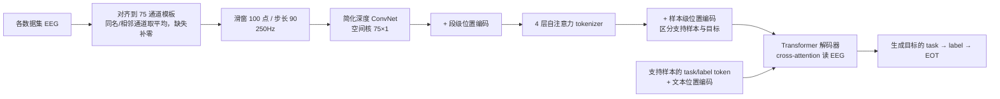

# ECHO：研究问题、架构与训练逻辑

> 版本：2026-11-14 / 论文笔记 v0.2。依据已保存的 arXiv v1 全文（2509.22556，含附录 A–B，从 `echo.html` 提取）；尚未核对代码，未本地复现。统一记号见[阅读约定](../process/文档维护与阅读约定.md)。

## 1. 作者要解决的问题

**问题陈述（作者观点）：** 现有大 EEG 模型（LEM）都是“以编码器为中心”：预训练一个大编码器，下游只接一个比它小几个数量级的分类头，再微调。作者认为这形成了**解码器瓶颈**：

- 编码器为了迁就小分类头，在小数据上微调时可能遗忘预训练知识；
- 分类头太弱、标注数据又少，训练不稳定，容易学到噪声。

而“以 LLM 为中心”的做法（NeuroLM、UniMind）只是把“EEG → 标签”的映射挪到了文本嵌入空间，**文本只充当了替代的标签空间**，并没有带来真正的推理或上下文学习（ICL）能力；作者还认为 LLM 的归纳偏置不适合 EEG 这种依赖精确时间动态的信号。

**对应设计：** 把 EEG 建模改写成**序列到序列（seq2seq）**问题：输入序列包含若干“支持样本”（EEG + 它的任务 token + 标签 token）和一个目标 EEG；输出序列依次生成目标的任务 token 和标签 token。模型通过“下一 token 预测”学会从支持样本中推断映射关系，从而具备 ICL：**不更新参数**，只换支持样本，就能适应新任务。

**作者强调**：编码器、解码器都用“现成的简单组件”（深度 ConvNet + 标准 Transformer 解码器），以说明收益来自范式，而不是架构改进。

**哪些已被实验支持：**

| 主张 | 证据 | 强度 |
|---|---|---|
| 多任务 ECHO 优于单任务基线 | Table 2：SEED、Stieger、Mental Arithmetic、Attention、High-Gamma 上带支持样本的 ECHO 最好 | **比较条件不对等**：ECHO 在测试时可以使用**来自测试被试的带标签支持样本**，基线不能（见 §5） |
| 解码器中心范式本身有用 | 附录 B.2：不给支持样本的 ECHO 在 36 项比较中有 29 项优于“只用编码器 + 分类头” | 这一对照最公平；但两者训练方式也不同 |
| 可以泛化到未见数据集 | Table 3：未参与训练的 BCIC 2020-T1，不给支持样本 0.750，给支持样本 0.778，CBraMod 0.570 | 只有一个未见数据集 |
| 两种额外的位置编码都不可少 | 图 3：去掉样本级位置编码 → 降到随机水平；去掉文本位置编码 → 输出乱码 | 说明是结构必需，不是性能增益 |

## 2. 输入与输出

- 输入：EEG 统一重采样到 **250 Hz**，并对齐到一个**固定的 75 通道模板**（§3.1）。附录 Table 5：输入为 75 通道 × 2500 点（10 s）。
- 需要**通道名**：用来把各数据集的通道映射到模板。
- 输出：一串离散 token：`<|support|>…<|task|> <|y|> <|EOT|>`，即先预测任务类型（如 `<|MI|>`、`<|EMO|>`），再预测该任务下的标签。

## 3. 前向计算（逐步）

### 3.1 预处理：通道模板对齐

- 事先定义一个固定的标准通道集合（75 个）及其顺序；
- 对每个标准通道 $\bar c$，定义一个“别名/相邻变体”集合 $\mathcal M_{\bar c}$（不同电极系统中的同名或相邻电极）；
- 对每个数据集，找出属于 $\mathcal M_{\bar c}$ 的通道子集 $X_{\bar c}$，取平均：

$$\bar X_{\bar c}=\frac{1}{|X_{\bar c}|+1}\sum_{x\in X_{\bar c}}x$$

  分母多加 1 是为了数值稳定（这也意味着只有一个匹配通道时，信号会被缩放为一半）；没有匹配通道时补零。

这样所有数据集都变成同样的 75 个通道、同样的顺序。作者的理由：已有方法（如 CBraMod 的 ACPE）在推理时仍要求通道配置与训练时一致。

### 3.2 编码器

1. 沿时间用滑窗切段：窗长 100 点、步长 90 点（250 Hz 下约 0.4 s、重叠 0.04 s），得到 $K$ 段；
2. 每段经过简化的**深度 ConvNet**（Schirrmeister 2017）：4 个卷积层，其中第二层的空间卷积核为 **(75, 1)**，即一次性跨全部 75 个模板通道；
3. 每段卷积特征加上**可学习的段级位置编码** $PE^{enc}_k$，展平并投影成 256 维 token；
4. 经过 4 层、8 头的自注意力（tokenizer）精炼。

### 3.3 解码器

标准 Transformer 解码器：自注意力处理文本 token 序列，**cross-attention** 读取所有 EEG 样本的 token。附录 A.3 写解码器以 Radford et al. 2022（即 Whisper）的解码器初始化。层数：正文写 6 层（隐藏维 384、6 头、FFN 1536），附录 Table 5 写 4 层，两处不一致。

**混合位置编码**（三种）：

1. EEG 样本内部的段级位置编码（编码器中，§3.2）；
2. **样本级位置编码** $PE^{dec}_s$：同一个 EEG 样本的所有 token 加同一个向量，用来区分“第几个支持样本”和“目标样本”；
3. **文本位置编码** $PE^{txt}_n$：给 $2S+3$ 个文本 token 标位置。

### 3.4 序列格式

```
输入：<|SOT|> [支持样本 1 的 task, label] … [支持样本 S 的 task, label] <|task|> <|y|>
      （EEG：支持样本 1…S 与目标样本的 token，经 cross-attention 读取）
输出：[支持样本的 task, label] … <|task|> <|y|> <|EOT|>
```

作者把学习过程描述为 4 步：① 从支持样本中学 EEG–任务–标签的映射；② 推广到目标样本；③ 先预测任务 token，再以任务和 EEG 为条件预测标签；④ 预测结束符。

### 3.5 训练（两阶段，全部有监督）

1. **预热阶段**：编码器接一个覆盖**所有数据集全部类别**（26 类）的分类器做有监督训练，90 epoch，Adam lr 5e-5 → 1e-6 余弦衰减；
2. **上下文训练阶段**：整个模型 40 epoch，解码器 lr 5e-5、编码器 lr 5e-6。第一轮 10 epoch 固定使用 8 个支持样本；之后每步随机使用 0–12 个支持样本。两轮都先冻结编码器、再逐步解冻。目标是下一 token 的交叉熵：

$$p(s_i\mid s_{<i},\{T_n\},\{\mathcal E(X_\cup)\})=\mathcal D(s_{<i},\{T_n\},\{\mathcal E(X_\cup)\})$$

**注意：ECHO 没有任何自监督预训练**。所谓“预训练”就是在 12 个带标签数据集上的有监督多任务训练。



## 4. 训练数据

12 个公开数据集，6 类任务、26 个类别：情绪（SEED、SEED-IV、SEED-V）、运动想象（BCIC-IV-2a、High-Gamma、PhysioNet、KoreaU、Stieger2021 左右/上下等）、抑郁（Mumtaz2016）、工作负荷（Mental Arithmetic）、事件分类、注意（Attention）。BCIC 2020-T1 不参与训练，作为未见数据集。8 张 A100（40 GB）。

## 5. 评测设置

- **按被试编号**划分训练/验证/测试（Table 1），所有方法使用同一划分；Mumtaz2016 的索引边界写成 “0–43 / 43–52 / 52–62”，有重叠，可能是笔误；
- 5 个随机种子（0–4）；按验证集 **AUROC** 选模型；报告 BACC、Kappa、加权 F1、AUROC、AUC-PR；
- **基线**：单任务，每个数据集单独微调；
- **ECHO**：一次多任务训练，所有测试集上一次性测试，不给任务 token，需要自己推断任务和类别；
- **支持样本的来源**：从**每个测试被试**的标准化测试集中随机抽取 **20 个样本**作为固定上下文（这些样本不参与评测），推理时给 0、8 或 12 个支持样本；Mumtaz2016 每个被试只有一个标签，只做零样本。

**可比性提醒**：带支持样本的 ECHO 在测试时使用了**来自测试被试本人的带标签样本**，这相当于少样本的被试校准，基线没有得到这一信息。只有“不给支持样本”（No Support）的 ECHO 与基线是在相同信息条件下比较。

## 6. 实验结果与可支持的结论

**Table 2（BACC）：**

| 数据集 | CBraMod | CodeBrain | LaBraM | EEGNet | ECHO（无支持） | ECHO（有支持） |
|---|---|---|---|---|---|---|
| SEED | 0.726 | 0.784 | 0.685 | 0.744 | 0.741 | **0.819** |
| Stieger2021-LR | 0.842 | 0.813 | 0.817 | 0.805 | 0.842 | **0.853** |
| Mumtaz2016 | 0.895 | 0.901 | 0.899 | 0.911 | **0.970** | — |
| High-Gamma | 0.751 | 0.814 | 0.743 | 0.832 | 0.844 | **0.855** |
| Mental Arithmetic | 0.591 | 0.632 | 0.579 | 0.514 | 0.544 | **0.685** |
| Attention | 0.648 | 0.622 | 0.679 | 0.600 | 0.806 | **0.819** |

观察：

- 在 SEED、Mental Arithmetic 上，“无支持”的 ECHO 并不比最好的基线强（SEED 0.741 vs CodeBrain 0.784；MA 0.544 vs 0.632），优势来自支持样本；
- 在 High-Gamma（128 通道 MI）上，简单的 EEGNet（0.832）强于所有预训练基础模型；
- 附录 B.1：SEED-IV 上 ECHO 略低于 CBraMod，作者解释为 SEED-IV 与 SEED-V 标签重叠，模型容易把任务判断错。

**零样本 / 未见数据集（Table 3）：**

| 方法 | SEED | BCIC 2020-T1（未见） |
|---|---|---|
| CBraMod | 0.726 | 0.570 |
| ECHO（只用编码器 + 分类头） | 0.655 | 0.525 |
| ECHO（无支持） | 0.741 | 0.750 |
| ECHO（有支持） | 0.819 | 0.778 |

**解码器中心 vs 编码器 + 分类头（附录 B.2）**：36 项比较中 29 项“无支持”的 ECHO 更好；SEED-IV、Mumtaz 上编码器 + 分类头更好。

## 7. 局限、疑点与未读懂的部分

1. **支持样本来自测试被试**，带支持样本的结果不是严格的跨被试零校准评测。
2. **没有自监督预训练**：只在 12 个有标签数据集上做有监督多任务训练，与其他“基础模型”的前提不同。
3. **固定 75 通道模板 + (75,1) 空间卷积**：新数据集的通道必须能映射到模板；缺失通道补零。
4. **采样率 250 Hz**，与多数 EEG 基础模型的 200 Hz 不同。
5. **解码器层数前后不一致**（6 vs 4）；解码器以 Whisper 初始化，这是否影响“只用简单组件”的说法，论文未讨论。
6. **任务推断错误会直接导致分类错误**（SEED-IV 与 SEED-V 的例子）。
7. 论文没有单独的“局限”章节。

## 8. 与本赛题规格的事实对照

此节只列事实，不构成方案选择。

| 方面 | ECHO 的情况 | 赛题情况 |
|---|---|---|
| 采样率 | 250 Hz | 200 Hz |
| 通道 | 对齐到 75 通道模板，需要通道名 | 4–128 通道；接口是否提供导联名称**待确认** |
| 支持样本 | 测试时使用测试被试的带标签样本 | 按被试 8:1:1 隔离；测试被试的标签在测试时**是否可见、能否用作上下文**，规则未说明，需确认 |
| 多任务单模型 | 核心卖点 | 是否要求统一模型**待确认** |
| 预训练 | 无自监督预训练，直接用下游标签 | 决赛要求在官方语料上从零预训练；官方语料是否带标签未说明 |
| 模型选择 | 验证集 AUROC | 验证集 BACC |
| 输出 | 生成离散 token；论文仍报告了 AUROC、AUC-PR（概率如何得到未说明） | 需要 BACC、PR-AUC、ROC-AUC |

## 9. 留给讨论的问题

- ECHO 的提升有多少来自“解码器中心的 seq2seq 范式”，有多少来自“测试时看到同一被试的带标签样本”？附录 B.2 的“无支持 vs 只用编码器”对照能回答其中多少？
- 赛题的被试隔离规则下，“上下文学习”还有用武之地吗？如果测试被试的任何标签都不可见，ECHO 的设计还剩下哪些价值？
- ECHO 把任务类型也当作要预测的 token。主赛道 14 个数据集如果在推理时知道自己属于哪个数据集，这一步还有必要吗？

## 原文与证据

- [ECHO（arXiv v1，2509.22556）](https://arxiv.org/html/2509.22556v1)：§2（式 1–4）、§3（式 5–11，图 2）、§4（Table 1–3，图 3）；附录 A.1（数据）、A.3 Table 5（模型配置）、A.4（训练与伪代码）、B.1–B.2（完整结果与零样本、编码器对照）。本地副本：`research/reve_route_20261113/sources/echo.txt`、`echo.html`。

- [原始资料目录](../../research/reve_route_20261113/sources/)
- [返回论文索引](README.md)
