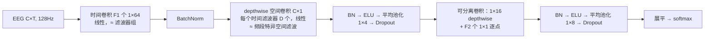

# EEGNet：研究问题、架构与训练逻辑

> 版本：2026-11-14 / 论文笔记 v0.2。依据已保存的 arXiv 版全文（JNE 2018，含附录，从 `eegnet.html` 提取）；尚未核对代码，未本地复现。统一记号见[阅读约定](../process/文档维护与阅读约定.md)。

## 1. 作者要解决的问题

**问题陈述（作者观点）：** 传统 BCI 针对每种范式手工设计信号处理、特征和分类器，需要大量领域知识，而且范式特定的预处理（如只保留某个频段）可能排除掉其他有用特征。已有的 CNN 也大多针对单一范式设计。作者问：**能否设计一个单一的 CNN 架构，在不同 BCI 范式上都准确分类，同时尽可能紧凑（参数尽可能少）？**

**对应设计：** 用深度可分离卷积（depthwise / separable convolution）把经典的 EEG 特征提取概念直接写进网络结构：

- 时间卷积 ≈ **滤波器组**（学习不同频段的带通滤波器）；
- 对每个时间滤波器后的特征图做 depthwise 空间卷积 ≈ **频段特异的空间滤波器**（类似 FBCSP，即滤波器组共空间模式）；
- 可分离卷积 ≈ 先对每个特征图做时间汇总，再学习如何组合特征图。

**哪些已被实验支持：**

| 主张 | 证据 | 强度 |
|---|---|---|
| 一个架构可跨范式使用 | 4 种范式（P300、ERN、MRCP、SMR）都能取得与参考方法相当的结果 | 成立；结果主要以图呈现 |
| 参数少两个数量级 | Table 3：EEGNet-8,2 约 1.7k–2.3k 参数 vs DeepConvNet 约 15–17 万 | 精确数字 |
| 数据有限时表现好 | 被试内（训练数据少）时 EEGNet 优于或等于 DeepConvNet | 成立 |
| 特征可解释 | 学到的时间/空间滤波器对应已知的神经生理现象（如 SMR 的 μ 节律空间分布与 FBCSP 相似） | 定性证据 |

## 2. 输入与输出

- 输入：$(C,T)$ 的单个试次，论文统一重采样到 **128 Hz**；
- 输出：$N$ 类 softmax。
- **不需要电极名或坐标**，但 $C$ 是架构的固定参数（空间卷积核大小为 $(C,1)$），换一个通道数就要重新建模型。

## 3. 前向计算（逐步，Table 2）

记 $F_1$ = 时间滤波器数，$D$ = 每个时间滤波器对应的空间滤波器数，$F_2$ = 逐点滤波器数（论文中固定 $F_2=D\cdot F_1$）。常用配置 EEGNet-8,2（$F_1=8$、$D=2$、$F_2=16$）和 EEGNet-4,2。

**Block 1：时间滤波 + 空间滤波**

1. Reshape：$(C,T)\to(1,C,T)$；
2. **时间卷积** Conv2D，$F_1$ 个大小为 $(1,64)$ 的滤波器，`same` 填充，**线性**（无激活）。核长取采样率的一半（128 Hz 下为 64 点 = 0.5 s），作者的理由是这样能捕捉 2 Hz 以上的频率信息。输出 $(F_1,C,T)$；参数 $64F_1$；
3. BatchNorm；
4. **depthwise 空间卷积**，大小 $(C,1)$，深度乘数 $D$，`valid` 填充，**线性**，权重范数约束 $\le1$。每个时间滤波器的输出图各自学习 $D$ 个空间滤波器，把 $C$ 个通道压成 1 个。输出 $(D F_1,1,T)$；参数 $C\cdot D\cdot F_1$；
5. BatchNorm → **ELU** → 平均池化 $(1,4)$（128 Hz → 32 Hz）→ Dropout（被试内 0.5，跨被试 0.25）。

作者说明：两个卷积都保持线性，因为加非线性没有明显收益；这一两步结构受 FBCSP 启发，也与双线性判别成分分析相似。

**Block 2：可分离卷积**

6. **SeparableConv2D**：先做大小 $(1,16)$ 的 depthwise 卷积（32 Hz 下 16 点 = 500 ms，对每个特征图单独做时间汇总），再做 $F_2$ 个 $(1,1)$ 的逐点卷积（学习如何组合特征图）。输出 $(F_2,1,T/4)$；
7. BatchNorm → ELU → 平均池化 $(1,8)$ → Dropout。输出 $(F_2,1,T/32)$。

**分类**

8. 展平为 $F_2\cdot T/32$ 维，**直接**接 softmax 全连接层（权重范数约束 0.25）。为减少参数，不加中间全连接层。

所有卷积层不使用 bias。

**参数量（Table 3）：**

| 数据集（试次长度） | DeepConvNet | ShallowConvNet | EEGNet-4,2 | EEGNet-8,2 |
|---|---|---|---|---|
| P300（1 s） | 174,127 | 104,002 | 1,066 | 2,258 |
| ERN（1.25 s） | 169,927 | 91,602 | 1,082 | 2,290 |
| MRCP（1.5 s） | 175,727 | 104,722 | 1,098 | 2,322 |
| SMR（2 s） | 152,219 | 40,644 | 796 | 1,716 |

（SMR 数据已在 4 Hz 高通，时间核长改为 32。）

## 4. 训练逻辑

- **从零有监督训练**，没有预训练；
- Adam（默认参数），交叉熵损失，训练 500 个 epoch，保存**验证集损失最低**的权重；
- 类别不平衡时在损失中加类别权重；
- 实现：TensorFlow / Keras，代码 github.com/vlawhern/arl-eegmodels。

## 5. 评测设置

| 数据集 | 范式 | 特征类型 | 滤波 | 被试 | 每人试次 | 类别 |
|---|---|---|---|---|---|---|
| P300（RSVP） | 视觉诱发 | ERP | 1–40 Hz | 15 | 约 2000 | 2（约 5.6:1 不平衡） |
| ERN（Kaggle Inria） | 反馈错误相关负电位 | ERP | 1–40 Hz | 26 | 340 | 2（约 3.4:1） |
| MRCP | 运动相关皮层电位 | ERP + 振荡 | 0.1–40 Hz | 13 | 约 1100 | 2 |
| SMR（BCI IV-2a） | 运动想象 | 振荡 | 4–40 Hz | 9 | 288 | 4 |

两种分析：

- **被试内**：4 折按块交叉验证（2 块训练、1 块验证、1 块测试）；
- **跨被试**：P300、MRCP 随机选 4 名被试作验证、1 名作测试、其余训练，重复 30 次；ERN 用比赛规定的 16 名训练、10 名测试；SMR 对每名测试被试，从其余被试中随机取 5 名训练、3 名验证。

指标：P300、ERN、MRCP 用 AUC；SMR 用准确率。对比方法：DeepConvNet、ShallowConvNet（时间核与池化长度按 128/250 的比例减半），以及传统方法：ERP 类用 Kaggle 冠军方案 xDAWN + 黎曼几何（单模型，不用集成和特定元特征），SMR 用 OVR-FBCSP + 弹性网络。

## 6. 实验结果与可支持的结论

结果主要以图 2–5 呈现（各模型的平均 AUC/准确率与置信区间），正文给出的定性结论：

- **被试内**：EEGNet 在 ERN、MRCP、SMR 上优于 DeepConvNet；DeepConvNet 在被试内（训练数据少）时几乎都较差，P300 除外；
- **跨被试**：EEGNet 与 DeepConvNet 在 ERP 类任务上相当；SMR 上所有 CNN 之间无显著差异；跨被试时训练集比被试内大约 10–15 倍；
- ShallowConvNet 在振荡类（SMR）上较好、在 ERP 类上较差；DeepConvNet 正好相反；EEGNet 两类都不差；
- EEGNet-4,2 与 EEGNet-8,2 之间无显著差异。

**可解释性（图 6–10）：** 时间滤波器对应特定频段；SMR 上 EEGNet 学到的空间滤波器与 FBCSP 在 8–12 Hz 学到的空间模式相似；用 DeepLIFT 做单试次相关性分析，相关区域与已知神经生理一致。作者据此认为模型表现不是由伪迹或噪声驱动的。

**在后续基础模型论文中作为基线的表现（不同协议，不能互相比较）：**

- REVE / CBraMod 的表格：BCIC-IV-2a 0.448、FACED 0.409、TUAB 0.764、Mumtaz 0.923，整体低于预训练模型；
- ECHO Table 2：High-Gamma（128 通道 MI）0.832，**高于**所有预训练基础模型（CBraMod 0.751、LaBraM 0.743）；
- FAME 附录 H（NeuralBench 13 项）：精神分裂症 71.0% vs REVE 47.2%；SSVEP 只有 8.5%（REVE、LaBraM 约 96.6%）；
- NeuralBench 中部分任务专用网络有优势。

这些说明：在某些任务、某些协议下，小型专用网络并不输给大模型；但 EEGNet 也有明显的弱项（如上述 SSVEP）。

## 7. 局限、疑点与未读懂的部分

1. **通道数固定**：$(C,1)$ 空间卷积使每个模型绑定一种通道配置；没有跨布局能力，也没有预训练。
2. **超参数依赖采样率和数据**：时间核长取采样率一半；高通 4 Hz 的数据要改核长。
3. **结果主要以图呈现**，难以精确引用数值。
4. **跨被试划分方式因数据集而异**，验证集选择是随机的。
5. **时间核 0.5 s 对 1 s 输入**：在很短的试次上，时间卷积覆盖了一半的长度。

## 8. 与本赛题规格的事实对照

此节只列事实，不构成方案选择。

| 方面 | EEGNet 的情况 | 赛题情况 |
|---|---|---|
| 采样率 | 论文用 128 Hz；时间核长 = 采样率一半 | 200 Hz（按同一规则核长为 100） |
| 通道 | 每个模型固定 $C$，不需要电极名 | 14 个数据集通道数各不相同（4–128） |
| 预训练 | 无 | 复赛允许使用公开权重；决赛要从零预训练基础模型 |
| 规模 | 约 1–2k 参数 | — |
| 角色 | 后续论文中常用的监督基线 | 实验计划需要“合理的基线” |
| 代码 | 公开（arl-eegmodels；braindecode 也有实现） | — |

## 9. 留给讨论的问题

- EEGNet 把“滤波器组 + 空间滤波”的经典思路写进了结构。大型基础模型中，哪些是在学这些东西，哪些在学别的？
- ECHO 的 High-Gamma 和 NeuralBench 的部分任务上，EEGNet 不输给大模型。如果在赛题的实验计划中把 EEGNet 作为基线，它在哪些赛道上可能是一个很强的对手？
- 决赛规定从零训练基础模型。像 EEGNet 这样不预训练的专用网络，在这种规则下是作为基线，还是作为参照的下限？

## 原文与证据

- [EEGNet（J. Neural Eng. 2018，arXiv 版）](https://arxiv.org/abs/1611.08024)：§2.1（Table 1 数据）、§2.2（Table 2 架构、Table 3 参数量）、§2.3（被试内/跨被试划分）、§3（图 2–10）、§4（讨论）、附录（DeepConvNet、ShallowConvNet 结构）。本地副本：`research/reve_route_20261113/sources/eegnet.txt`、`eegnet.html`。
- 代码：github.com/vlawhern/arl-eegmodels。
- [FAME（arXiv v1，预印本）](https://arxiv.org/html/2608.01898v1)：附录 H Table 7；[ECHO（arXiv v1）](https://arxiv.org/html/2509.22556v1)：Table 2。

- [原始资料目录](../../research/reve_route_20261113/sources/)
- [返回论文索引](README.md)
