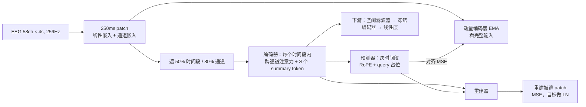

# EEGPT：研究问题、架构与训练逻辑

> 版本：2026-11-14 / 论文笔记 v0.2。依据已保存的 NeurIPS 2024 正式版 PDF（含附录 A–H）；尚未核对代码逐层实现，未本地复现。统一记号见[阅读约定](../process/文档维护与阅读约定.md)。

## 1. 作者要解决的问题

**问题陈述（作者观点）：**

1. EEG 信噪比极低，大脑活动复杂，用 MAE 式“遮住再重建原始信号”很难学到抽象特征；
2. 不同设备的采样率和电极位置不同，卷积编码器难以把“通道”与“信号内容”解耦，导致鲁棒性和扩展性差。

**对应设计：**

- **双重自监督**：在“重建被遮的原始 patch”之外，再加一个**表示对齐**任务：让模型从被遮输入预测出的特征，去对齐一个**动量编码器**看到完整输入后给出的特征。作者的论点是：表示空间的目标比原始信号信噪比更高、语义更丰富；
- **分层结构**：先在同一时间段内跨通道整合（空间），再在时间段之间建模（时间），以降低计算量；
- **通道嵌入码本**：通道名 → 可学习向量的映射，使不同数据集的通道能对应到模型输入；
- **下游只做“线性探测”**：冻结编码器，只训练少量附加模块。

**哪些已被实验支持：**

| 主张 | 证据 | 强度 |
|---|---|---|
| 对齐损失提升表示质量 | Table 5 / 7：去掉对齐损失，BCIC-2A 0.585 → 0.529，KaggleERN AUROC 0.662 → 0.575 | 较强；但只在 3 个数据集、一种下游设置上 |
| 冻结 + 线性探测足够好 | Table 4 与附录 A.3 Table 8 | **需要打折扣**：多个任务的“线性探测”实际包含卷积层、自适应空间滤波器，BCIC-2A 甚至并联了一个任务专用 CNN 分支（见 §5） |
| 模型越大越好 | Table 6 / 图 5：0.4M → 101M，BCIC-2A 0.492 → 0.585 | 只在 BCIC-2A 上；拟合的幂律指数很小（0.029） |
| 优于 LaBraM | Table 4 中 BCIC-2A/2B、Sleep-EDFx、KaggleERN 高于 LaBraM | LaBraM 在该表中用的是线性探测（LaBraM 自己论文说明它需要全量微调）；在 TUAB/TUEV 上 EEGPT 低于 LaBraM（附录 A.6） |

## 2. 输入与输出

- 预训练输入：$x\in\mathbb R^{M\times T}$，**$M=58$ 个固定电极**（10-20 扩展系统，图 4），**256 Hz**，**$T=1024$（4 s）**。
- patch：每通道每 **64 点（250 ms）** 为一个 patch，无重叠：$p_{i,j}=x_{i,(j-1)d:jd}$，$N=T/d=16$ 个时间段。共 $58\times16=928$ 个 patch。
- 通道信息：需要**通道名**，用来在通道嵌入码本中查找向量。
- 输出：每个时间段输出 $S$ 个“summary token”（类似 [CLS]），最优模型 $S=4$、维度 512。下游时，把 summary token 的输出送入线性层。

## 3. 前向计算（逐步）

### 3.1 局部时空嵌入

$$token_{i,j}=W_p^\top p_{i,j}+b_p+\varsigma_i$$

$W_p\in\mathbb R^{64\times d_e}$ 是线性 patch 嵌入；$\varsigma_i$ 是通道 $i$ 的可学习嵌入，按通道名查表。没有时间位置嵌入，时间位置在后面的预测器中用 RoPE 引入。附录 G.1 可视化显示，预训练后的通道嵌入按前后左右位置聚类。

### 3.2 Mask

训练时遮盖 **50% 的时间段和 80% 的通道 patch**。论文没有说清两者如何组合（例如是先选时间段再在剩余时间段中选通道，还是独立抽样），需查代码。

**术语提醒**：论文把**保留的部分**记作 $\mathcal M$（“masked part”），把**被遮的部分**记作 $\bar{\mathcal M}$，与常见用法相反。下文用“可见”和“被遮”避免混淆。

### 3.3 编码器（空间，按时间段）

对每个时间段 $j$，把该时间段内**可见**的通道 token 和 $S$ 个可学习 summary token 一起送入 Transformer，输出 summary token 的表示 $enc_j$：

$$enc_j=\mathrm{ENC}\big(\{token_{i,j}\}_{(i,j)\text{ 可见}}\big)$$

也就是说，**编码器内部只做跨通道注意力**，每个时间段独立处理；一个 4 s 样本被压缩成 16 个时间段 × $S$ 个 summary token。

### 3.4 预测器（时间）

预测器在时间维上工作：输入是各个有可见内容的时间段的 $enc_j$，加上 RoPE 时间位置 $pos_j$；对没有可见内容的时间段，用一个**可学习的 query token** 占位。输出所有 $N$ 个时间段的预测特征 $pred_t$：

$$\{pred_t\}_{t=1}^N=\mathrm{PRED}\big(\{enc_j+pos_j\}\big)$$

输入和输出两端各有一个线性层（embedding / unembedding）。

### 3.5 动量编码器与对齐损失

动量编码器与编码器结构相同，但看到**全部** token（可见 + 被遮）；参数是编码器参数的指数滑动平均（论文写“累积系数 $\tau=0.01$”）。对齐损失：

$$\mathcal L_A=\frac1N\sum_{j=1}^N\|pred_j-\mathrm{LN}(menc_j)\|_2^2$$

（原文式 6 前有一个负号，应为笔误。）LayerNorm 作用于目标特征，以减弱极端值的影响。附录 A.1：**去掉预测器**、直接对齐编码器与动量编码器的输出时，重建损失不再下降，作者解释为表示坍缩。

### 3.6 重建器与重建损失

重建器（Transformer）的输入：可见时间段的 $enc_j+pos_j$（作者称为编码器到重建器的 “skip connection”）以及其余时间段的 $pred_j+pos_j$。输出被遮 patch 的重建 $rec_{i,j}$，对**做过 LayerNorm 的原始 patch** 计算 MSE：

$$\mathcal L_R=\frac1{|\bar{\mathcal M}|}\sum_{(i,j)\in\bar{\mathcal M}}\|rec_{i,j}-\mathrm{LN}(p_{i,j})\|_2^2,\qquad\mathcal L=\mathcal L_A+\mathcal L_R$$

### 3.7 下游

- 冻结编码器；
- 在编码器之前加一个**自适应空间滤波器**（1×1 卷积，可训练），把数据集自己的通道线性映射到模型认识的通道（例如 BCIC-2B 的 3 通道 → C5、C3、C1、Cz、C2、C4、C6 共 7 个通道）；
- 编码器输出的 summary token 展平后接线性层。

## 4. 训练逻辑

### 4.1 预训练数据（Table 1、附录 C.1）

| 数据集 | 范式 | 被试 | 截取方式 |
|---|---|---|---|
| PhysioNet MI | 运动想象/执行 | 109 | 每个 trial 0–6 s，随机截 4 s |
| HGD | 运动执行（128 通道） | 14 | 0–10 s，随机截 4 s |
| TSU（清华 SSVEP benchmark） | SSVEP，40 类 | 35 | 0–4 s |
| SEED | 情绪 | 15 | 0–10 s |
| M3CV | 多范式（静息、ERP、P300、运动、SSVEP 等） | 106 | 0–4 s |

预处理：统一为 mV 单位、全局平均参考、重采样 256 Hz。每个数据集随机留出 10% 作验证集。论文没有报告总小时数，规模明显小于 LaBraM（2.5k 小时）和 REVE（60k 小时）。

### 4.2 模型与优化（Table 6、§3.2）

8 个变体，参数 0.4M–101M。最优的“large”为 $d_e=512$、编码器/预测器/重建器各 8 层、$S=4$，参数 **101M**。AdamW + OneCycle（初始 2.5e-4，峰值 5e-4，最小 3.13e-5），200 epoch，batch 64，16 位混合精度，8 张 RTX 3090。

**参数量说法不一致**：摘要和结论称“10M 参数”；Table 2–3 的 “Ours” 标为 25M；§3.2 说下游统一用最优 large 模型（Table 6 中为 101M）。引用参数量时需要说明出处。

## 5. 下游评测设置（附录 C.2）

| 数据集 | 划分 | 下游实际结构 |
|---|---|---|
| BCIC-2A（MI，4 类，22 ch） | LOSO（留一被试） | **自适应空间滤波器 + 冻结 EEGPT + 并联的任务专用 CNN 分支（MSConvNet，类似 EEGNet）**，两路特征拼接后接线性层；每个 session 做 EA 对齐；0–38 Hz 滤波 |
| BCIC-2B（MI，2 类，3 ch） | LOSO | 空间滤波器 3 → 7 通道 + 冻结 EEGPT + 线性层；EA 对齐 |
| Sleep-EDFx（睡眠，5 类） | 被试按 6:2:2 随机划分，10 折 | 每 0.25 s 一个 EEGPT 输出，再用 **4 层 Transformer** 分类器整合 30 s |
| KaggleERN（ERN，2 类） | 10 名被试作测试，其余 4 折交叉验证 | 空间滤波器 56 → 19 通道 + 冻结 EEGPT + 线性层，125 ms 滑动窗口 |
| PhysioP300（P300，2 类） | LOSO（9 名被试） | 逐通道可学习缩放 + 冻结 EEGPT + 线性层 |
| TUAB / TUEV | 沿用 BIOT 划分 | **两层卷积（1×1 空间卷积 + depthwise 时间卷积，kernel 15 / 55）** + 冻结 EEGPT + 展平 + 线性层 |

每个实验重复 3 次。基线：TUAB/TUEV 用 BIOT 论文的全量微调结果；其他任务中 BENDR 全量微调，BIOT 和 LaBraM 用线性探测。

**解读**：论文所说的“线性探测”指冻结预训练编码器，但附加模块并不都是线性的，有些还包含一个独立训练的任务专用网络。因此 Table 4 的分数反映的是“冻结 EEGPT + 各任务定制的适配结构”的整体效果。

## 6. 实验结果与可支持的结论

**Table 4（BACC）：**

| 数据集 | BENDR | BIOT | LaBraM | EEGPT |
|---|---|---|---|---|
| BCIC-2A | 0.490 | 0.459 | 0.561 | 0.585 |
| BCIC-2B | 0.707 | 0.641 | 0.685 | 0.721 |
| Sleep-EDFx | 0.666 | 0.662 | 0.677 | 0.692 |
| KaggleERN | 0.567 | 0.512 | 0.544 | 0.584 |
| PhysioP300 | 0.611 | 0.549 | 0.648 | 0.650 |

**TUAB / TUEV（Table 2–3，附录 A.6）：** EEGPT TUAB 0.798、TUEV 0.623；LaBraM 0.814、0.641。作者把差距归因于 LaBraM 预训练数据更多、且包含与 TUAB/TUEV 分布相近的 TUH 数据。

**消融：**

| 附录/表 | 对照 | 结果（BCIC-2A BACC / BCIC-2B AUROC / KaggleERN AUROC） |
|---|---|---|
| A.2 Table 7 | 完整模型 | 0.585 / 0.806 / 0.662 |
| | 去掉对齐损失 $\mathcal L_A$ | 0.529 / 0.726 / 0.575 |
| | 重建目标不做 LayerNorm | 0.557 / 0.792 / 0.589 |
| | 去掉编码器到重建器的 skip | 0.580 / 0.770 / 0.636 |
| A.3 Table 8 | 全量微调，无空间滤波器 | 0.577 / 0.787 / 0.608 |
| | 全量微调，有空间滤波器 | 0.518 / 0.754 / 0.611 |
| | 线性探测，无空间滤波器 | 0.559 / 0.797 / 0.646 |
| | 线性探测，有空间滤波器 | 0.585 / 0.806 / 0.662 |
| A.7 Table 11 | TUAB 随机初始化（不预训练） | 0.755（预训练后 0.798） |

A.3 的结果说明，在这几个小数据集上，冻结编码器反而比全量微调好；但“全量微调 + 空间滤波器”最差，原因论文没有分析。

**规模（Table 6、附录 A.4–A.5）：** 参数从 0.4M 到 101M，BCIC-2A 从 0.492 到 0.585；作者拟合了 ACC $=(33.6N)^{0.029}$ 等幂律，指数都很小。预训练数据取 12.5%–100% 也呈缓慢上升。

**外部评测：** AdaBrain-Bench 跨被试表中，EEGPT 在 BCI-IV-2A 只有 25.81%（LaBraM 54.98%），EEGMAT 61.66%（CBraMod 88.89%）。说明原论文中的优势**不一定能迁移到其他适配协议**。协议见[评测证据](../benchmarks/评测证据与可比性.md)。

## 7. 局限、疑点与未读懂的部分

1. **固定 58 通道、256 Hz、4 s**：作者在局限中承认只用 4 s 数据预训练可能限制能力；其他采样率、更长的输入都需要额外适配。
2. **下游结构不统一**：各任务的适配模块不同，难以把分数归因于预训练表示本身。
3. **参数量自相矛盾**（10M / 25M / 101M）。
4. **预训练与下游可能重叠**：PhysioNet MI（预训练）与 PhysioP300（下游）引用同一来源 [23]；M3CV 包含 P300 和 SSVEP 范式。
5. **mask 组合方式、动量系数 $\tau=0.01$ 的确切含义**（是新参数占 1% 还是旧参数占 1%）需要查代码。
6. **划分不全是跨被试**：Sleep-EDFx 按被试随机切分（6:2:2）属于跨被试；但 KaggleERN 用“4 折交叉验证”，需要确认折是否按被试划分。

## 8. 与本赛题规格的事实对照

此节只列事实，不构成方案选择。

| 方面 | EEGPT 的情况 | 赛题情况 |
|---|---|---|
| 采样率 | 256 Hz | 统一 200 Hz，需要重采样或重新训练 |
| patch | 250 ms（64 点） | 200 Hz 下 250 ms 为 50 点 |
| 时长 | 预训练固定 4 s | 1/2/4/10/30 s |
| 通道 | 58 个固定电极，需要通道名；下游用可训练空间滤波器映射 | 4–128 通道；接口是否提供导联名称**待确认** |
| SSVEP | 预训练含 TSU（SSVEP） | 有 SSVEP 赛道（60 ch，1 s / 2 s） |
| 权重 | github.com/BINE022/EEGPT；公开权重与许可**未核** | 手册未点名 EEGPT |
| 算力 | 8 × RTX 3090，200 epoch | 决赛官方算力 |

## 9. 留给讨论的问题

- EEGPT 的对齐目标和 LaBraM 的离散码目标都在回避“直接重建原始信号”。两者回避的理由一样吗？各自的证据是什么？
- 附录 A.3 显示，冻结编码器在小数据集上优于全量微调。这和 CBraMod、LaBraM“必须全量微调”的结论矛盾吗？还是适配结构不同造成的？
- “先空间后时间”的分层结构和 CBraMod 的“空间、时间并行”有什么本质区别？

## 原文与证据

- [EEGPT（NeurIPS 2024）](https://proceedings.neurips.cc/paper_files/paper/2024/file/4540d267eeec4e5dbd9dae9448f0b739-Paper-Conference.pdf)：§2（式 1–11，图 1–3）、§3（Table 1–6，图 5）；附录 A（A.1 预测器、A.2 预训练消融、A.3 微调方式、A.4–A.5 规模、A.6 与 LaBraM 对比、A.7 无预训练）、C（数据与下游配置，Table 12–13）、F（BIOT 在 P300 上的分析）、G（通道嵌入可视化）、H（局限）。本地副本：`research/reve_route_20261113/sources/eegpt.pdf`。
- 代码：github.com/BINE022/EEGPT。
- [AdaBrain-Bench 官方结果表](https://github.com/Jamine-W/AdaBrain-Bench)：Cross-Subject Transfer；当前表未包含 REVE。

- [原始资料目录](../../research/reve_route_20261113/sources/)
- [返回论文索引](README.md)
