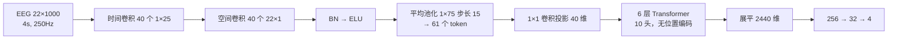

# EEG Conformer：研究问题、架构与训练逻辑

> 版本：2026-11-14 / 论文笔记 v0.2。**论文本体（IEEE TNSRE 2023）未保存、未阅读**。本笔记依据：作者仓库 README（本地 `eegconformer_readme.md`）与作者公开代码 `conformer.py`（github.com/eeyhsong/EEG-Conformer，main 分支，2026-11-14 读取，未存入仓库）。因此下文的“研究动机”只能依据 README 的摘要，架构与训练细节依据代码；**代码与论文之间可能有差异**，正式引用前需读原文。统一记号见[阅读约定](../process/文档维护与阅读约定.md)。

## 1. 作者要解决的问题

**依据 README 的摘要：** 提出一个紧凑的“卷积 + Transformer”模型，在一个统一的 EEG 分类框架中同时捕捉**局部特征**和**全局特征**：

- 卷积模块用一维的时间卷积和空间卷积学习低层的局部特征；
- 自注意力模块直接接在后面，提取局部时间特征之间的**全局相关性**；
- 最后用简单的全连接分类器输出类别；
- 另外设计了一种可视化方法，把类激活图投影到脑地形图上。

核心思想（README 原话）：**空间–时间卷积 + 池化 + 自注意力**。

动机背后的假设（推断，待读原文确认）：纯 CNN（如 EEGNet、ShallowConvNet）的感受野有限，难以建模长时间范围的依赖；纯 Transformer 直接处理原始 EEG 又缺乏局部归纳偏置、数据需求大。

## 2. 输入与输出（以代码中的 BCI IV-2a 配置为例）

- 输入：$(B,1,22,1000)$，即 22 通道、4 s、250 Hz；
- 输出：4 类 logits。
- 通道数 22 写死在空间卷积核中，**换通道数需要改模型**；不需要电极名。

## 3. 前向计算（逐步，依据代码）

### 3.1 卷积模块（PatchEmbedding，结构与 ShallowConvNet 相同）

1. **时间卷积**：40 个 $(1,25)$ 卷积核（250 Hz 下 0.1 s），无填充：时间长度 1000 → 976；
2. **空间卷积**：40 个 $(22,1)$ 卷积核，把 22 个通道压成 1 个；
3. BatchNorm → ELU；
4. **平均池化** $(1,75)$、步长 15：976 → $\lfloor(976-75)/15\rfloor+1=61$。代码注释称“池化相当于 ViT 中沿时间维切 patch”。每个 token 覆盖 75 个点（0.3 s），步长 15 个点（0.06 s），相邻 token 大幅重叠；
5. Dropout 0.5；
6. $1\times1$ 卷积投影到 40 维，重排为 **61 个 token × 40 维**。

**没有位置编码**。代码注释：“用卷积捕捉局部特征，而不是位置嵌入”。

### 3.2 Transformer 编码器

- **6 层**，每层：LayerNorm → 多头自注意力（**10 头**，每头只有 4 维）→ Dropout → 残差；LayerNorm → FFN（40 → 160 → 40，GELU）→ Dropout → 残差；dropout 都是 0.5；
- 实现细节：注意力的缩放因子用的是 $\sqrt{\text{emb\_size}}=\sqrt{40}$，而不是常见的 $\sqrt{\text{head\_dim}}$。

### 3.3 分类头

代码中定义了两种头：

- `clshead`：对 token 做全局平均池化 → LayerNorm → 线性层（**定义了但未使用**）；
- `fc`（**实际使用**）：把 61×40 = 2440 维**展平** → 256 → 32 → 4，中间用 ELU 和 Dropout（0.5、0.3）。

## 4. 训练逻辑（依据代码）

- **从零有监督训练**，没有预训练；
- **被试内**：每名被试单独训练一个模型；BCI IV-2a 用第一个 session（`A0xT`）训练，第二个 session（`A0xE`）测试；
- 用训练数据的均值、标准差对训练集和测试集做 z-score；
- **数据增强（分段重组，S&R）**：把同一类别的试次切成 8 段，每段从随机抽取的同类试次中拼接，生成新的试次；每个 batch 都追加一批增强数据；
- Adam，lr 2e-4，$\beta=(0.5,0.999)$，batch 72，**2000 epoch**；交叉熵损失。

**评测方式需要注意**：代码在**每个 epoch** 都用测试集评估，并同时记录“测试集最高准确率”（bestAcc）和“各 epoch 测试准确率的平均值”（averAcc）。如果论文报告的是 bestAcc，那就相当于**在测试集上选模型**。README 报告的 BCI IV-2a 78.66%、IV-2b 84.63%（hold out）、SEED 95.30%（5 折）对应哪一个统计量，需要读原文确认。

## 5. 实验结果与可支持的结论

**作者报告（README）：**

| 数据集 | 结果 | 设置 |
|---|---|---|
| BCI IV-2a | 准确率 78.66% | hold out（被试内，跨 session） |
| BCI IV-2b | 准确率 84.63% | hold out |
| SEED | 准确率 95.30% | 5 折 |

这些都是**被试内**设置，不能与跨被试结果直接比较。

**在后续基础模型论文中作为基线（跨被试，协议各异）：**

- CBraMod / REVE 表格：BCIC-IV-2a **0.470**、PhysioNet-MI 0.605、FACED 0.456、TUAB 0.776、TUEV 0.407、ISRUC 0.740，在非预训练模型中通常属于较强的一档；
- **同一个 BCI IV-2a**：被试内 78.66%（README）vs 跨被试 47.0%（CBraMod 表），差距巨大，说明**评测协议对数值的影响远大于模型差异**；
- NeuralBench：癫痫检测 84.253%，高于 REVE 的 77.608%；mental imagery 28.914% vs REVE 25.581%（mental imagery 与赛题的运动想象赛道不是同一任务，不能直接对应）。

协议见[评测证据](../benchmarks/评测证据与可比性.md)。

## 6. 局限、疑点与未读懂的部分

1. **论文原文未读**：动机、消融、可视化方法、SEED 的具体设置都未核实。
2. **可能在测试集上选模型**（§4），需要对照论文确认报告的是哪个数值。
3. **通道数和输入长度写死**：空间卷积核 $(22,1)$；分类头输入维度 2440 由 61 个 token 决定，换时长就要改模型。
4. **没有位置编码**：时间顺序信息只能来自卷积和池化窗口的重叠，Transformer 本身对 token 顺序不敏感。
5. **每头仅 4 维**、dropout 0.5，模型非常小且正则很强。
6. **被试内设置**，与赛题的跨被试设置不同。

## 7. 与本赛题规格的事实对照

此节只列事实，不构成方案选择。

| 方面 | EEG Conformer 的情况 | 赛题情况 |
|---|---|---|
| 采样率 | 代码中 250 Hz；卷积核、池化长度按此设定 | 200 Hz，需要按比例调整 |
| 通道 / 时长 | 每个模型固定（如 22 ch × 4 s） | 14 个数据集各不相同 |
| 评测 | 作者报告为被试内 | 按被试 8:1:1，验证集 BACC 选权重 |
| 预训练 | 无 | 复赛可用公开权重；决赛从零预训练 |
| 角色 | 后续论文中常用的监督基线 | 实验计划需要“合理的基线” |
| 代码 | 公开；已收入 braindecode | — |

## 8. 留给讨论的问题

- EEG Conformer 的卷积前端就是 ShallowConvNet。“卷积提取局部特征 + Transformer 建模全局关系”这个分工，与 CBraMod、REVE 等基础模型中 patch 嵌入 + Transformer 的分工有什么异同？
- 同一个模型在 BCI IV-2a 上被试内约 79%、跨被试约 47%。在赛题的跨被试设置下，引用任何“作者报告的分数”之前，需要先确认什么？
- 如果实验计划要把 EEG Conformer 作为基线，需要对通道数、时长和采样率做哪些调整，这些调整本身会不会影响结论？

## 原文与证据

- EEG Conformer（IEEE TNSRE 2023，vol. 31, pp. 710–719，DOI 10.1109/TNSRE.2022.3230250）：**原文未保存、未阅读**。
- [作者仓库](https://github.com/eeyhsong/EEG-Conformer)：README（本地 `research/reve_route_20261113/sources/eegconformer_readme.md`）；`conformer.py`（main 分支，2026-11-14 读取）：PatchEmbedding、TransformerEncoder、ClassificationHead、ExP（训练循环与 S&R 增强）。
- CBraMod Table 2–3 / REVE Table 2（作为跨被试基线的数值）。
- [NeuralBench 官方逐任务结果，固定提交 fe31393](https://github.com/facebookresearch/neuroai/blob/fe31393affab2590e59b0a7e1457aad1a1da908e/docs/_static/neuralbench-results-data.json)。

- [原始资料目录](../../research/reve_route_20261113/sources/)
- [返回论文索引](README.md)
