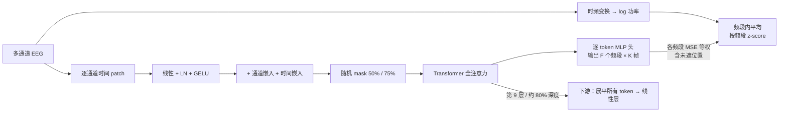

# FAME：研究问题、架构与训练逻辑

> 版本：2026-11-14 / 论文笔记 v0.2。依据已保存的 arXiv v1 全文（2026-08，含附录 A–J）；尚未核对代码，未本地复现。统一记号见[阅读约定](../process/文档维护与阅读约定.md)。

> **与赛事的关系（事实）：** 作者单位之一是 **Omni-Intelligence（深圳）**，与本赛事主办方“全域智能”对应；主评测用的是 **OmniEEG-Bench**（Lu et al. 2026，同一团队，见[OmniEEG-Bench](../benchmarks/OmniEEG-Bench.md)）。这只说明 FAME 与赛事评测体系出自同一团队，不说明评委的偏好。

## 1. 作者要解决的问题

**出发点：** 扩大 EEG 预训练数据或模型规模，下游表现并不稳定提升。作者区分了两种可能：(a) 更多数据本身没有提供更多与下游相关的信息；(b) 现有预训练范式没能把更多数据转化为更可迁移的表示。论文研究的是 (b)。

**核心论点（分两层）：**

1. **表示层面的低频偏置**：EEG 功率谱大致服从 $1/f^\alpha$，低频功率远大于高频；神经网络又倾向于先学低频成分（spectral bias）。两者叠加，预训练表示会偏向保留低频信息。
2. **目标层面的放大**：MAE 用时域 MSE 重建。由 Parseval 定理，

$$\|x-\hat x\|_2^2\propto\sum_f|X_f-\hat X_f|^2=\sum_f|X_f|^2|r_f|^2,\qquad r_f=\frac{X_f-\hat X_f}{|X_f|+\epsilon}$$

即在**相对误差** $r_f$ 相同时，每个频率的损失按其功率 $|X_f|^2$ 加权。EEG 功率集中在低频，所以 MSE 重建对低频提供强得多的监督信号。模型可以主要靠恢复慢的高能活动就把损失降下来。

**对应设计：** 不重建原始波形，而是重建**按频段分别标准化**的时频活动，并让各频段损失**等权**。这样每个频段得到的监督强度与它本身的功率无关。

**哪些已被实验支持：**

| 主张 | 证据 | 强度 |
|---|---|---|
| 现有模型普遍有低频偏置 | 图 3：多个预训练编码器的 Wasserstein 距离、频率可恢复性都随频率上升 | 描述性证据较一致；但具体数值只有图 |
| 偏置不随规模消失，甚至随模型变大加重 | 图 3(C) | 只有图；模型数量有限 |
| FAME 让学习更均衡 | 图 4：单通道 TUAB、6 层 MLP 的受控实验 | 受控且清晰，但规模很小（MLP、10 epoch、单通道） |
| FAME 优于 MAE | 附录 F 图 6：同数据、同 50M 规模、同种子，42 个任务中 27 个更好 | **最直接的目标函数对照**；只有图 |
| 频率越均衡，下游越好 | 图 5、附录 J：部分任务呈负相关（TUEV 最强 r=−0.77） | 作者自己承认样本（模型数）少，只算探索性结果；方向还依任务而异 |
| 线性探测 SOTA（41 中 24 项） | Table 1 | 50M 与 1B 的评测协议可能不同（见 §5），需谨慎 |

**REVE 用的是 L1 损失**，不是 MSE。Parseval 定理只直接适用于 L2，所以上面的推导不能原样套用到 REVE。L1 是否同样有“按功率加权”的效应，论文没有讨论。

## 2. 输入与输出

- 输入：多通道 EEG，按通道切成不重叠的时间 patch，每个 token 是“一个通道的一个时间 patch”，形状 $\mathbb R^{B\times S\times L}$，$S=C\times T$（$C$ 通道数、$T$ 每通道 patch 数、$L$ patch 长度）。
- 位置：**通道索引**与**时间索引**，分别查可学习的嵌入表。
- 输出：每个 token 预测一段**频段能量轨迹**，形状 $\mathbb R^{B\times S\times F\times K}$（$F$ 个频段、每个 patch 对应 $K$ 个时间帧）。
- **论文未给出**：采样率、patch 长度 $L$、时频变换 $\mathcal T$ 的具体类型（STFT / 小波等）和参数、各频段的确切边界。正文只说大规模预训练用 δ/θ/α/β/γ 五个频段。

## 3. 前向计算（逐步，依附录 D）

### 3.1 Patch tokenizer

每个 patch 独立地经过共享的线性层：

$$\tilde x_{i,s}=\mathrm{Dropout}(\mathrm{GELU}(\mathrm{LN}(W_{tok}x_{i,s}+b_{tok})))$$

没有卷积前端，也没有频域输入特征。

### 3.2 通道与时间嵌入

两张可学习表：$E^{ch}\in\mathbb R^{C\times D}$、$E^{time}\in\mathbb R^{T\times D}$，按索引查表后相加：

$$z^{(0)}_{i,s}=\tilde x_{i,s}+E^{ch}_{c_{i,s}}+E^{time}_{t_{i,s}}$$

这里的“通道索引”如何在不同数据集间对齐（按电极名映射到统一表，还是按数据集各自编号），附录 D 没有说明；附录 G 提到用“token 有效性 mask”移除不存在的通道，暗示存在一个统一的通道全集。

### 3.3 Mask

随机选一部分 patch，把输入替换为 mask token，**保留其位置**，所有 token 一起进入编码器（BERT 式）。mask 比例：50M 为 50%，1B 为 75%。

### 3.4 Transformer 编码器

标准 pre-LN Transformer，对**全部** channel–time token 做全注意力（不区分空间、时间）。

| 版本 | 层数 | 维度 | 头数 | FFN |
|---|---|---|---|---|
| 50M | 12 | 512 | 8 | 2048 |
| 1B（附录 D） | 24 | 2048 | 16 | 8192 |
| 1B（附录 G） | **20** | 2048 | 16 | 8192 |

1B 模型的层数在附录 D 与附录 G 之间不一致。

### 3.5 频率均衡的重建目标

1. 对**未遮盖的原始 EEG** 做时频变换，得到对数功率：$a_{c,f,u}=\log(|\mathcal T(x)_{c,f,u}|^2+\epsilon)$（$c$ 通道、$f$ 频率点、$u$ 时间帧）；
2. 按预定义的频段划分，把每个频段内的频率点**取平均**：$A_{c,b,u}=\frac1{|\mathcal I_b|}\sum_{f\in\mathcal I_b}a_{c,f,u}$；
3. 每个频段用**全语料**的均值和标准差**独立标准化**：$\tilde A_{c,b,u}=(A_{c,b,u}-\mu_b)/(\sigma_b+\epsilon)$。

注意第 1 步已经取了对数，对数本身就大幅压缩了功率差异；第 3 步再按频段标准化。论文的受控实验（§3.7）没有把“取对数”和“分频段标准化”的作用分开。

### 3.6 预测头与损失

每个 token 经共享的两层 MLP（$D\to D\to F\cdot K$），reshape 成 $F\times K$。损失：

$$\mathcal L_{\mathrm{FAME}}=\frac1{|\mathcal B|}\sum_{b\in\mathcal B}\frac1{|\Omega_b|}\sum_{(c,u)\in\Omega_b}(\hat A_{c,b,u}-\tilde A_{c,b,u})^2$$

**$\Omega_b$ 包含被遮和未遮的所有位置**：mask 只破坏编码器的输入，解码器在整个序列上都受监督（dense supervision）。这与 MAE、CBraMod 只在被遮位置上算损失不同。

- 先在频段内取平均，再在频段间等权平均：既不让高功率频段主导，也不让包含频率点更多的宽频段（如 γ）主导。

### 3.7 受控实验（图 4）

单通道 TUAB 数据，6 层 MLP，训练 10 epoch。MAE 重建原始信号（$\mathbb R^T$）；FAME 用 9 个连续 5 Hz 频段（0–45 Hz）重建 $\mathbb R^{9T}$。结果：MAE 的低频损失迅速下降，高频损失难以下降；FAME 各频段损失下降速度相近；第 4 层表示的 Wasserstein 距离在 FAME 下随频率变化更平缓。

## 4. 训练逻辑

### 4.1 预训练数据（附录 A Table 2）

列出 **12 个 OpenNeuro 数据集**：ds003690（听觉反应任务）、ds003825（THINGS-EEG，视觉概念 RSVP）、ds003846（触觉预测误差）、ds003885（静态图像观看）、ds004043（视觉注意）、ds004148（静息与认知状态）、ds004152（击鼓运动学习）、ds004264（视觉运动控制）、ds004284（价值决策）、ds004315（情绪诱导强化学习）、ds004356（听觉脑干反应）、ds004357（视觉特征编码）。通道数 31–128，采样率 500–10,000 Hz。论文**没有报告总小时数**和预处理细节。

决赛的预训练语料也是 OpenNeuro 数据集（21 个，32/64/76/128 通道）。两者是否重叠，需要等官方公布决赛语料清单后才能核对。

### 4.2 优化与算力（附录 I）

8 张 NVIDIA H20（96 GB），**5 个 epoch**，约 12 小时墙钟时间，约 **96 GPU 小时**（指 50M 模型的一次完整预训练；1B 的算力未单独报告）。正文未给学习率、batch size 等优化超参数。

### 4.3 表示层与 checkpoint 选择（附录 E）

- 50M：在 **ADHD 下游任务**上做线性探测，比较各层表示，第 9 层（约 80% 深度）最好；再比较各 epoch 的 checkpoint，第 5 个 epoch 最好。之后所有下游评测统一用“第 5 epoch、第 9 层”。
- 1B：用第 15 层（20 层中的 75% 深度）。
- 作者说明这一选择“在下游实验之前完成，并对所有变体一致应用”。但 ADHD 本身也是 41 个评测任务之一，ADHD 上的结果因此受到选择过程的影响。

## 5. 下游评测设置

**两套协议在论文中并存，需要分开看：**

| | 附录 E（50M 的微调/探测协议） | 附录 G（1B 的多任务线性探测） |
|---|---|---|
| 表示 | 第 9 层所有 token 展平 → 新的线性层 | 第 15 层所有有效 token 展平 → LayerNorm + Dropout + 线性层 |
| 划分 | “把可用**样本**按 8:1:1 划分” | **按被试** 80/10/10 划分（有被试 ID 时）；无法按被试划分时用预设的备用划分 |
| 训练 | 未详述 | 10 epoch，AdamW lr 1e-3，batch 64，各任务轮流更新各自的头 |
| 模型选择 | 验证集最佳 checkpoint | 验证集 BACC |

如果 50M 的结果确实按样本划分，那么同一被试的数据可能同时出现在训练集和测试集中，50M 与 1B 在 Table 1 中的数字就**不是同一协议下的比较**。论文没有明确说明 Table 1 的 50M 结果用的是哪一套划分。

**任务数口径不一致**：摘要和正文说 41 个任务；附录 B 说 44 个数据集；附录 F 说 42 个任务；附录 G 说初始 48 个、有效 46 个。

**NeuralBench（附录 H Table 7）**：13 项任务，全量微调，遵循 NeuralBench 官方协议。

## 6. 实验结果与可支持的结论

**Table 1（线性探测 BACC %，节选）：**

| 任务 | CBraMod | LaBraM | REVE | FAME-50M | FAME-1B |
|---|---|---|---|---|---|
| ADHD | 61.95 | 58.73 | 62.97 | 57.60 | 86.39 |
| FACED | 49.98 | 15.44 | 20.59 | 33.00 | 43.10 |
| Benchmark SSVEP | 40.52 | 3.38 | 6.03 | 25.00 | 42.13 |
| PhysioNet MI | 49.77 | 28.13 | 34.16 | 45.14 | 53.86 |
| ISRUC-S1 | 48.47 | 50.81 | 57.70 | 62.96 | 61.40 |
| TUAB | 73.07 | 74.78 | 78.41 | 67.87 | 75.41 |
| TUEV | 62.56 | 42.88 | 53.47 | 66.95 | 80.70 |
| HFO | 59.94 | 56.92 | 59.78 | 67.47 | 79.24 |
| Siena | 75.28 | 66.16 | 62.07 | 61.96 | 51.64 |

观察（只描述，不推断原因）：

- 在这套线性探测协议下，CBraMod 在 FACED、SSVEP 等任务上远强于 REVE 和 LaBraM，这与 REVE 论文中“CBraMod 线性探测很弱”的结论方向相反，说明**线性探测的具体实现（读哪一层、如何展平、头的结构）会大幅改变模型排序**；
- FAME-50M 在 TUAB 上明显低于 REVE（67.87 vs 78.41）；1B 在 Siena 上最低；
- 50M → 1B 的提升在部分任务上非常大（ADHD 57.6 → 86.4），但两者的评测协议可能不同（§5）。

**NeuralBench（附录 H Table 7，全量微调 BACC %，13 项平均）：** REVE 60.9、FAME-50M **61.4**、FAME-1B 60.8、LaBraM 59.8、CBraMod 57.4。差距很小；1B 平均不如 50M。分项差异很大：精神分裂症 REVE 47.2 vs FAME-50M 67.7；情绪 REVE 31.7 vs FAME-50M 28.6；SSVEP LaBraM、REVE 96.6，FAME-50M 95.9，CBraMod 80.1。

**图 3(C)：各模型的低频偏置（从 PDF 第 5 页图中目测读数，约值，仅供参考）：** BIOT ≈ 2、FEMBA ≈ 7、**REVE ≈ 13**、LaBraM ≈ 21、CBraMod ≈ 21、BrainOmni ≈ 22、NeuroGPT ≈ 29、NeuroLM ≈ 42。即在 FAME 自己的度量下，**REVE 的低频偏置在现有模型中处于较低一档**。图 3(B) 的逐频段可恢复性曲线只画了 NeuroLM、BrainOmni、CBraMod、LaBraM、NeuroGPT，没有 REVE。

**FAME vs MAE（附录 F 图 6）：** 同数据、同 50M、同种子，只换重建目标和输出头。42 个任务中 27 个 FAME 更好，其余“大多相近”；TUEV、HFO 提升最大。这是论文中最直接支持“目标函数有作用”的证据，但只有图、没有表格数值。

**频率偏置与下游表现的相关（图 5、附录 J）：** 方向依任务而异。TUEV、AD65 上“频率越均衡越好”较一致；ADHD 上则是高频信息保留越好越有利。作者明确说：这一关联基于有限数量的模型，**只是探索性结果**。

## 7. 局限、疑点与未读懂的部分

1. **作者承认的局限**：需要预先计算并存储时频目标；固定的频段划分和等权未必适合每个数据集；偏置与泛化的关联只是探索性的。
2. **关键实现细节缺失**：时频变换类型、patch 长度、采样率、频段边界、预训练总时长与优化超参数都没有给出。
3. **评测协议不一致**：50M 按样本划分（附录 E）vs 1B 按被试划分（附录 G）；任务数 41/42/44/46 口径不一。
4. **checkpoint 与表示层用一个下游任务（ADHD）选出**，该任务也在评测集合中。
5. **对数与分频段标准化的作用没有分开**：受控实验同时改变了目标的域（时域 → 对数时频）、尺度（逐频段标准化）和监督范围（含未遮位置），哪一项起主要作用不清楚。
6. **对 L1 目标的适用性未讨论**（REVE 用 L1）。
7. **1B 模型层数不一致**（24 vs 20）。
8. **预训练只训 5 个 epoch**，且第 5 个 epoch 是最佳点，说明训练可能还没有饱和，也可能是选择过程的结果，论文未讨论。

## 8. 与本赛题规格的事实对照

此节只列事实，不构成方案选择。

| 方面 | FAME 的情况 | 赛题情况 |
|---|---|---|
| 评测体系 | OmniEEG-Bench（同一团队） | 赛事基于 omni-eegbench 统一评测框架 |
| 下游输入规格 | 6–128 通道、1–30 s（附录 B） | 4–128 通道、1–30 s |
| 主指标 | BACC；附录 G 按验证集 BACC 选模型 | 主指标 BACC；按验证集 BACC 选权重 |
| 划分 | 1B：按被试 80/10/10 | 按被试 8:1:1，3 个种子 |
| 预训练语料 | 12 个 OpenNeuro 数据集 | 决赛：21 个 OpenNeuro 数据集，与下游已做被试隔离 |
| 算力 | 50M：8×H20，约 96 GPU 小时 | 决赛官方算力，配额待确认 |
| 权重 | 论文未说明是否公开 | 手册点名“全域智能提供的 OmniEEG 预训练权重”可用，这与 FAME 是否为同一模型**未确认** |

## 9. 留给讨论的问题

- FAME 的论点是“目标函数决定了表示保留哪些频率”。赛题的 7 类任务各自依赖哪些频段？哪些任务可能从“频率均衡”中获益，哪些可能反而受损？
- 同一个 CBraMod，在 REVE 论文的线性探测中很弱，在 FAME 的线性探测中很强。这对“用线性探测评估预训练表示”这件事意味着什么？
- 如果决赛语料与 FAME 的预训练语料有重叠，FAME 的结论在决赛条件下的参考价值会更高还是更低？

## 原文与证据

- [Understanding and Correcting Low-Frequency Bias in EEG Foundation Model / FAME（arXiv v1，2026-08，预印本）](https://arxiv.org/html/2608.01898v1)：Method（式 1–17）、Experiments（图 3–5、Table 1）；附录 A Table 2（预训练数据）、B Table 3（下游数据）、D Table 5–6（架构）、E（层与 checkpoint 选择、微调协议）、F 图 6（FAME vs MAE）、G（1B 线性探测协议）、H Table 7（NeuralBench）、I（算力）、J（偏置与泛化的相关）。Table 7 在 PDF 第 19 页。本地副本：`research/reve_route_20261113/sources/fame.txt`、`fame.pdf`。
- [REVE（NeurIPS 2025，arXiv v1）](https://arxiv.org/html/2510.21585v1)：用于对照其 L1 目标。

- [原始资料目录](../../research/reve_route_20261113/sources/)
- [返回论文索引](README.md)
