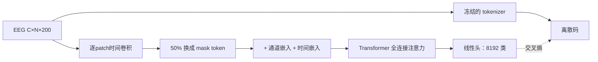

# LaBraM：研究问题、架构与训练逻辑

> 版本：2026-11-13 / 论文笔记 v0.2（重写）。论文已读（ICLR 2024，arXiv v1）；官方代码已对照阅读（935963004/LaBraM，提交 c431221）；未运行、未复现。统一记号见[阅读约定](../process/文档维护与阅读约定.md)。
>
> 为什么要读：参赛手册点名的复赛可用权重之一；CodeBrain、NeuroLM、UniMind 都直接建立在它之上。

## 一句话

LaBraM 把 BEiT v2 的做法搬到 EEG：先训练一个 tokenizer，把每个 1 秒的单通道 patch 变成一个离散码；再训练 Transformer，从被遮挡的输入预测这些码。它的通道处理方式是一张按导联名称查的可学习嵌入表。

## 研究出发点

作者要回答两个问题（论文 §1）：怎样让一个模型吃下通道数和时长各不相同的 EEG 数据集；怎样在低信噪比的 EEG 上做有效的掩码预训练。

- 对第一个问题，办法是把每个通道切成等长 patch，再加“通道嵌入 + 时间嵌入”。
- 对第二个问题，作者报告直接重建原始波形时损失不收敛（§2.2），所以改成预测离散码，而码本通过重建傅里叶谱来训练。

“原始波形重建不收敛”是作者的经验陈述，没有给出曲线。后来 CBraMod、REVE 都用波形重建训练成功，CodeBrain 则复现了这个不收敛现象（在 LaBraM 框架内）。所以这句话的适用范围是 LaBraM 的 tokenizer 设置，不是 EEG 的普遍性质。

## 输入与数据

- 预处理：0.1–75 Hz 带通，50 Hz 陷波，重采样到 200 Hz，以 0.1 mV 为单位（数值大致落在 −1 到 1）。
- 预训练语料：约 2,534.78 小时，16 个来源（附录 D）。其中 TUH 系列四个子集（TUSZ 1138.53、TUEP 591.22、TUAR 92.22、TUSL 20.59）合计约 1,843 小时，占七成以上；自采数据 342.23 小时，SEED 系列 166.75 小时。
- 通道数从 19 到 64 不等。每个样本的 patch 总数限制在 256 以内，所以 64 通道取 4 秒、32 通道取 8 秒（§3.2）。
- Patch 长度 $w=200$ 点，即 1 秒，不重叠。一个样本有 $C\cdot N$ 个 patch，$N$ 是秒数。

## 骨干：Neural Transformer

前向顺序（§2.1，结合 `modeling_pretrain.py`）：

1. **时间编码器。** 每个 patch（200 点）单独过三层一维卷积（核 15/3/3，首层步长 8，每层后接 GroupNorm 和 GELU）。Base 版输出 8 个通道 × 25 个时间点，展平正好是 200 维。
2. **通道嵌入。** 一张可学习的表，按导联名称取对应行，加到该通道的所有 patch 上。代码里这张表有 128 行可用，预定义的导联名称表有 120 个。
3. **时间嵌入。** 一张 16 行的可学习表，第 $k$ 秒的 patch 加第 $k$ 行。也就是代码支持的单个样本最长为 16 个 patch。
4. **Transformer。** 所有 $C\cdot N$ 个 patch 加一个 class token，一起做全连接自注意力。改动有两处：注意力里对 Q、K 先做 LayerNorm；去掉 QKV 的偏置。
5. **读出。** 下游把所有 patch 的输出做平均池化，接任务头。

三档规模（表4）：

| 规模 | 层数 | 隐藏维 | 参数量 |
|---|---|---|---|
| Base | 12 | 200 | 5.8M |
| Large | 24 | 400 | 46M |
| Huge | 48 | 800 | 369M |

论文除非特别说明，结果都来自 Base。

## 第一阶段：神经 tokenizer

名称是 vector-quantized neural spectrum prediction（§2.2，表3）。

1. 编码器就是上面的 Neural Transformer（12 层），把每个 patch 编成一个向量。
2. 量化：码本 8192 个码、每码 64 维。向量和码都先做 L2 归一化再找最近邻，等价于按余弦相似度查表。码本用指数滑动平均更新。
3. 解码器：3 层 Transformer，从量化后的码预测该 patch 的幅度谱和相位谱。
4. 损失：幅度 MSE + 相位 MSE + codebook 损失 + commitment 损失（式9）。幅度和相位在样本内做 z-score。

附录 E 承认相位重建得不如幅度好。

## 第二阶段：掩码码预测

1. 随机选 50% 的 patch，把它们的嵌入换成一个可学习的 mask token（在时间编码器之后替换）。
2. Transformer 的输出过一个线性层，预测被遮位置的码，交叉熵损失（式11）。
3. **对称遮挡**：同一个样本再用互补的 mask 算一次损失，两次相加（式12）。理由是 tokenizer 的前向只需算一次，可以复用。

$$\mathcal L=\mathcal L_{\mathcal M}+\mathcal L_{\tilde{\mathcal M}},\qquad \mathcal L_{\mathcal M}=-\sum_{i\in\mathcal M}\log p(z_i\mid \text{被遮挡的输入}).$$

## 下游适配

- 全参数微调，带逐层学习率衰减（Base 为 0.65）。
- 多分类按验证集 Kappa 选权重，二分类按 AUROC 选。五个种子。
- 硬件：8 张 A800。论文没有报告预训练耗时。

## 实验告诉了我们什么

**主结果只有两个数据集**，TUAB 和 TUEV，都与预训练语料同属 TUH（作者说明录音不重叠，并在图4比较了是否把它们放进预训练，差别不大）。附录 F 另有 SEED-V 和 MoBI。

| 数据集 | 指标 | BIOT | LaBraM-Base | Large | Huge |
|---|---|---|---|---|---|
| TUAB | 平衡准确率 | 0.7959 | 0.8140 | 0.8226 | 0.8258 |
| TUEV | 平衡准确率 | 0.5281 | 0.6409 | 0.6581 | 0.6616 |
| SEED-V | 准确率 | 0.3802 | 0.4095 | 0.4096 | 0.4102 |

基线数字取自 BIOT 论文，不是作者重跑。SEED-V 是每个 session 内按 trial 划分，不是跨被试。

**规模的回报很小。** 参数从 5.8M 到 369M（约 64 倍），TUAB 只涨 1.2 个点，SEED-V 基本不动。作者在 §3.6 自己指出，Base 用 500 小时数据在 TUAB 上就超过了用 2,500 小时的结果。

**消融**（附录 G–L，都只在 TUAB 和 TUEV 上，Base）：

| 设置 | TUAB 平衡准确率 | TUEV 平衡准确率 |
|---|---|---|
| 完整 LaBraM | 0.8140 | 0.6409 |
| 不用码本，回归 tokenizer 的连续输出 | 0.8058 | 0.6162 |
| 不用 tokenizer，直接重建原始波形 | 0.8261 | 0.5630 |
| 不用 tokenizer，直接重建傅里叶谱 | 0.8166 | 0.5730 |
| 去掉对称遮挡 | 0.8155 | 0.6284 |
| 微调时去掉通道嵌入 | 0.8004 | 0.5949 |
| 线性探测 | 0.7954 | 0.3461 |

读法：

- tokenizer 的价值是任务相关的。在 TUEV 上离散码比直接重建波形高约 8 个点；在 TUAB 上直接重建波形反而最好。作者的解释是 TUEV 更依赖“高层语义”，这是事后解释，没有进一步检验。
- 这张表同时说明，在 LaBraM 的骨干上直接重建波形是能训练的，至少能得到 TUAB 上最好的结果。这与正文“损失不收敛”的说法需要对照理解：不收敛指的是 tokenizer 阶段，表里的设置 2 是骨干阶段。
- 线性探测在 TUEV 上只有 0.3461，离全微调差近 30 个点。作者在附录 M 承认 LaBraM 需要全微调。
- 遮挡比例 0.5 与 0.4 在 TUAB 上几乎相同，0.5 的优势主要在 TUEV（表8）。

## 代码与论文的差异

读自提交 c431221，没有运行。

1. **通道必须在预定义的名称表里。** 输入时要给出每个通道在名称表中的下标，用来取通道嵌入。不在表里的电极、双极导联或没有名称的通道，没有对应的嵌入行。
2. **时间嵌入只有 16 行。** 超过 16 秒的样本不能直接输入。预训练时每个样本的 patch 总数也限制在 256。
3. **通道之间没有几何关系。** 通道嵌入是独立的可学习向量，相邻电极与相距很远的电极在初始化时没有区别，关系完全靠数据学。
4. 论文说下游用平均池化；代码里还保留了 class token，并提供返回全部 patch token 的接口，后续工作（如 UniMind）用的就是后者。

## 局限与尚未读懂的部分

- 作者自述：数据和模型规模离视觉、语言模型还很远；需要全微调；只有 EEG 单模态（附录 M）。
- 主实验只有两个 TUH 数据集，且预训练语料七成来自 TUH。跨设备、跨范式的泛化证据主要来自后续 benchmark，而不是这篇论文。
- 我没有逐行读 `modeling_vqnsp.py` 的解码器部分，tokenizer 的描述以论文为准。
- 论文没有报告码本利用率。

## 与本赛事有关的事实

- 复赛可用权重。公开的是 Base（5.8M）。
- 按赛题规格：睡眠赛道 30 秒样本超过 16 行时间嵌入；128 通道×2 秒正好是 256 个 patch；62 通道×10 秒是 620 个 patch，超过预训练时的 256 上限。
- 赛题目前没有说明数据接口是否提供导联名称。LaBraM 的通道嵌入依赖名称。
- 决赛语料为 32/64/76/128 通道。LaBraM 的预训练语料里没有 76 或 128 通道的配置。

## 留给讨论的问题

1. LaBraM 的消融显示离散码对 TUEV 有用、对 TUAB 无用；CodeBrain 的消融显示去掉 tokenizer 在 ISRUC_S3 上只掉 0.9 个点。两篇合起来，“先训练 tokenizer”的收益在哪类任务上是可靠的？
2. 64 倍参数只换来 1 个点，这是数据量不够、任务太简单，还是骨干结构的问题？论文的图5只能部分回答。
3. 按名称查表的通道嵌入，和 REVE 的坐标编码、CBraMod 的位置卷积，在“下游出现预训练没见过的电极”时各自会发生什么？

## 原文与证据

- [LaBraM（ICLR 2024，核对 arXiv v1）](https://arxiv.org/html/2405.18765v1)：§2.1–2.3 方法；§3.2–3.6、表1–2；附录 C（表3–5 超参）、D（语料）、F–L（附加任务与消融）、M（局限）。
- [官方代码 935963004/LaBraM，提交 c431221](https://github.com/935963004/LaBraM)：`modeling_pretrain.py`、`modeling_finetune.py`、`utils.py`。
- 对照阅读：[CodeBrain](CodeBrain.md)（沿用其两阶段框架和量化器）。

- [原始资料目录](../../research/reve_route_20261113/sources/)
- [返回论文索引](README.md)
