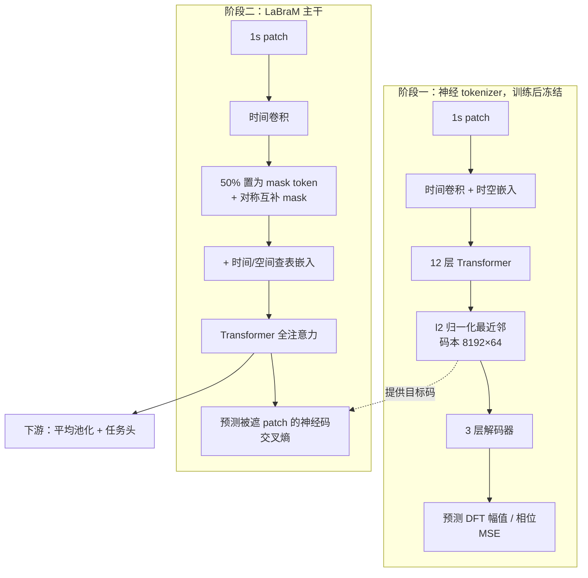

# LaBraM：研究问题、架构与训练逻辑

> 版本：2026-11-14 / 论文笔记 v0.2。依据已保存的 arXiv v1 全文（ICLR 2024，含附录 A–M）；尚未核对代码逐层实现，未本地复现。统一记号见[阅读约定](../process/文档维护与阅读约定.md)。

## 1. 作者要解决的问题

**问题陈述（作者观点）：** 想把 LLM 式“大规模无监督预训练 → 下游微调”搬到 EEG，但遇到三个障碍：

1. **数据不足**：单个 EEG 数据集通常只有几十小时。作者提出两个问题：Q1 如何利用大量无标注 EEG？Q2 训练大 EEG 模型需要多少数据？
2. **采集配置多样**：电极数、导联不同，难以统一成 Transformer 的输入单元；
3. **缺乏有效的表示学习范式**：EEG 信噪比低。作者报告，在他们的早期实验中**直接重建原始波形时损失不收敛**。

**对应设计：** (a) 按“通道 × 1 s”切 patch 统一输入；(b) 先训练一个**神经 tokenizer**，把每个 patch 离散化成码本中的一个“神经码”，训练目标是预测该 patch 的傅里叶幅值和相位；(c) 再用 BERT 式 mask 预训练主干，预测被遮 patch 的神经码（分类任务，而不是回归波形）。

**哪些已被实验支持：**

| 主张 | 证据 | 强度 |
|---|---|---|
| 离散码目标优于直接重建 | 附录 G Table 7 | **结果分裂**：TUEV 上码本目标明显更好（0.641 vs 原始波形 MSE 0.563）；TUAB 上反而原始波形 MSE 更好（0.826 vs 0.814） |
| 模型越大越好 | Table 1–2：Base/Large/Huge 在 TUAB、TUEV 上递增 | 只在两个 TUH 数据集上；增幅不大（TUAB 0.814 → 0.826） |
| 需要大量数据 | 图 5 数据量扩展 | Base 用 500 小时在 TUAB 上**反而超过** 2500 小时；只有 Huge 呈明显上升趋势 |
| 预训练有用 | 附录 J 图 8 | 只有图，正文未给数值 |
| 可用作冻结特征 | 附录 K：**不能**。TUEV 线性探测 0.346（全量微调 0.641） | 作者自己承认需要全量微调 |

## 2. 输入与输出

- 输入：$X\in\mathbb R^{C\times T}$，200 Hz；外加**电极名称**（用来在 10-20 系统电极全集 $\mathcal C$ 中查找空间嵌入）。不需要三维坐标，但电极必须能映射到这张表里。
- patch：1 s（200 点）、无重叠，每个样本含 $C\lfloor t/200\rfloor$ 个 patch。
- 序列长度上限：为控制显存，**每个样本最多 256 个 patch**。例如 64 通道 → 4 s，32 通道 → 8 s。
- 输出：预训练时对每个被遮 patch 输出码本上 8192 类的分布；下游时对所有 token 做**平均池化**后接任务头。

## 3. 前向计算（逐步）

LaBraM 的完整训练包含两个模型，它们共享同一种主干结构（§3.1–3.3），但参数**不共享**：

- **模型 A：神经 tokenizer**（第一阶段训练，之后冻结），负责把 patch 变成离散码；
- **模型 B：LaBraM 主干**（第二阶段训练），负责从被遮输入预测这些码。下游只用模型 B。

### 3.1 时间编码器（每个 patch 独立）

3 层 1D 卷积 + GroupNorm + GELU（附录 Table 3–4）。Base：第一层 1→8 通道、kernel 15、stride 8、padding 7，把 200 点压到 25 个位置；后两层 8→8、kernel 3。输出 8 × 25 = 200 维，即 $e_{c,k}\in\mathbb R^{200}$。Large/Huge 把卷积通道数分别扩到 16、32（对应隐藏维 400、800）。

### 3.2 时间与空间嵌入（绝对位置编码）

- **时间嵌入表** $TE=\{te_1,\dots,te_{t_{max}}\}$：按 patch 的时间序号查表，$t_{max}$ 是超参数（论文未给具体值，需查代码）；
- **空间嵌入表** $SE=\{se_1,\dots,se_{|\mathcal C|}\}$：按**电极名**在 10-20 系统电极全集中查表；
- 都是可学习的 $d$ 维向量，直接加到 patch 嵌入上：$e_{c,k}+te_k+se_c$。

含义：同一电极名在任何数据集中都对应同一个向量；表里没有的电极名没有嵌入可用。附录 L：预训练时去掉空间嵌入，损失**无法收敛**（模型无法知道要重建哪个位置）；下游微调时丢弃空间嵌入，TUEV 从 0.641 降到 0.595。

### 3.3 Transformer 编码器

对**所有** token 做全注意力（不区分空间、时间）。两点改动：Q、K 在点积前做 LayerNorm（QK-norm，防止 logits 过大）；QKV 计算去掉 bias。规模（Table 4）：

| 版本 | 层数 | 隐藏维 | MLP | 头数 | 参数 |
|---|---|---|---|---|---|
| Base | 12 | 200 | 800 | 10 | 5.8M |
| Large | 24 | 400 | 1600 | 16 | 46M |
| Huge | 48 | 800 | 3200 | 16 | 369M |

### 3.4 第一阶段：向量量化神经频谱预测（训练模型 A）

1. **编码**：patch 经过 §3.1–3.3 的结构（12 层）得到 $p_i$；
2. **量化**：码本 $\mathcal V\in\mathbb R^{8192\times64}$。$p_i$ 和码本向量都先做 $\ell_2$ 归一化，再找最近邻（等价于余弦相似度最大）：$z_i=\arg\min_j\|\ell_2(p_i)-\ell_2(v_j)\|_2$。归一化是为了提高码本利用率；码本用 EMA 更新；
3. **解码目标**：对每个 patch 做 DFT，得到各频率的**幅值** $A^m$ 和**相位** $\phi^m$，并在样本内做 z-score；
4. **解码器**：3 层 Transformer，输入量化后的码向量，经两个预测头分别回归幅值和相位（MSE）。正文写“输出先平均池化再接预测头”，但损失是逐 patch 计算的，具体实现需查代码；
5. **损失**：

$$\mathcal L_T=\sum_{x}\sum_i\|o^A_i-A_i\|_2^2+\|o^\phi_i-\phi_i\|_2^2+\|\mathrm{sg}(\ell_2(p_i))-\ell_2(v_{z_i})\|_2^2+\|\ell_2(p_i)-\mathrm{sg}(\ell_2(v_{z_i}))\|_2^2$$

后两项是标准的 VQ-VAE 码本损失和承诺损失（sg 为 stop-gradient）。

附录 E 的可视化显示：幅值的整体趋势重建得不错，**相位重建明显较差**。

### 3.5 第二阶段：mask 预训练（训练模型 B）

1. 按 50% 比例随机选 patch，把它们的**嵌入**（时间编码器输出）替换为一个可学习的 mask token；
2. 加上时间、空间嵌入后，**所有 token**（含被遮的）进入 Transformer（BERT 式，不是 MAE 式）；
3. 输出 $h_i$ 经线性层得到 8192 类的 softmax，目标是冻结的 tokenizer 给出的码 $z_i$，只在被遮位置上算交叉熵：

$$\mathcal L_{\mathcal M}=-\sum_x\sum_{m_i=1}\log p(z_i\mid e^{\mathcal M})$$

4. **对称 mask**：同一个样本再用**互补的 mask**（原来没遮的这次遮）算一次损失 $\mathcal L^{sym}_{\mathcal M}$，总损失 $\mathcal L=\mathcal L_{\mathcal M}+\mathcal L^{sym}_{\mathcal M}$。两个理由：tokenizer 的前向只需算一次就能复用；相当于数据增强。结果是每个 patch 在每个样本里都被预测一次。

附录 B 把两阶段解释为一个变分自编码器的 ELBO：tokenizer 是 $q_\phi(z|x)$，频谱解码器是 $p_\psi(\tilde x|z)$，主干是 $p_\theta(z|x^{\mathcal M})$。

### 3.6 下游

去掉码本预测头；所有 token 输出做**平均池化**，接任务头，全量微调。

## 4. 训练逻辑

### 4.1 预训练数据（附录 D）

约 20 个数据集，共 **2,534.78 小时**，两个阶段使用同一批数据：

- TUH 子集占大头：TUSZ 1,138.53 h、TUEP 591.22 h、TUAR 92.22 h、TUSL 20.59 h；
- 情绪：SEED 系列（SEED、SEED-IV、SEED-GER、SEED-FRA）166.75 h；
- MI / P300 / 运动：PhysioNet MMI 47.3 h、Inria BCI 29.98 h、BCI IV-1、Grasp-and-Lift、Target vs Non-Target 等；
- **作者自采数据 342.23 h**（140 多名被试，62 通道），**不公开**；
- 4 个下游数据集（TUAB、TUEV、SEED-V、MoBI）都排除在外；作者说明 TUAB、TUEV 的记录与预训练数据不重叠（§3.5）。

预处理：带通 0.1–75 Hz，50 Hz 陷波，重采样 200 Hz，以 0.1 mV（100 μV）为单位缩放，使数值大致在 −1 到 1 之间。没有做坏样本剔除。

### 4.2 超参数（附录 Table 3–5）

| 项目 | tokenizer | 主干预训练 | 下游微调 |
|---|---|---|---|
| batch | 1024 | 512 | 512 |
| 峰值 lr | 5e-5 | 5e-4 | 5e-4 |
| epoch（warmup） | 100（10） | 50（5） | Base 50（5）；Large/Huge 30（3） |
| 数据步长 | 200 点（1 s） | 800 点（4 s） | — |
| 其他 | AdamW，余弦调度 | mask 0.5，梯度裁剪 3，EMA 0.996，layer scale | 逐层 lr 衰减 0.65（Base）/ 0.8；drop path 0.1–0.2；多分类 label smoothing 0.1 |

硬件：8 张 A800。论文未给预训练总时长。

## 5. 下游评测设置

主文只有 TUAB（异常检测，二分类）和 TUEV（事件分类，6 类）；附录 F 补充 SEED-V（情绪，5 类）和 MoBI（步态角度回归）。

- TUAB、TUEV：沿用 BIOT 的划分，数据集自带 train/test，再从训练病人中 8:2 切出验证集，跨被试。
- SEED-V：每个 session 的 15 个 trial 按 5:5:5 切分，**同一被试同时出现在训练集和测试集**；且使用 20 名被试的版本（CBraMod 指出公开版只有 16 名）。
- MoBI：同一 trial 前 10 分钟训练、后 5 分钟验证，**被试内**。
- 5 个随机种子；模型选择指标：二分类 AUROC，多分类 Cohen's Kappa。基线数字取自 BIOT 论文。

## 6. 实验结果与可支持的结论

**主结果（Table 1–2，BACC）：**

| 模型 | TUAB | TUEV |
|---|---|---|
| BIOT | 0.7959 | 0.5281 |
| LaBraM-Base | 0.8140 | 0.6409 |
| LaBraM-Large | 0.8226 | 0.6581 |
| LaBraM-Huge | 0.8258 | 0.6616 |

TUEV 上相对 BIOT 提升很大（0.528 → 0.641），TUAB 上提升较小。

**附录 F：** SEED-V 准确率 Base 0.410、Huge 0.410，几乎不随模型变大而提升；MoBI 的 Pearson 相关 Base 0.538、Huge 0.563。

**消融汇总：**

| 附录/表 | 对照 | 主要结果（TUAB / TUEV BACC） |
|---|---|---|
| G Table 7 | LaBraM（预测离散码） | 0.814 / 0.641 |
| | 设置 1：用余弦相似度直接预测 tokenizer 的连续输出（不离散化） | 0.806 / 0.616 |
| | 设置 2：不用 tokenizer，直接 MSE 重建原始波形 | **0.826** / 0.563 |
| | 设置 3：不用 tokenizer，MSE 重建傅里叶幅值和相位 | 0.817 / 0.573 |
| H Table 8 | mask 比例（含对称 mask） | 0.5 在 TUEV 上最好，其余比例都相近 |
| I Table 9 | 去掉对称 mask | Base 在 TUAB 上反而略升（0.8155）；Huge 在 TUEV 上降幅大（0.662 → 0.626） |
| K Table 10 | 只微调后 8 层 / 后 4 层 / 线性探测 | 后 8 层在 TUEV 上**最好**（0.661 > 全量 0.641）；线性探测 TUEV 只有 0.346 |
| L Table 11 | 微调时去掉空间嵌入 | 0.800 / 0.595 |

**如何解读 G：** 作者把 TUAB 称为“低层任务”（正常/异常肉眼可辨），TUEV 称为“高层任务”，以此解释为什么离散码只在 TUEV 上占优。这一解释没有被直接检验，只有两个数据集。可以确定的只是：**“离散码 vs 直接重建”的优劣依任务而异**。

**数据量扩展（图 5）：** Base 用 500 小时预训练，TUAB 结果超过 2500 小时，TUEV 达到 2500 小时结果的 90% 以上；Large 在 1000 小时后增速放缓；只有 Huge 随数据量持续上升。

**其他论文中的 LaBraM：** CBraMod 与 REVE 的对比表中 LaBraM-Base 的数值（如 PhysioNet-MI 0.617、FACED 0.527、BCIC-IV-2a 0.487）由那些论文的作者用公开 Base 权重微调得到，不是 LaBraM 原论文报告的。CBraMod 附录 G 把 LaBraM 的架构放在 CBraMod 的数据上重新预训练，结果略好于原版，但仍低于 CBraMod。

**外部评测：** NeuralBench 官方快照（固定提交 fe31393）中 LaBraM 的 mean_rank 为 4.39，接近 REVE 的 4.22；c-VEP 87.600% vs REVE 79.093%，图像 Top-5 87.650% vs 84.750%，SSVEP 96.488% vs 96.071%。三项指标含义不同，不能混合比较。协议见[评测证据](../benchmarks/评测证据与可比性.md)。

## 7. 局限、疑点与未读懂的部分

1. **固定电极词表**：空间嵌入按 10-20 电极名查表，不能处理表外电极；双极导联（如 TUAB 的 “FP1-F7”）如何映射到单个电极名，需查代码。
2. **序列长度上限 256 个 patch**，时间嵌入长度 $t_{max}$ 也有上限；超过时如何处理，论文未说明。
3. **冻结表示很弱**（附录 K），依赖全量微调；作者在局限中也承认微调成本高。
4. **相位重建差**（附录 E），tokenizer 的码主要承载幅值谱信息，这对依赖相位的任务意味着什么，论文没有讨论。
5. **预训练数据含 342 小时私有数据**，无法完全复现。
6. **评测覆盖窄**：主文只有两个 TUH 数据集；附录的 SEED-V 和 MoBI 都不是跨被试设置。
7. **只公开 Base 权重**（CBraMod 论文的说明）；Large、Huge 的结果他人无法复用。
8. **未读懂/待核**：$t_{max}$ 的取值；tokenizer 解码器“先平均池化再预测”与逐 patch 损失的关系；码本实际利用率（论文未报告）。

## 8. 与本赛题规格的事实对照

此节只列事实，不构成方案选择。

| 方面 | LaBraM 的情况 | 赛题情况 |
|---|---|---|
| 采样率 / patch | 200 Hz，1 s 无重叠 patch | 200 Hz；时长 1/2/4/10/30 s，都能整除 |
| 通道信息 | 需要电极名，在 10-20 电极表中查空间嵌入 | 接口是否提供导联名称**待确认** |
| 序列长度 | 预训练上限 256 个 patch | 128 ch × 2 s = 256（正好到上限）；62 ch × 10 s = 620、20 ch × 10 s = 200、4 ch × 30 s = 120 |
| 权重 | 公开 Base（5.8M） | **手册明确列出 LaBraM 为可用公开权重** |
| 决赛 | 预训练约 2.5k 小时（含私有数据），8 张 A800 | 21 个 OpenNeuro 数据集，官方算力，不能加载权重 |
| 两阶段训练 | 先训 tokenizer（100 epoch），再训主干（50 epoch） | 决赛约两周，需要在时间内完成全部预训练 |

## 9. 留给讨论的问题

- 附录 G 显示，直接重建原始波形在 TUAB 上更好，预测离散码在 TUEV 上更好。如果一个模型要覆盖 7 类任务，这个“依任务而异”的结果意味着什么？
- 附录 K 中只微调后 8 层反而比全量微调好。这说明预训练表示的哪一部分更通用？
- 数据量扩展的结果（Base 500 小时就足够）和决赛语料规模放在一起看，能推出什么、推不出什么？

## 原文与证据

- [LaBraM（ICLR 2024，arXiv v1）](https://arxiv.org/abs/2405.18765)：§2（方法，式 1–12）、§3（Table 1–2，图 3–5）；附录 B（ELBO 解释）、C Table 3–5（超参数）、D（预训练数据清单）、E（频谱重建可视化）、F Table 6（SEED-V、MoBI）、G Table 7（目标消融）、H–L（mask 比例、对称 mask、无预训练、部分微调、空间嵌入）、M（局限）。本地副本：`research/reve_route_20261113/sources/labram.txt`。
- 代码：github.com/935963004/LaBraM。
- [NeuralBench 官方逐任务结果，固定提交 fe31393](https://github.com/facebookresearch/neuroai/blob/fe31393affab2590e59b0a7e1457aad1a1da908e/docs/_static/neuralbench-results-data.json)；[模型参数与 mean_rank 数据](https://github.com/facebookresearch/neuroai/blob/fe31393affab2590e59b0a7e1457aad1a1da908e/docs/_static/neuralbench-model-scatter-data.json)。

- [原始资料目录](../../research/reve_route_20261113/sources/)
- [返回论文索引](README.md)
