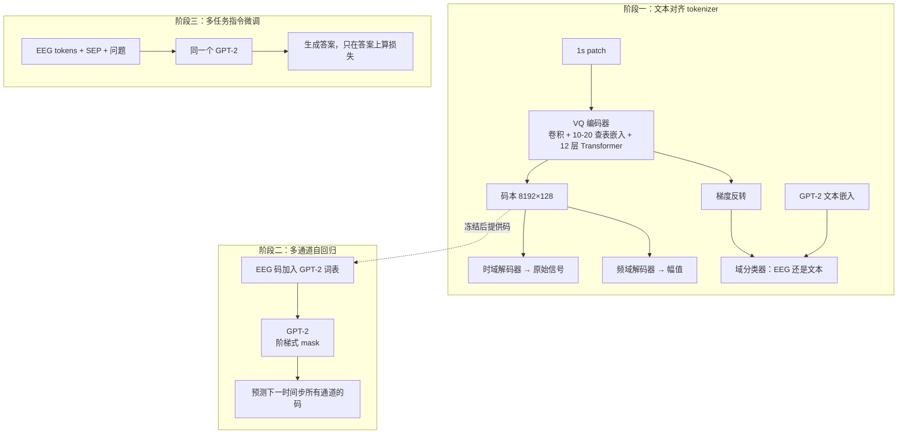

# NeuroLM：研究问题、架构与训练逻辑

> 版本：2026-11-14 / 论文笔记 v0.2。依据已保存的 arXiv v1 全文（2024-08，含附录 A–H，从 `neurolm.html` 提取）；尚未核对代码，未本地复现。统一记号见[阅读约定](../process/文档维护与阅读约定.md)。

## 1. 作者要解决的问题

**问题陈述（作者观点）：** BIOT、LaBraM 等预训练模型都要在**每个下游任务上单独全量微调**，一个微调后的模型只能做一个任务，计算和存储成本都高。作者想借用大语言模型（LLM）的多任务能力，把 EEG 当作一门“外语”，让**一个模型通过指令微调同时完成多个 EEG 任务**。

三个挑战：(1) **EEG–文本对齐**：没有现成的 EEG–文本配对数据；(2) **在 LLM 框架下学表示**：主流 EEG 方法用 mask 重建，LLM 用自回归，二者如何衔接；(3) **多任务统一**：不同任务差异大，难以不牺牲单个任务的性能。

**对应设计（三阶段）：**

1. **文本对齐的神经 tokenizer**：沿用 LaBraM 的 VQ tokenizer，改为同时重建时域信号和频率幅值，并用对抗训练让 EEG 嵌入落到文本嵌入的空间里；
2. **多通道自回归预训练**：把 EEG 码加入 GPT-2 的词表，按时间步做“下一步预测”；
3. **多任务指令微调**：把每个下游任务写成问答形式，一起训练。

**哪些已被实验支持：**

| 主张 | 证据 | 强度 |
|---|---|---|
| 一个模型可以完成多个任务 | Table 2–4：6 个任务都能输出合理结果 | 成立；但**所有任务上都低于单任务的 LaBraM** |
| 自回归预训练有帮助 | 图 8 | 只有图 |
| EEG–文本对齐是必要的 | 附录 F.2：不对齐时，模型在指令微调中输出随机词而不是选项 | 定性证据 |
| 模型越大越好 | Table 2–4 | 不成立：HMC 上 XL（0.576）明显低于 B（0.674）；作者归因于过拟合 |
| 对选项顺序鲁棒 | 图 5：打乱选项顺序 | TUEV、HMC 上成立；TUSL 上明显下降 |

**作者自己承认**：NeuroLM 仍落后于在各数据集上端到端训练的最好方法；对超参数较敏感；只做了粗粒度（空间层面）的对齐。

## 2. 输入与输出

- 输入：$X\in\mathbb R^{C\times T}$，按窗口长 $L$ 切成样本，每个样本再切成长 $P=200$ 点（1 s @ 200 Hz）的不重叠 patch：$x_{ij}$（通道 $i$、时间 $j$）。
- 通道信息：按 10-20 系统查空间嵌入（与 LaBraM 相同），需要电极名。
- 序列长度上限 **1024 个 patch**（GPT-2 的上下文长度）；不足时补零并屏蔽注意力。
- 输出：文本答案（例如 “Yes”/“No”，或选项 “(A)”–“(F)”）；评测时取概率最大的 token，不用 beam search。

## 3. 前向计算（逐步）

### 3.1 阶段一：文本对齐的神经 tokenizer

**VQ 编码器**（几乎与 LaBraM 相同）：时间编码器（3 层 1D 卷积，第一层 kernel 15、stride 8）→ 加上按 10-20 系统查表的时间、空间嵌入 → 12 层 Transformer（隐藏维 768），得到每个 patch 的表示 $h_i$。

**量化**：码本 $8192\times128$，$\ell_2$ 归一化后找最近邻（等价于余弦相似度）：$z_i=\arg\min_j\|\ell_2(h_i)-\ell_2(v_j)\|_2$。

**重建目标（与 LaBraM 的区别）**：LaBraM 重建傅里叶幅值和相位；NeuroLM 改为重建**原始时域信号**和**频率幅值**（样本内 z-score），不再重建相位。理由：作者观察到相位重建对 tokenizer 训练贡献很小。两个独立的解码器分别输出 $o^t_i$、$o^f_i$：

$$\mathcal L_1=\sum_x\sum_i\underbrace{\|o^t_i-x_i\|_2^2+\|o^f_i-f_i\|_2^2}_{\text{重建}}+\underbrace{\|\mathrm{sg}(\ell_2(h_i))-\ell_2(v_{z_i})\|_2^2}_{\text{码本}}+\underbrace{\|\ell_2(h_i)-\mathrm{sg}(\ell_2(v_{z_i}))\|_2^2}_{\text{承诺}}$$

**EEG–文本空间对齐（对抗训练）**：

- 没有 EEG–文本配对，所以不做“逐样本”对齐，而做“空间层面”的对齐；
- 加一个**域分类器** $\mathcal C$，判断一个嵌入来自 EEG 还是来自 LLM 的文本嵌入；
- 在 VQ 编码器之后接**梯度反转层**：分类器努力区分，编码器努力让它分不出来，结果是 EEG 嵌入落入文本嵌入所在的空间；
- 总目标：$\min\ \mathcal L_1+\lambda\sum_i d_i\log\mathcal C(h_i)$，其中 $\lambda=\frac{2}{1+e^{-10t/T}}-1$ 随训练进度从 0 逐渐增大到 1。

### 3.2 阶段二：多通道自回归预训练

1. 冻结 VQ 编码器，把 EEG 编码成码；
2. 加载预训练的 **GPT-2**，把 8192 个 EEG 码**加入文本词表**；
3. EEG token 加上 LLM **复用的时间嵌入**和**新建的空间嵌入**；
4. **阶梯式注意力 mask（stair-stepping mask）**：每个 EEG token 可以看到**当前及之前所有时间步**上**所有通道**的 token；
5. 目标：用第 $1..n-1$ 步的全部 token，预测第 $n$ 步**所有通道**的码：

$$p(I_{11},\dots,I_{CN})=\prod_{n=1}^N p(I_{1n},\dots,I_{Cn}\mid h_{11},\dots,h_{C(n-1)})$$

即“每个通道的 token 预测同一通道的下一个 token”，但预测时可以利用所有通道的历史。

6. 每次迭代也混入少量纯文本数据，以保持语言能力。

附录式 6–7 把阶段一和阶段二合起来解释为一个 VAE 的 ELBO：tokenizer 是后验 $q_\phi$，解码器是 $p_\psi$，自回归 LLM 学的是先验 $p_\theta$。

### 3.3 阶段三：多任务指令微调

- 每个下游样本写成：`[EEG tokens] [SEP] Question: … Options: … Answer: …`（附录 B Table 5）。例如 TUAB：“Is this EEG segment abnormal? Answer: {Yes, No}”；TUEV、HMC、TUSL 用选择题形式；
- **只在答案部分计算损失**：$p(t^a\mid x^p)=\prod_i p(t^a_i\mid x^p,t^a_{<i})$；
- 6 个任务的数据混在一起训练；同样混入少量纯文本。

## 4. 训练逻辑

### 4.1 预训练数据（附录 C Table 6）

约 **25,000 小时**，其中 **TUEG 约 24,000 小时**；其余为 SEED 系列（170.54 h）、BCI IV-1、Emobrain、Grasp-and-Lift、Inria BCI、PhysioNet MMI、Siena 等，以及**作者自采数据 342.23 h（不公开）**。除 TUEG 规模更大外，数据组成与 LaBraM 基本相同。

### 4.2 预处理

0.1–75 Hz 带通，50 或 60 Hz 陷波（按采集地区），重采样 200 Hz，除以 100（单位 100 μV）。

### 4.3 超参数（附录 D Table 7–9）

| 项目 | tokenizer | 自回归预训练 | 指令微调 |
|---|---|---|---|
| 规模 | 12 层编码器 + 3 层解码器，隐藏维 768 | B 254M（12 层、768）；L 500M（24 层、1024）；XL 1696M（48 层、1600），均含 VQ 编码器 | 同左 |
| batch | 512 | EEG 480/512，文本 32/64 | 指令 512，文本 128 |
| 峰值 lr | 5e-5 | 6e-4 | B 5e-4，L 5e-5，XL 2e-5 |
| epoch | 50 | 20 | B、L 5；XL 3 |

8 张 A100-80G。附录 G：分别用第 5、10、15、20 个 epoch 的预训练模型做指令微调，20 epoch 整体最好，但 SEED、HMC 在 5 epoch 时最好，Workload 在 10 epoch 时最好。

## 5. 下游评测设置

| 数据集 | 任务 | 通道 / 时长 | 划分 |
|---|---|---|---|
| TUAB | 异常检测（2 类） | 23 / 10 s | 自带训练/测试，训练病人 80:20 切出验证 |
| TUEV | 事件（6 类） | 23 / 5 s | 同上 |
| SEED | 情绪（3 类） | 62 / 4 s | 15 个 trial 按时间顺序 9:3:3，**所有被试合并**，属于被试内划分 |
| HMC | 睡眠（5 类） | 4 / 30 s | 按被试编号：1–100 训练，101–126 验证，126–154 测试（原文边界写法有重叠） |
| Workload | 认知负荷（2 类） | 19 / 4 s | 按被试编号 |
| TUSL | 慢波事件（3 类） | 23 / 10 s | 60:20:20（未说明是否按被试）；只有 245 个样本 |

- 基线**逐任务单独训练**，按验证集选最优模型；NeuroLM 用**训练结束时的最终模型**，不做验证集选择。两者的模型选择方式不同。
- 3 个随机种子。作者也承认：多任务模型与单任务基线的比较“并不完全公平”。

## 6. 实验结果与可支持的结论

**BACC（Table 2–4）：**

| 数据集 | BIOT | LaBraM | NeuroLM-B | NeuroLM-L | NeuroLM-XL |
|---|---|---|---|---|---|
| TUAB | 0.7959 | **0.8140** | 0.7826 | 0.7876 | 0.7969 |
| TUEV | 0.5281 | **0.6409** | 0.4560 | 0.4132 | 0.4679 |
| SEED | 0.7097 | **0.7318** | 0.5554 | 0.6006 | 0.6034 |
| HMC | 0.6862 | **0.7286** | 0.6737 | 0.6658 | 0.5761 |
| Workload | 0.6655 | 0.6609 | 0.6172 | 0.6311 | 0.6345 |
| TUSL | 0.5758 | **0.7625** | 0.6734 | 0.5314 | 0.6845 |

（Workload 的最好结果是 FFCL 0.7069。）

可以确定的结论：在本文设置下，**一个多任务模型的代价是每个任务上都低于单任务的 LaBraM**，在 SEED 上差距最大（0.555 vs 0.732）。TUAB 的 AUC-PR 尤其低（0.70 左右 vs LaBraM 0.90），说明“直接取最大概率的答案 token”这种输出方式可能不利于排序类指标。

**时域 vs 频域重建目标（附录 F.1 图 10）：** 只重建时域时，TUAB、Workload、TUSL 更好；只重建频域时，TUEV、SEED、HMC 更好；两者都重建时多数任务相近或更好。与 LaBraM 附录 G 的结论类似：**最合适的重建目标依任务而异**。

**指令数据规模（图 6）**：在 TUAB、TUEV、HMC 上减少指令数据，NeuroLM 和 LaBraM 都比较稳定。

**UniMind 同表**（见 [UniMind](UniMind.md)）显示，多任务设计在同类比较中仍有明显的改进空间。

## 7. 局限、疑点与未读懂的部分

1. **多任务的代价**：所有任务上都低于单任务的 LaBraM。
2. **模型选择方式不同**：NeuroLM 取最终模型，基线按验证集选。
3. **“文本对齐”的含义有限**：只是让 EEG 嵌入的分布与文本嵌入的分布不可区分，并不意味着 EEG token 携带了语义。
4. **自回归目标与 EEG 的匹配**：预测“下一秒所有通道的码”，对 1 s 或 2 s 的短样本（只有 1–2 个时间步）几乎没有可预测的上下文。
5. **序列长度上限 1024**：64 通道 × 16 s 就达到上限。
6. **私有数据**：预训练含 342 小时自采数据。
7. **SEED 划分是被试内的**；TUSL 只有 245 个样本，结果波动大。

## 8. 与本赛题规格的事实对照

此节只列事实，不构成方案选择。

| 方面 | NeuroLM 的情况 | 赛题情况 |
|---|---|---|
| 采样率 / patch | 200 Hz，1 s | 200 Hz；1/2/4/10/30 s |
| 通道 | 10-20 查表，需要电极名 | 接口是否提供导联名称**待确认** |
| 序列上限 | 1024 个 patch | 最长的 62 ch × 10 s = 620，128 ch × 2 s = 256，都在上限内 |
| 多任务单模型 | 核心卖点 | 主赛道是否要求提交**统一模型**，还是允许每个数据集各自适配，**待确认**（见[待确认事项](../competition/待确认事项.md)） |
| 主指标 | BACC；输出为文本答案 | BACC，辅助 PR-AUC、ROC-AUC（需要概率输出） |
| 规模 | 254M–1.7B | 决赛官方算力，配额待确认 |
| 权重 | 论文未说明是否公开 | 复赛只能用公开可下载的权重 |

## 9. 留给讨论的问题

- 主赛道覆盖 14 个数据集。“一个模型多任务”和“一个预训练模型 + 每个数据集单独适配”这两种思路，在赛题规则下各自意味着什么？这个问题的答案取决于提交约定，目前还未确认。
- NeuroLM 和 LaBraM 用几乎相同的数据和 tokenizer，只换了第二、三阶段。多任务带来的性能下降，主要来自自回归预训练、指令微调，还是 GPT-2 本身？论文的实验能区分吗？
- 附录 F.1 显示时域、频域目标对不同任务各有优势，这与 LaBraM 附录 G、FAME 的结论放在一起，能看出什么共同点？

## 原文与证据

- [NeuroLM（arXiv v1，2024-08）](https://arxiv.org/abs/2409.00101)：§2（式 1–8，图 2–4）、§3（Table 1–4，图 5–8）；附录 B Table 5（指令设计）、C Table 6（预训练数据）、D Table 7–9（超参数）、E（注意力可视化）、F（时域/频域目标消融、对齐可视化）、G Table 10–12（预训练 epoch）、H（局限）。本地副本：`research/reve_route_20261113/sources/neurolm.txt`、`neurolm.html`。

- [原始资料目录](../../research/reve_route_20261113/sources/)
- [返回论文索引](README.md)
