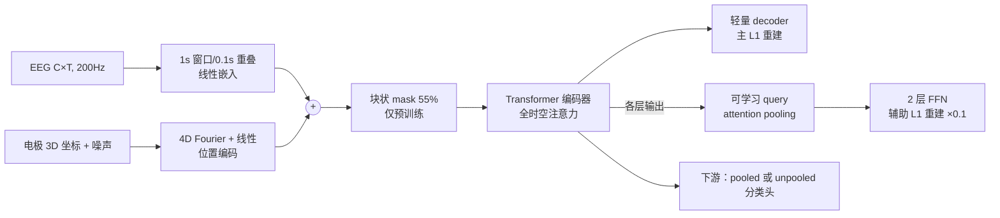

# REVE：研究问题、架构与训练逻辑

> 版本：2026-11-14 / 论文笔记 v0.2。依据已保存的 arXiv v1 全文（含附录 A–F）与作者仓库 README；尚未核对代码逐层实现，未本地复现。统一记号见[阅读约定](../process/文档维护与阅读约定.md)。v0.1 的内容已并入并按原文逐项核对。

## 1. 作者要解决的问题

**问题陈述（作者观点）。** 公开 EEG 数据在导联数、电极位置、记录时长、设备上高度异构。作者认为已有基础模型（BIOT、LaBraM、CBraMod、NeuroGPT）的两类做法限制了扩展：

1. 预训练语料多来自 TUH，固定 19/21 导联蒙太奇，换到其他布局时泛化差；
2. 位置编码是“绝对查表”（BIOT、LaBraM 为每个通道名学一个向量）或“卷积式”（CBraMod），无法自然覆盖没见过的电极布局，往往需要全量微调才能迁移。

因此作者的目标是两件事：**(a)** 让编码器能接收任意电极布局和任意长度；**(b)** 让冻结的表示本身就好用（线性探测强），而不是依赖全量微调。

**哪些已被实验支持、哪些没有**：

| 主张 | 证据 | 强度 |
|---|---|---|
| 可处理未见布局与更长输入 | TUEV 双极导联、ISRUC 30 s（Table 2）与 HMC 30 s（附录 C.6）上有结果；预训练窗口约 10 s | 只说明“能跑且分数不差”，没有对照“同条件下不用 4D PE 会怎样” |
| 4D PE 优于查表位置编码 | Table 19：Learnable PE 0.701 vs 完整模型 0.707（两项任务平均） | 差距很小；作者自己说明 4D PE 的主要价值在于**可扩展性**，不是在已见配置上的精度 |
| 冻结表示强于其他模型 | Table 3、Table 4 线性探测大幅领先 CBraMod | 较强，但 CBraMod 由 REVE 作者复现，且池化方式影响很大（见 §6） |
| 预训练对 REVE 帮助更大 | Table 3：REVE 无预训练 0.541 → 有预训练 0.648；CBraMod 0.620 → 0.642 | 只在 PhysioNet-MI 一个数据集上 |
| 辅助损失提升冻结表示 | Table 17（Small 模型）LP 平均 0.523 → 0.558 | 平均提升，但 ISRUC 的 LP 反而下降（0.699 → 0.625） |

## 2. 输入与输出

- 输入：$X\in\mathbb R^{B\times C\times T}$，以及每个通道的电极三维坐标 $P\in\mathbb R^{C\times3}$。坐标是**必需输入**：有 3D 坐标就直接用，否则由标准电极名（10-5 系统）推得；无法识别名称的通道在预训练时被剔除。
- 采样率：预训练统一 200 Hz（与本赛题一致）。
- 时长：作者在局限中写明信号须**至少 1 秒，且为 1 秒的整数倍**。
- 输出：预训练时输出被 mask 的原始波形 patch；下游时输出 token 表示 $\in\mathbb R^{B\times C\times p\times D}$，或池化后的全局向量，再接分类头。

## 3. 前向计算（逐步）

### 3.1 分段（patching）

每个通道沿时间切成窗口 $w=1\,\mathrm s=200$ 点、重叠 $o=0.1\,\mathrm s=20$ 点，步长 180 点（Table 5）。得到 $X_p\in\mathbb R^{C\times p\times w}$，不完整的尾段丢弃。

论文给出的 patch 数公式为 $p=\lceil\frac{T-w}{w-o}\rceil+\mathbb 1[(T-w)\bmod(w-o)\ne0]$。这个式子与“丢弃不完整片段”的说法不自洽（例如 $T=400$ 时公式给 3，而完整窗口只有 2 个）。**以下按“只计完整窗口”$p=\lfloor\frac{T-w}{w-o}\rfloor+1$ 推算，需以代码为准：**

| 赛题规格（200 Hz） | $T$ | 推算 $p$ | token 数 $C\times p$ |
|---|---|---|---|
| SSVEP 60 ch × 1 s | 200 | 1 | 60 |
| 58 ch × 2 s / 128 ch × 2 s | 400 | 2 | 116 / 256 |
| 64 ch × 4 s / 22 ch × 4 s | 800 | 4 | 256 / 88 |
| 62 ch × 10 s / 20 ch × 10 s | 2000 | 11 | 682 / 220 |
| 4 ch × 30 s / 6 ch × 30 s | 6000 | 33 | 132 / 198 |

这张表只说明 token 规模差异很大（60 到 682），不代表任何结论。1 秒数据只有 1 个时间 patch，意味着时间维上没有“上下文”可言。

### 3.2 Patch 嵌入

每个 patch（200 个采样点）经同一个线性层映射为 $D$ 维 token：$E\in\mathbb R^{C\times p\times D}$。没有卷积前端，也没有频域特征。

### 3.3 4D 位置编码

1. 电极坐标 $P$ 在训练时加高斯噪声（$\sigma=0.25$ cm），模拟头型与放置误差；
2. 扩展时间维：时间索引 $1..p$ 乘以缩放因子 $s_t$，使其与空间坐标量级相近，得 $P_{\mathrm{ext}}\in\mathbb R^{C\times p\times4}$；
3. **Fourier 部分**：$(x,y,z,t)$ 每维取 $n_{\mathrm{freq}}$ 个频率，四维取笛卡尔积，得 $n_{\mathrm{freq}}^4$ 个分量，再取 sin/cos，维度 $2n_{\mathrm{freq}}^4$。Base 取 $n_{\mathrm{freq}}=4$，即 $2\times256=512$，正好等于隐藏维 512（Large 取 5，$2\times625=1250$）；
4. **可学习部分**：$P_{\mathrm{ext}}$ 经 Linear → GELU → LayerNorm 得 $F_{\mathrm{lin}}$；
5. 合成：$P_{\mathrm{enc}}=\mathrm{LayerNorm}(F_{\mathrm{pe}}+F_{\mathrm{lin}})$，**加到** token 上（绝对位置编码的方式）。

关键点：位置向量是坐标的**函数**，而不是按通道编号查表，所以任何新坐标都能算出位置向量。“没见过的布局”能否得到**有意义**的表示，是另一个问题，论文没有直接检验。

### 3.4 结构化 mask（仅预训练）

总 mask 比例 $M_r=55\%$。在选中的通道周围空间半径 $R_s=3$ cm、选中 token 前后时间半径 $R_t=3$ s 内成块遮盖；另外 $D_r=10\%$ 的被遮 token 会把对应通道的**整条时间序列**丢弃（并按 $R_d=4$ cm 影响邻近通道），模拟坏导。理由：相邻通道和相邻时间的 EEG 高度相似，随机散点 mask 让重建变得太容易。

### 3.5 Transformer 编码器

- 只有**可见** token（加上位置编码）进入编码器（MAE 做法），被遮 token 不进入编码器；
- 对**所有**时空 token 做全注意力（不是先空间后时间的分解注意力），复杂度随 $C\times p$ 平方增长；
- 组件：RMSNorm、GEGLU 前馈（扩展比 8/3）、除最后的 decoder 层外所有线性层无 bias、FlashAttention v2；
- 训练时每条样本约 10 s（附录 F 按每序列 68×11 个 token 估算）。
- 规模（Table 6）：

| 版本 | 层数 | 头数 | 维度 | 参数 | $n_{\mathrm{freq}}$ |
|---|---|---|---|---|---|
| Small | 4 | 8 | 512 | 12M | 4 |
| Base | 22 | 8 | 512 | 69M | 4 |
| Large | 22 | 19 | 1250 | 408M | 5 |

### 3.6 主重建路径（仅预训练）

编码器输出的可见 token，与一个**可学习的 mask token**（复制 $N_m$ 份）拼在一起，**重新加上同一套 4D 位置编码**，送入轻量 decoder（同样的 Transformer 结构）；最后线性层映射回 200 点波形，只对被遮 patch 计算 L1 损失。与原版 MAE 不同，decoder 复用编码器的位置编码，以保留可变长度、可变布局的能力。

### 3.7 辅助（secondary）重建路径（仅预训练）

- 收集编码器**每一层**（FFN 之后）的输出 token，拼接后由一个**可学习 query** 做 attention pooling，得到**一个全局 token**；
- 把该 token 复制到每个被遮位置、加位置编码，经 2 层 FFN 重建被遮 patch，同样用 L1 损失；
- 作者的动机：MAE 在浅 decoder 下，编码器最后一层容易过度专门化于重建；跨层池化迫使信息分布在各层，并形成一个能单独承载信息的“瓶颈向量”，从而有利于线性探测。

### 3.8 下游

decoder 和辅助头丢弃；不做 mask，所有 token 进入编码器。读出可以是（a）池化后的全局向量，或（b）把全部 token 展平后接分类头（“unpooled”）。两者差异很大（§6 Table 4）。

## 4. 训练逻辑

### 4.1 预训练数据与预处理

- 92 个公开或可申请获取的数据集（OpenNeuro、MOABB、TUH 等），24,274 名被试，61,415 小时，约 396 个不同的电极名；以临床数据为主，另有较小比例的认知/BCI 数据；
- 只剔除短于 10 s 的记录，以及下游评测用到的记录；
- 重采样到 200 Hz，带通 0.5–99.5 Hz，float32；按**记录会话**统计做 z-score，再将超过 15 个标准差的值截断。作者强调与 CBraMod 不同：不丢弃幅值超过 100 μV 的片段，所以保留的数据多得多（60k 小时，对比 CBraMod 9k、LaBraM 2.5k）。

### 4.2 优化

StableAdamW（$\beta=0.9/0.95$，$\varepsilon=10^{-9}$），峰值学习率 $2.4\times10^{-4}$，batch 4096；Warmup-Stable-Decay（梯形）调度，并在多个 epoch 中循环；学习率随模型宽度按 $\eta\propto D^{-0.9}$ 缩放；初始化 std 0.02；按电极数分桶打乱以平衡各 GPU 负载。辅助损失权重 $\lambda=0.1$：

$$\mathcal L=\mathcal L_{\mathrm{primary},L1}+0.1\cdot\mathcal L_{\mathrm{secondary},L1}$$

选 L1 而非 L2 的理由：EEG 噪声大，L2 会放大离群值的影响。

### 4.3 算力（附录 F）

NVIDIA A100 集群。作者用公式**估算**（不是实测）Base 单次预训练约 **260 A100 GPU 小时**：token 量 = 60k 小时 × 3600 × 1.1（重叠系数）× 68（平均通道数）× 17 epoch，每条序列平均 68×11 个 token（即约 10 s 窗口），峰值 312 TFLOPs、利用率按 50% 计。该估算的假设（MFU、是否计入 decoder）需要谨慎看待。

### 4.4 下游适配（作者的做法）

1. 一次连续训练分两段：先冻结编码器只训线性头（LP），再解冻做全量微调（FT），思路来自 Kumar et al. 2022（先对齐分类头，避免一开始的大梯度破坏预训练特征）；
2. 在注意力的 Q/K/V/O 投影中插入 LoRA；
3. Dropout 和 Mixup 做数据增强；
4. 每段都有 warmup，之后用 Reduce-on-Plateau 调度；
5. Model souping：把多次微调的权重取平均，Base/Large 在 ≥5 个模型时平均提升约 1.5%，但对 Small 有时反而变差。

**注意**：这套流程本身包含多项技巧。Table 2 中 REVE 的分数是在这套流程下得到的，而基线分数“沿用已有论文报告的数值”，两边的微调流程并不相同。

## 5. 下游评测设置

10 个数据集（Table 1）：PhysioNet-MI（64 ch，4 s）、BCIC-IV-2a（22 ch，4 s）、TUEV（16 ch，5 s）、TUAB（16 ch，10 s）、HMC（4 ch，30 s）、ISRUC（6 ch，30 s）、FACED（32 ch，10 s）、Mumtaz（19 ch，5 s）、MAT（20 ch，5 s）、BCIC2020-3（64 ch，3 s）。划分沿用 CBraMod/LaBraM/BIOT 的协议，基线分数取自已有论文。

ISRUC 例外：作者发现基线代码误用了一个下巴电极，REVE 的结果剔除了它，所以 ISRUC 上 REVE 与基线的预处理不同。

## 6. 实验结果与可支持的结论

**Table 2（全量微调，BACC，9 个数据集；HMC 结果在附录 C.6）：** REVE-Base 平均 0.715，CBraMod 0.690，LaBraM 0.665。差距最大的是 BCIC-IV-2a（0.640 vs 0.514）和 MAT（0.766 vs 0.726）；ISRUC 上 REVE 低于 CBraMod（0.782 vs 0.787，且预处理不同）。可支持的结论仅限于：“REVE 完整流程在这 10 个数据集上的报告分数高于已报告的基线分数”。

**Table 3（PhysioNet-MI）：**

| 设置 | REVE-Base | CBraMod | LaBraM | BIOT |
|---|---|---|---|---|
| 有预训练 + 微调 | 0.648 | 0.642 | 0.617 | 0.615 |
| 无预训练（随机初始化训练） | **0.541** | 0.620 | — | — |
| 冻结 | **0.537** | 0.385 | 0.372 | 0.370 |

读法：REVE 的**架构本身**（随机初始化）在这个任务上弱于 CBraMod；它的优势来自预训练表示。这一点对“从零训练”的场景值得注意。

**Table 4（线性探测，pooled vs unpooled）：** Base 平均 0.586（pooled）/ 0.609（unpooled）；Large 0.623 / 0.654；CBraMod 0.373 / 0.501（由 REVE 作者复现）。按任务看差异明显：FACED pooled 0.240 vs unpooled 0.422；BCIC2020-3 0.234 vs 0.390；TUEV 则反过来 0.592 vs 0.508。也就是说，**同一个编码器，读出方式不同会改变不同任务的排序**。

**消融（附录 D）：**

| 表 | 内容 | 结果 | 局限 |
|---|---|---|---|
| Table 17 | 辅助损失有/无（Small） | LP 0.523→0.558；FT 0.612→0.665 | 只用 Small；ISRUC LP 下降 |
| Table 18 | 块状 vs 随机 mask × 比例 | 块状 55% 最好（FT 0.665）；随机 mask 在 25% 时最好 | Small、8 个任务平均 |
| Table 19 | 位置编码与 mask 组件 | 去掉位置噪声降幅最大（0.707→0.660）；查表 PE 0.701 | 只有 2 个任务 |
| Table 20 | GEGLU/RMSNorm | GEGLU+RMSNorm 0.596 > GELU+RMSNorm 0.579 > GEGLU+LayerNorm 0.558 | 3 个任务、Small |

**附录 E：**

- Table 21 通道稀疏化：PhysioNet-MI 左右手从 64 ch 0.824 降到 4 ch 0.728、1 ch 0.660；想象语音从 64 ch 0.565 降到 4 ch 0.258（接近随机）。说明对通道减少的敏感度**依任务而异**。
- Table 22 少样本（BCIC-IV-2a 左右手，最近类均值分类器）：仅预训练，20-shot 0.723；经多个 MI 数据集有监督微调后 0.817。

**外部评测：** NeuralBench 官方快照（固定提交 fe31393）中 REVE 的 mean_rank 为 4.22，36 项任务中 12 项第 1、20 项前 2（按源数据计算，任务指标不同）。NeuralBench 文档同时警告：REVE 的预训练语料与 TUH 病理/事件/伪迹、Lee2019 ERP/SSVEP、PhysioNet-MI、THINGS-EEG2 等评测任务有**记录重叠**（未见标签，但见过信号），这些任务上的分数可能偏高。协议差异见[评测证据](../benchmarks/评测证据与可比性.md)。

## 7. 局限、疑点与未读懂的部分

1. **时长限制**：须为 1 s 的整数倍，作者自己列为局限。
2. **依赖电极坐标**：没有坐标或标准电极名就无法构造位置编码。
3. **全时空注意力的开销**：token 数 = $C\times p$；30 s、62 ch 级别的输入，序列长度可达数百到上千。
4. **patch 数公式不自洽**（§3.1），实际边界处理需要看代码。
5. **对照不完全公平**：Table 2 基线分数取自原论文，微调流程（LoRA、Mixup、souping）不同；Table 4 的 CBraMod 是 REVE 作者复现的。
6. **消融规模小**：多数消融在 Small 模型、2–8 个任务上完成；Base/Large 的组件贡献没有单独验证。
7. **未读懂/待核**：$s_t$ 的具体取值；坐标单位与归一化（cm？头模型？）；unpooled 分类头的具体结构；souping 是否计入 Table 2 的分数（文中写 TUEV souping 后达 0.696，而 Table 2 为 0.676，推测 Table 2 未计入，待确认）。
8. **数据重叠**：预训练排除了“下游评测用到的记录”，但该排除只针对作者自己的 10 个下游任务。

## 8. 与本赛题规格的事实对照

此节只列事实，不构成方案选择。

| 方面 | REVE 的情况 | 赛题情况 |
|---|---|---|
| 采样率 | 200 Hz | 统一 200 Hz |
| 时长 | 须为 1 s 整数倍 | 1/2/4/10/30 s，全部满足 |
| 通道 | 需要坐标或标准电极名 | 赛题只公开通道数；接口是否提供导联名称/坐标**待确认**（见[待确认事项](../competition/待确认事项.md)） |
| 极少通道 | Table 21 显示随任务变化 | 有 4、6 通道的睡眠数据 |
| 长输入 | HMC/ISRUC 30 s 有结果 | 睡眠 30 s |
| 权重 | 作者在 HuggingFace 公开 `brain-bzh/reve-base` 等 | 复赛允许公开可下载权重；手册未点名 REVE，许可条款未核 |
| 决赛 | 预训练用 92 个数据集、60k 小时、A100 集群 | 21 个 OpenNeuro 数据集、32/64/76/128 ch、官方算力，不能加载权重 |

## 9. 留给讨论的问题

这些是阅读中浮现的问题，不是结论：

- REVE 的优势主要来自预训练表示（Table 3），而决赛必须从零训练。哪些设计在“数据少一个数量级”时还成立？
- pooled 与 unpooled 读出在不同任务上的优劣相反（Table 4）。这反映的是编码器的什么性质？
- 单个线性 patch 嵌入、没有频域处理，对 SSVEP（1 s、依赖特定频率）这类任务意味着什么？目前笔记中没有直接证据。
- 如果赛题接口不提供电极坐标，REVE 的核心设计还剩下什么？

## 原文与证据

- [REVE（NeurIPS 2025，arXiv v1）](https://arxiv.org/html/2510.21585v1)：§2（方法）、§3（实验设置）、§4 Table 2–4、§5 局限；附录 A Table 5–6、D Table 17–20、E Table 21–22、F 算力。本地副本：`research/reve_route_20261113/sources/reve.txt`、`reve.pdf`。
- [项目页](https://brain-bzh.github.io/reve/)；作者代码仓库 README（本地 `reve_readme.md`）：预训练 `src/train.py`，下游 `src/dt.py`（`training_mode=lp / lp+ft`），权重 `hf:brain-bzh/reve-base`。
- NeuralBench 对 REVE 的数据重叠说明：本地 `reve.rst`。
- [NeuralBench 官方逐任务结果，固定提交 fe31393](https://github.com/facebookresearch/neuroai/blob/fe31393affab2590e59b0a7e1457aad1a1da908e/docs/_static/neuralbench-results-data.json)。

- [原始资料目录](../../research/reve_route_20261113/sources/)
- [返回论文索引](README.md)
