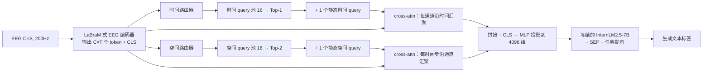

# UniMind：研究问题、架构与训练逻辑

> 版本：2026-11-14 / 论文笔记 v0.2。依据已保存的 arXiv v1 全文（2506.18962，含附录 A–D，从 `unimind.html` 提取）；尚未核对代码，未本地复现。作者写明“代码将会公开”，阅读时未确认。统一记号见[阅读约定](../process/文档维护与阅读约定.md)。

## 1. 作者要解决的问题

**问题陈述（作者观点）：** BIOT、LaBraM 需要逐任务微调；NeuroLM 把多个任务放进一个 LLM，但性能明显不如单任务方法（在 SEED、TUEV、SleepEDF 上落后 10% 以上）。作者归结为两个原因：

1. **EEG 与语言之间的模态鸿沟太大**：NeuroLM 只在“域”的层面做对抗对齐，没有建立语义层面的联系；
2. **任务之间的异质性**：通道、时长、时空活动模式都不同，不区分任务的混合训练会拖累个别任务。

**对应设计：**

- **神经–语言连接器（NLC）**：用两组可学习 query，分别从时间维和空间维，通过 cross-attention 从 EEG 嵌入中汇聚信息，再投影到 LLM 的嵌入空间（思路类似视觉–语言模型中的 Q-Former）；
- **任务感知 query 选择（TQS）**：维护一个 query 池，由路由器根据输入 EEG 动态挑选最合适的几个 query，让不同任务用不同的 query 组合。

**哪些已被实验支持：**

| 主张 | 证据 | 强度 |
|---|---|---|
| 多任务性能大幅超过 NeuroLM | Table 1：10 个数据集平均 67.50 vs 55.20 | 成立；但 UniMind 与 NeuroLM 的 LLM（InternLM2.5-7B vs GPT-2）、训练数据都不同 |
| 多任务首次追平单任务 | Table 1：平均 67.50 vs LaBraM 66.56 | 平均略高；SEED、SEED-IV、TUEV、SHU 上仍低于 LaBraM。平均值混合了 BACC 与 F1 |
| NLC 和 TQS 各有贡献 | Table 2：基线 65.77 → +NLC 68.38 → +NLC+TQS 70.67 | 较清楚的逐步消融 |
| 相关任务联合训练互相增强 | 图 7：6 对数据集，联合训练都优于单独训练 | 只有图 |
| 跨被试泛化 | — | **作者明确说明没有研究对完全未见被试的泛化** |

## 2. 输入与输出

- 输入：$X\in\mathbb R^{C\times S}$（$C$ 通道、$S$ 个采样点），200 Hz；外加一段任务提示文字。
- EEG 编码器“借自 LaBraM”：逐通道切成长 $t$ 的不重叠 patch，得到 $T=\lfloor S/t\rfloor$ 个时间步；时间编码器 + Transformer 输出 $E\in\mathbb R^{(C\cdot T+1)\times D_e}$（含一个 class token）。
- 输出：LLM 生成的文本标签。由于输出是文本、没有置信度，**AUROC 和 AUC-PR 无法计算**（作者在附录中明确说明），只报告 BACC、Cohen's Kappa、加权 F1。

## 3. 前向计算（逐步）

### 3.1 EEG 编码器

来自 LaBraM（时间卷积 + Transformer，需要 10-20 电极名查空间嵌入）。附录 Table 6 写 “EEG Hidden Size 1152、12 层、10 个头”，与 LaBraM-Base 的 200 维不一致，具体使用了哪个 checkpoint、编码器是否冻结，论文没有说清，需查代码。训练时“冻结 LLM，其余组件可训练”，共约 **8,759 万个可训练参数**。

### 3.2 TQS：任务感知 query 选择

- 时间、空间两个分支，各有一个大小为 **16** 的 query 池 $P$ 和一个路由器 $R$（两层 MLP）；
- 路由器根据输入的 EEG 嵌入 $E$ 给池中每个 query 打分，取得分最高的 Top-K 个：$q^i_a=\mathrm{TopK}(P_i,\ S=R_i(E))$，$i\in\{t,s\}$；
- 默认取 **空间 2 个、时间 1 个**自适应 query；
- 另外每个分支再加 **1 个静态 query**（所有样本共享，捕捉稳定特征）：$Q_i=[q^i_a;\ q^i_{st}]$。

### 3.3 NLC：神经–语言连接器

把 $E$ 分别重排成时间视角 $E_t\in\mathbb R^{C\times T\times D_e}$ 和空间视角 $E_s\in\mathbb R^{T\times C\times D_e}$，各用一层 8 头 cross-attention：

$$F_t=\mathrm{CrossAttn}(Q_t,E_t)\in\mathbb R^{n_{qt}\times C\times D_e},\qquad F_s=\mathrm{CrossAttn}(Q_s,E_s)\in\mathbb R^{n_{qs}\times T\times D_e}$$

- 时间 query 对**每个通道**沿时间维汇聚，输出每通道 $n_{qt}$ 个向量；
- 空间 query 对**每个时间步**沿通道维汇聚，输出每时间步 $n_{qs}$ 个向量；
- 拼接上 class token：$F=\mathrm{Concat}(F_t,F_s,F_{cls})$，长度 $n_{qt}C+n_{qs}T+1$；
- 经两层 MLP 投影到 LLM 的隐藏维（4096），得到 $F'$。

注意：输出长度仍随 $C$ 和 $T$ 线性增长（不是像 Q-Former 那样压缩成固定数量的 token）。

### 3.4 LLM 解码

输入序列 $[F',\ \texttt{[SEP]},\ \text{任务提示}]$，**冻结的 InternLM2.5-7B** 以因果语言模型方式生成标签，只在答案 token 上算交叉熵：

$$\mathcal L=-\sum_{i=1}^L\log p(t_{a,i}\mid X,\ t_{a,<i})$$

每类任务设计 10 种不同的提示语，训练时随机选一种。

## 4. 训练逻辑

- **没有新的自监督预训练阶段**：直接用 LaBraM 的编码器 + 冻结的 LLM，在 10 个下游数据集合成的指令数据集（共约 92.9 万个样本）上做多任务指令微调；
- 每个 mini-batch 只来自一个数据集，各数据集轮流；
- AdamW，学习率 4e-5，余弦调度，warmup 3%，batch 128，**10 epoch**，bf16，最大序列长度 4096；
- 8 张 A800：InternLM-0.5B 约 7.3 小时，1.8B 约 8.4 小时，7B 约 21.8 小时。

## 5. 下游评测设置（附录 A）

| 数据集 | 任务 | 通道 / 时长 | 划分 | 是否跨被试 |
|---|---|---|---|---|
| TUAB、TUEV | 临床异常、事件 | 23 / 10 s、5 s | 自带训练/测试，训练被试 8:2 | 是 |
| TUSL | 慢波事件 | 23 / 10 s | **随机** 60:20:20（245 个样本） | 未说明 |
| SEED、SEED-IV | 情绪 | 62 / 1 s | trial 按时间顺序 9:3:3 / 16:4:4，合并所有被试 | **否** |
| HMC | 睡眠 | 4 / 30 s | 按被试编号 | 是 |
| SleepEDF、SHHS | 睡眠 | **1 通道** / 30 s | 被试随机 8:1:1 | 是 |
| Workload | 认知负荷 | 19 / 4 s | 按被试编号 | 是 |
| SHU | 运动想象 | 32 / 4 s | **session** 3:1:1 | **否** |

- SEED、HMC、TUEV、TUSL 沿用 NeuroLM 的划分并**直接引用 NeuroLM 报告的基线数值**；其余数据集由作者按自己的划分重新实现基线。
- 预处理：0.1–75 Hz 带通，FFT 识别工频后在 50 或 60 Hz 陷波，重采样 200 Hz；多数数据集做 z-score，SHU 用 95 百分位归一化。

## 6. 实验结果与可支持的结论

**Table 1（BACC %，节选）：**

| 数据集 | BIOT | LaBraM（单任务） | NeuroLM（多任务） | UniMind（多任务） |
|---|---|---|---|---|
| SEED | 70.97 | **73.18** | 60.34 | 70.55 |
| HMC | 68.62 | 72.86 | 67.37 | **75.27** |
| TUAB | 79.59 | 81.40 | 79.69 | **81.76** |
| TUEV | 52.81 | **64.09** | 46.79 | 63.19 |
| Workload | 66.55 | 66.09 | 63.45 | **78.67** |
| TUSL | 57.58 | 76.25 | 68.45 | **78.95** |
| SEED-IV | 36.19 | **47.63** | 32.30 | 45.56 |
| SleepEDF | 64.95 | 68.96 | 56.40 | **72.98** |
| SHHS | 72.22 | 71.69 | 59.15 | **74.00** |
| SHU | 59.16 | **67.90** | 59.36 | 65.77 |

**消融（Table 2–4、图 3–4）：**

- 组件：基线（一组固定 query 从整个序列汇聚）65.77 → 加 NLC（时空分离）68.38 → 再加 TQS 70.67。TQS 在 Workload 上贡献最大（70.66 → 78.67）；
- query 类型：只用静态 68.37，只用自适应 69.34，两者结合 70.67；
- 自适应 query 数量：空间 2 + 时间 1 最好，更多反而下降；
- query 池大小：16 最好（太小则任务之间相互干扰，太大则相似任务之间不共享）；
- LLM 规模：0.5B / 1.8B / 7B，越大在 SEED、TUEV 上越好，但 TUSL 上越差（只有 245 个样本，容易过拟合）。

注意 Table 2 中“+NLC+TQS”的数值（如 TUEV 63.19）与 Table 1 一致，而 Table 2 的平均 70.67 与 Table 1 的平均 67.50 不同：Table 1 的平均同时包含 BACC 和 F1，Table 2 只算 BACC。

**任务间关系（图 5–7）：** 路由器的打分在不同数据集之间形成清晰的聚类；同领域任务（TUAB/TUEV、SEED/SEED-IV、SHHS/HMC）选择相似的 query；部分跨领域任务也相似（例如睡眠与认知负荷的空间 query 使用相似度超过 75%）。作者据此给出神经科学解释，这部分是**解释性的**，未经独立验证。

## 7. 局限、疑点与未读懂的部分

1. **作者明确承认**：没有研究对完全未见被试和新任务的泛化。
2. **部分数据集是被试内划分**（SEED、SEED-IV、SHU），TUSL 是随机划分。
3. **无法计算 AUROC、AUC-PR**：输出是文本，没有置信度。
4. **基线数值来源混合**：一部分引用 NeuroLM，一部分自行重跑。
5. **EEG 编码器的细节不清**：隐藏维 1152 与 LaBraM-Base 不符；是否冻结未说明。
6. **与 NeuroLM 的比较不是单一变量**：LLM（7B vs GPT-2）、是否有自回归预训练、数据集都不同。
7. **SleepEDF、SHHS 只有 1 个通道**，空间 query 在这种情况下的作用不明。

## 8. 与本赛题规格的事实对照

此节只列事实，不构成方案选择。

| 方面 | UniMind 的情况 | 赛题情况 |
|---|---|---|
| 采样率 | 200 Hz | 200 Hz |
| 通道 | LaBraM 式电极名查表 | 接口是否提供导联名称**待确认** |
| 输出 | 文本标签，无法计算 AUROC / AUC-PR | 主指标 BACC；辅助指标含 PR-AUC、ROC-AUC |
| 划分 | 混合，部分被试内 | 全部按被试 8:1:1 |
| 多任务单模型 | 核心卖点 | 是否要求提交统一模型**待确认** |
| 模型规模 | 冻结 7B LLM + 约 8,800 万可训练参数 | 决赛官方算力，配额待确认；决赛不得加载任何预训练权重（包括 LLM） |
| 权重 | 论文写“将公开”，未核实 | 复赛只能用公开可下载的权重 |

## 9. 留给讨论的问题

- UniMind 的 TQS 让不同任务选择不同的 query。这与“同一个预训练编码器 + 每个任务单独的读出头”在本质上有什么区别？
- 决赛不得加载任何预训练权重，这对依赖预训练 LLM 的方法意味着什么？
- 附录说明输出为文本时无法计算 AUROC、AUC-PR。赛题的辅助指标要求什么样的模型输出？

## 原文与证据

- [UniMind（arXiv v1）](https://arxiv.org/html/2506.18962v1)：§2（式 1–4，图 2）、§3（Table 1–4，图 3–7）；附录 A（数据、划分、预处理、Table 5）、C（训练细节、Table 6–7）、D（完整结果）。项目页见本地 `unimind_project.html`。本地副本：`research/reve_route_20261113/sources/unimind.txt`、`unimind.html`。

- [原始资料目录](../../research/reve_route_20261113/sources/)
- [返回论文索引](README.md)
