# 初赛研究方案（草稿）

> 状态：2026-11-14 晚起草，**草稿 v0.1**。截止：11/15 12:00。
> 本稿按[报告模块结构](../competition/报告模块结构.md)组织。v0.2：模块 1–9 均已起草（2026-11-14 23 时）；方法采用用户确定的混合子空间方案。
> 标记说明：**【用户判断】** 是用户在讨论中给出的观点（见[讨论记录](../process/讨论记录.md)）；**【助手推断】** 是起草时补的推理，需要用户确认或删改；**【待定】** 是尚未决定的内容。所有数字都来自 `docs/papers/`、`docs/benchmarks/` 中的笔记，正式提交前需逐条回查原文。

---

## 0 封面（待填）

- 方案标题：【待定】暂拟“先诊断，后改进：面向跨任务 EEG 基础模型的频段正交子空间预测学习”
- 赛道：主赛道（覆盖全部 7 个分赛道）
- 队伍名称：【待填】
- 参赛人员：【待填】

---

## 1 赛道选择与研究动机

### 1.1 为什么选主赛道

本赛事的 7 个分赛道覆盖信号可靠性、疾病诊断、睡眠分期、认知与情绪、自然刺激解码、运动想象和 SSVEP。14 个下游数据集的通道数从 4 到 128，时长从 1 秒到 30 秒。分赛道考察的是“某一类任务做得好不好”；主赛道考察的是**同一个基础模型能否同时服务于性质差异很大的任务**。后者正是“基础模型”这一概念成立的前提，也是我们想研究的问题，因此选择主赛道。

### 1.2 问题的由来：从专用模型到基础模型

**专用模型的局限。** 传统 EEG 解码针对每种范式单独设计预处理、特征和分类器。EEGNet 等紧凑 CNN 把“滤波器组 + 空间滤波”写进网络结构，能跨范式使用，但每个模型绑定一种通道配置（空间卷积核大小等于通道数），不能跨布局迁移，也没有利用大规模无标注数据。

**EEG 数据本身的困难。** EEG 信噪比低；不同数据集的导联数、电极位置、参考方式、时长和采样率高度异构；被试之间差异大；功率谱大致服从 $1/f^\alpha$，能量集中在低频；有标注的数据量通常只有几十小时。

**基础模型的回应。** 为此出现了一系列在大规模无标注 EEG 上预训练的基础模型，分别处理异构输入和低信噪比问题，例如：

- BIOT 把逐通道片段拉平成序列；
- LaBraM 用神经 tokenizer 预测离散码；
- CBraMod 的 criss-cross 注意力把空间与时间分开建模；
- REVE 用电极坐标的 4D Fourier 位置编码支持任意布局，并在 6 万小时数据上预训练；
- FAME 把重建目标改为按频段标准化的时频活动。

### 1.3 基础模型仍然存在的问题

【用户判断】我们认为当前 EEG 基础模型最大的问题是：**准确率不稳定、表征空间缺乏可解释性、泛化能力没有被明确验证、下游评测困难**。归结起来，领域缺少对三件事的诊断：模型学到了什么，哪些设计真正在起作用，评测数字代表什么。下面逐条给出公开证据。

**(1) 准确率：并不稳定地超过专用小模型。**

- NeuralBench 的同一快照中，REVE 在运动想象（68.0%，第 1）和 SSVEP（96.1%，第 2）上很强；但在精神分裂症识别上只有 43.7%，最佳专用网络 ATCNet 为 72.9%；癫痫检测 77.6%，BDTCN 为 85.5%。
- ECHO 报告的 High-Gamma 运动想象中，EEGNet（0.832）高于 CBraMod（0.751）和 LaBraM（0.743）。
- 基础模型的优势随任务而异，“更大、更多数据”并不自动带来全面提升。LaBraM 的数据量实验中，Base 模型用 500 小时在 TUAB 上反而超过 2500 小时；FAME 报告扩大数据或规模后下游表现不稳定提升。

<figure style="text-align:center;margin:8pt 0">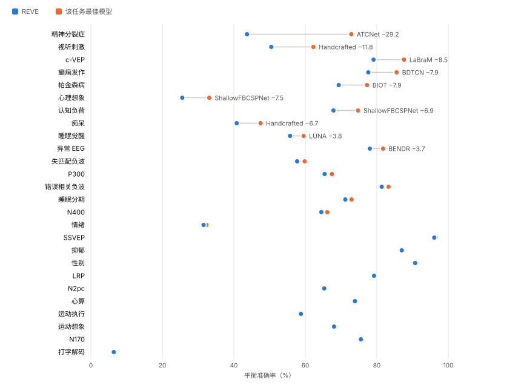<figcaption style="font-size:9pt;color:#52514e">图 1　NeuralBench 统一微调协议下，REVE 与各任务最佳模型的差距（数据：NeuralBench 官方结果，提交 fe31393）</figcaption></figure>

**(2) 表征：冻结表示普遍偏弱，学到了什么并不清楚。**

- 多个模型的作者承认，下游需要全量微调，冻结表示不够用：
  - LaBraM：TUEV 线性探测 0.346，全量微调 0.641；
  - CBraMod：冻结后 PhysioNet-MI 只有 0.385；
  - BrainOmni：冻结后 TUEV 从 0.618 降到 0.489。
- FAME 指出，现有预训练编码器普遍存在**低频偏置**：表示对高频成分的可恢复性更差。作者给出的机制是时域 MSE 重建按功率给各频率加权。
- REVE 的同一个模型换用不同读出方式（池化与不池化）后，各任务的结果差异明显（REVE Table 4）。FAME 的最佳读出层是第 9 层，而不是最后一层。这说明下游表现差，可能部分来自**读出**，而不全是**表征**本身。目前没有工作系统地区分这两者。
- Neuro-KE（NeurIPS 2026）也指出，原始 EEG 没有规范的 token 语义，模型可能保留了波形细节，却丢掉了有生理意义的结构；它把无需人工标注的 EEG 描述子转成掩码预训练的数值目标，在 12 个数据集、3 种骨干上相对只做重建平均提高 BAcc 2.60 个百分点（存在任务相关的例外）。这说明“把领域知识写进预训练目标”是有效的方向。
- 基础模型是否学到了不同时间、空间尺度的表征，是否包含并超出已知的神经科学先验（例如频段、节律、脑区分工），目前缺乏直接检验。

<figure style="flex:1;margin:0;text-align:center">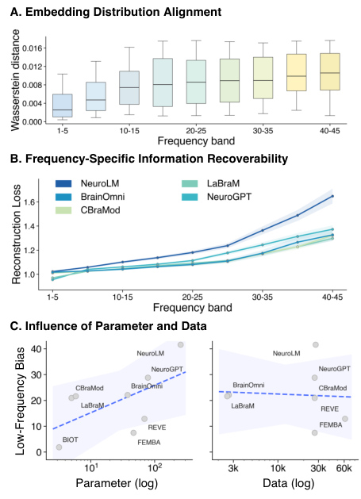<figcaption style="font-size:9pt;color:#52514e">图 2　现有预训练编码器偏向低频（图源：FAME Fig. 3）</figcaption></figure><figure style="flex:1;margin:0;text-align:center">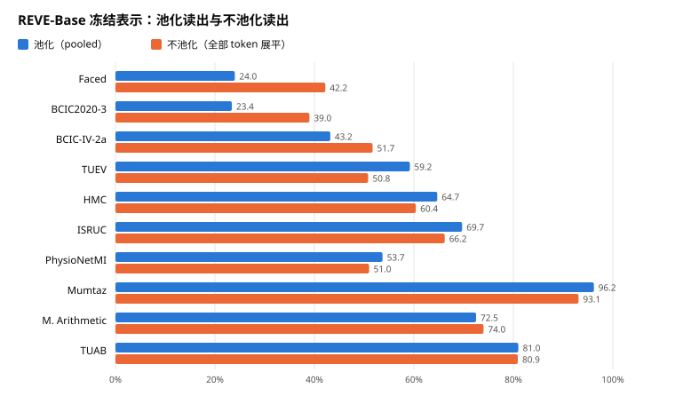<figcaption style="font-size:9pt;color:#52514e">图 3　同一冻结表示，只换读出方式（数据：REVE Table 4）</figcaption></figure>

**(3) 泛化：跨被试、回归和零样本适应没有被充分验证。**

- 同一个 EEG Conformer 在 BCI IV-2a 上被试内约 78.7%，跨被试只有 47.0%。评测协议对数值的影响，远大于模型之间的差异。
- **回归任务**：AdaBrain-Bench 唯一的回归任务 SEED-VIG（警觉度估计）在跨被试、全量微调设置下的 R² 如下。基础模型没有明显优于从零训练的 EEGNet，CBraMod 在该基准中几乎没有解释力；同一任务 CBraMod 原文报告的 R² 为 0.337，说明结果对复现设置高度敏感。

  | 模型 | R²（%） |
  |---|---|
  | EEGNet | 26.65 |
  | BIOT | 27.09 |
  | LaBraM | 25.35 |
  | EEGPT | 23.47 |
  | CBraMod | 2.40 |

- **零样本跨被试**：UniMind 作者明确说明没有研究对完全未见被试的泛化；ECHO 的上下文学习在测试时使用**测试被试本人的带标签支持样本**。“不使用目标被试标签时能否直接适应”这一点没有被验证。

<figure style="text-align:center;margin:8pt 0">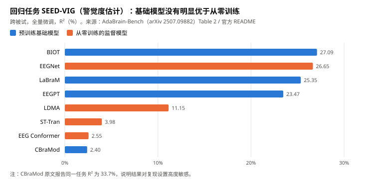<figcaption style="font-size:9pt;color:#52514e">图 4　回归任务 SEED-VIG：基础模型没有明显优于从零训练的模型（数据：AdaBrain-Bench Table 2）</figcaption></figure>

**(4) 评测：不同论文的数字往往不可比。**

- 划分方式不同：一些论文采用被试内划分，ISRUC 有时使用 20 个连续片段的序列上下文。
- “线性探测”的定义不同：EEGPT 的线性探测实际包含卷积层，在 BCIC-2A 上还并联了一个任务专用 CNN 分支。
- 模型选择方式不同：EEG Conformer 公开代码每个 epoch 都在测试集上评估，并记录最高准确率。
- 同一模型在不同论文中的数值不一致，例如 CBraMod 在 CSBrain 表中与其原文不同。
- 适配方式差异巨大：OmniEEG-Bench 的 SSVEP 上，REVE 线性探测 5.6%，全量微调 67.4%；而 NeuralBench 中 REVE 的 SSVEP 达到 96.1%。
- 【用户判断】此外，指标在真实场景中是否有意义也值得追问。例如运动想象是瞬时任务，逐窗口预测容易出现标签“闪动”噪声，平衡准确率反映不出这一点。

<figure style="flex:1;margin:0;text-align:center">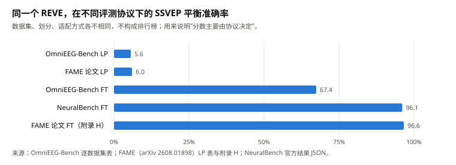<figcaption style="font-size:9pt;color:#52514e">图 5　同一个 REVE，不同协议下的 SSVEP 分数</figcaption></figure><figure style="flex:1;margin:0;text-align:center">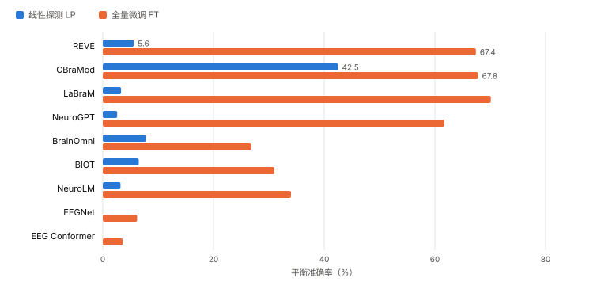<figcaption style="font-size:9pt;color:#52514e">图 6　OmniEEG-Bench：线性探测与全量微调的差距</figcaption></figure>

### 1.4 我们想研究的问题，以及与赛道的关系

【用户判断】基于上述问题，本方案采取“**先诊断，后改进**”的思路，诊断分三层：

1. **表征层**：基础模型是否学到了不同时间、空间尺度的表征？是否包含、甚至超出神经科学先验？【用户判断】Neuro-KE 可以作为对这一问题的回应：成熟的 EEG 描述子既能用来**检查**表示（探测表示中是否保留了有生理意义的结构），也能用来**监督**表示（作为预训练目标）。
2. **设计层**：现有模型的各项设计中，哪些是针对 EEG 特殊性提出的，哪些有深度学习理论支撑？
3. **评测层**：评测指标在真实场景中是否有意义？

【助手推断】主赛道恰好提供了诊断所需的条件：同一套被试隔离的 8:1:1 划分、固定种子、统一的验证集选择规则，覆盖 7 类频段特性和时间尺度差异很大的任务。例如 SSVEP 依赖稳定的高频响应，睡眠分期依赖 30 秒的慢节律，运动想象依赖 μ/β 节律的瞬时变化。如果一个改进只对某类任务有效，主赛道的结构能把这一点暴露出来。

---

## 2 相关工作

本节按“解决什么问题”组织，不按时间顺序。各工作的详细笔记见 [`docs/papers/`](../papers/README.md)。

### 2.1 任务专用的有监督模型

- **EEGNet**（Lawhern et al., J. Neural Eng. 2018）：用深度可分离卷积实现“时间滤波器组 + 频段特异的空间滤波”，约 1–2k 参数，在 P300、ERN、MRCP、运动想象 4 种范式上与参考方法相当。通道数是架构参数，不能跨布局。
- **EEG Conformer**（Song et al., IEEE TNSRE 2023）：ShallowConvNet 式的卷积前端加 6 层 Transformer，用卷积提取局部特征、自注意力建模全局关系；从零有监督训练。
- 这两者是基础模型论文中最常用的监督基线，也是本赛题实验计划中的必要对照。

### 2.2 EEG 基础模型：如何统一异构输入

| 工作 | 输入如何统一 | 位置 / 通道信息 |
|---|---|---|
| BIOT（NeurIPS 2023） | 逐通道片段的 FFT 能量 token 拉平成序列，线性注意力 | 通道查表嵌入 |
| LaBraM（ICLR 2024） | 通道 × 1 秒 patch | 按电极编号查表 |
| CBraMod（ICLR 2025） | 通道 × 时间 patch，空间与时间注意力并行 | 卷积生成的条件位置编码（ACPE），只需通道顺序 |
| EEGPT（NeurIPS 2024） | 先跨通道、再跨时间的分层结构 | 通道名码本 |
| BrainOmni（2025） | 传感器编码器 + cross-attention 压缩成 16 个潜在源 | 电极三维坐标、方向、类型 |
| CSBrain（2025） | 每层交替做多尺度时空 token 化（CST）和结构化稀疏注意力（SSA） | 按解剖脑区分组 |
| **REVE**（2025） | 保留观测通道，全局注意力 | 电极坐标 + 时间的 **4D Fourier 位置编码**，可处理未见布局 |

REVE 指出，以往模型的预训练语料多来自 TUH 的固定 19/21 导联，查表或卷积式位置编码难以覆盖未见布局。REVE 用 92 个数据集、约 6 万小时数据预训练（CBraMod 约 9 千小时，LaBraM 约 2.5 千小时），并强调冻结表示的可用性。

<figure style="text-align:center;margin:8pt 0">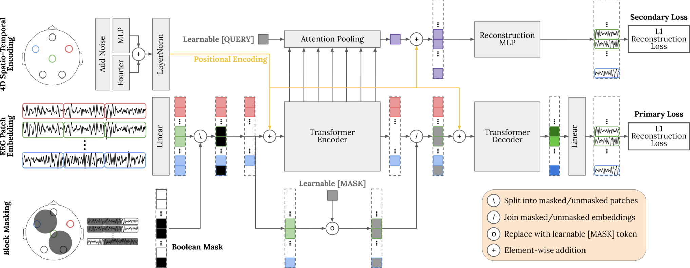<figcaption style="font-size:9pt;color:#52514e">图 7　REVE 预训练框架：4D Fourier 位置编码、块状掩码、主重建与辅助全局 token 重建（图源：REVE Fig. 1）</figcaption></figure>

<figure style="flex:1;margin:0;text-align:center">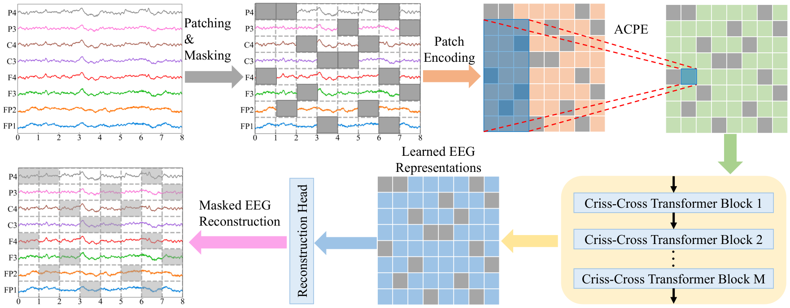<figcaption style="font-size:9pt;color:#52514e">图 8　CBraMod：criss-cross 注意力的预训练（图源：CBraMod Fig. 2）</figcaption></figure><figure style="flex:1;margin:0;text-align:center">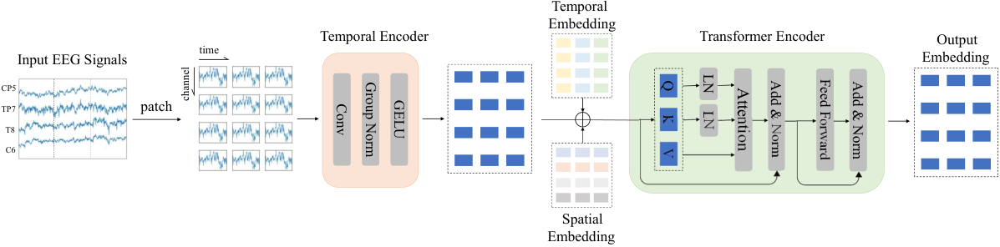<figcaption style="font-size:9pt;color:#52514e">图 9　LaBraM：通道 × 1 s patch 与时空嵌入（图源：LaBraM Fig. 1）</figcaption></figure>

<figure style="flex:1;margin:0;text-align:center">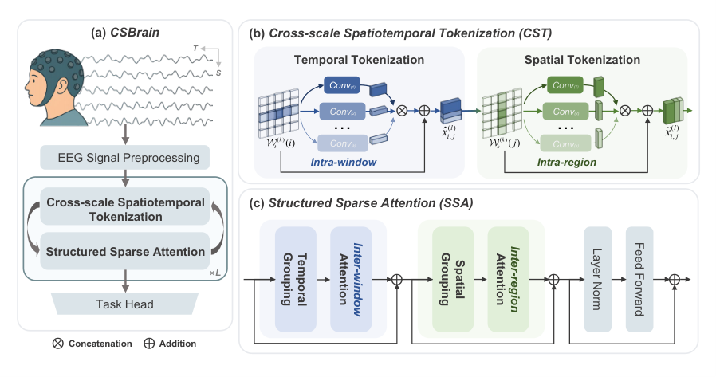<figcaption style="font-size:9pt;color:#52514e">图 10　CSBrain：多尺度 token 化与结构化稀疏注意力（图源：CSBrain Fig. 2）</figcaption></figure><figure style="flex:1;margin:0;text-align:center">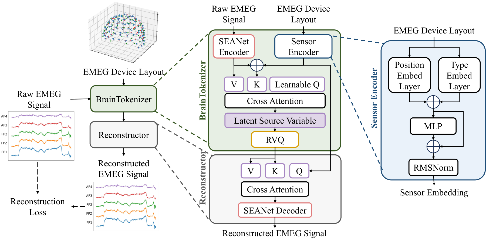<figcaption style="font-size:9pt;color:#52514e">图 11　BrainOmni：传感器编码器与潜在源 tokenizer（图源：BrainOmni Fig. 1）</figcaption></figure>

<figure style="text-align:center;margin:8pt 0">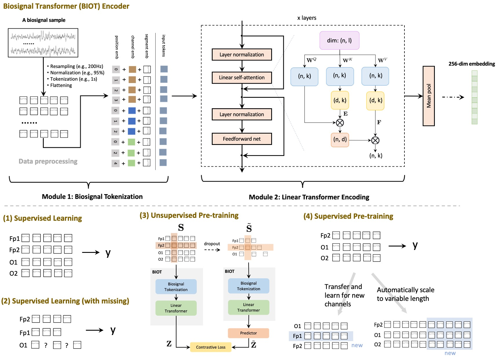<figcaption style="font-size:9pt;color:#52514e">图 12　BIOT：逐通道片段 token 化与线性 Transformer（图源：BIOT Fig. 1）</figcaption></figure>

### 2.3 EEG 基础模型：预训练预测什么

| 预测对象 | 代表工作 | 要点 |
|---|---|---|
| 原始波形 | REVE（L1 重建 + 全局 token 辅助损失）、CBraMod（掩码重建） | 简单直接；FAME 认为 MSE 重建会按功率放大低频监督 |
| 离散码 | LaBraM（VQ tokenizer 预测傅里叶幅值 / 相位，再预测被掩码的码）、BrainOmni（RVQ） | LaBraM 报告直接重建原始波形时不收敛；但其消融结果分裂：TUEV 上码本目标更好，TUAB 上原始波形更好 |
| 按频段标准化的时频活动 | **FAME**（2026） | 各频段对数功率分别标准化、等权，使每个频段的监督强度与其功率无关；13 个任务平均 61.4%，REVE 为 60.9% |
| 潜在表示 | **EEGPT**（动量编码器 + 预测器的表示对齐，JEPA 式）、S-JEPA | 在表示空间而非原始信号上设目标；EEGPT 去掉对齐损失后，BCIC-2A 从 0.585 降到 0.529 |
| 对比预测 | BENDR（wav2vec 2.0 式）、BIOT 的无监督预训练 | 避免逐点重建；BENDR 作者承认多数任务不及针对性方法 |

<figure style="text-align:center;margin:8pt 0">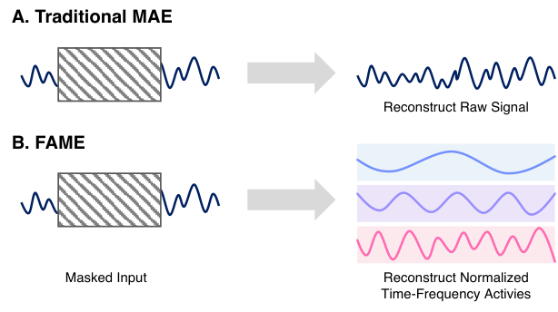<figcaption style="font-size:9pt;color:#52514e">图 13　FAME：传统波形重建 vs 按频段平衡的重建（图源：FAME Fig. 2）</figcaption></figure>

### 2.4 把领域知识写进监督信号

- **Neuro-KE**（NeurIPS 2026）：无需额外人工标注地计算 EEG 描述子，转成三种按范式区分的监督：掩码预训练的数值预测目标、EEG–文本对齐的特征状态文本锚、EEG 多模态大模型的特征依据回答。相对只做重建的掩码预训练，12 个数据集、3 种骨干上平均 BAcc +2.60；EEG–文本验证 BAcc 相对只用标签锚 +2.23。
- FAME 的按频段标准化目标，也可以看作同一思路的一个特例：用“频段功率”这一领域知识重新定义重建目标。
- 【助手推断】本方案与这条路线的区别在于：不只是增加知识目标，而是把目标按“频段 × 尺度”组织进可检查的子空间，并让下游任务以可读的门控权重选择使用哪些子空间。（Neuro-KE 正文未读，此对比需核实后再定稿。）

### 2.5 一个模型、多个任务：更强的解码器

- **NeuroLM**：把 EEG 码加入 GPT-2 词表，通过指令微调做多任务；所有任务都低于单任务的 LaBraM。
- **UniMind**：用时空 query 连接器和任务感知 query 选择接入 7B LLM；10 个数据集平均 67.50，略高于 LaBraM 的 66.56，但部分数据集仍落后。
- **ECHO**：序列到序列解码器，通过上下文中的带标签支持样本完成上下文学习。

【用户判断】这一分支是一个有趣的技术方向：它们希望借助泛化能力已被验证的解码器，解决“编码器或许已学到有用表征，但无法在下游任务上用好”的问题；但目前本身竞争力不足。【助手推断】它们共同暗示了一个可检验的问题：下游表现差，是**表征瓶颈**还是**读出瓶颈**。

<figure style="flex:1;margin:0;text-align:center">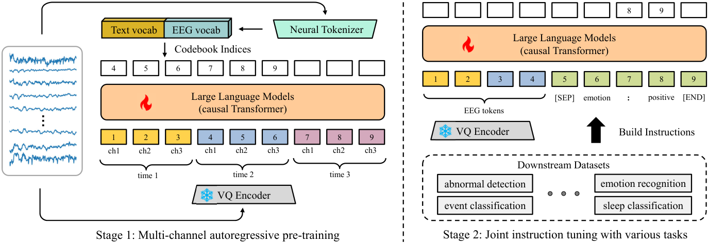<figcaption style="font-size:9pt;color:#52514e">图 14　NeuroLM：多通道自回归与指令微调（图源：NeuroLM Fig. 3）</figcaption></figure><figure style="flex:1;margin:0;text-align:center">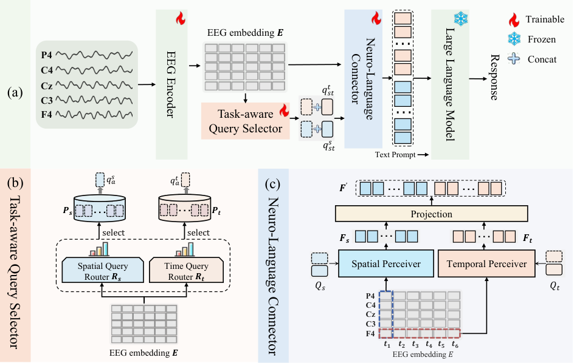<figcaption style="font-size:9pt;color:#52514e">图 15　UniMind：神经–语言连接器与任务感知 query 选择（图源：UniMind Fig. 2）</figcaption></figure>

<figure style="text-align:center;margin:8pt 0">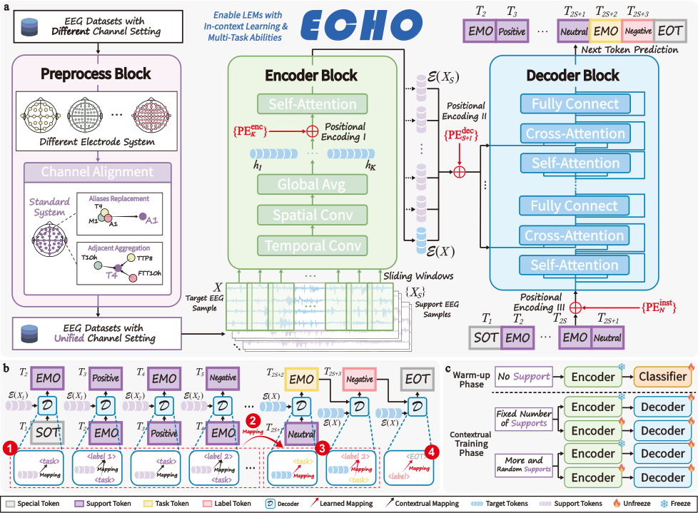<figcaption style="font-size:9pt;color:#52514e">图 16　ECHO：带支持样本的序列到序列解码（图源：ECHO Fig. 2）</figcaption></figure>

### 2.6 潜在预测与结构化表征（非 EEG 领域）

- **JEPA-Anything**（arXiv 2609.20800）：提出正交预测分解（OPF），把潜在空间分为若干相互正交的可学习子空间，各子空间分别做预测，并用正交约束 $\sum_k\|P_k^\top P_k-I\|_F^2+\sum_{i<j}\|P_i^\top P_j\|_F^2$ 防止信息混叠。子空间的含义不预先指定。
- **LocaLeJEPA**（arXiv 2610.28458）：把 LeJEPA 的全局分布匹配正则（SIGReg）改为 k-means 邻域内的局部匹配。
- **H-JEPA**（arXiv 2610.06805）：按时间分层的世界模型。每层以步长对下层潜变量下采样，并有自己的编码器、潜空间和预测器，各层端到端联合训练。探测显示，层级越高越丢弃快变特征；这种分工只在快慢成分的频率差距约 2 倍以上时出现。
- 其他多时间尺度模型：Clockwork VAE（各层以不同速率更新）、MTS3（快、慢两个状态空间模型）。

【助手推断】这些工作给出了两件 EEG 基础模型尚未系统使用的工具：**正交子空间**（让不同因素在表征中可分离、可检查）和**按尺度分层的潜在预测**（让不同时间尺度在表征中各有位置）。

<figure style="flex:1;margin:0;text-align:center">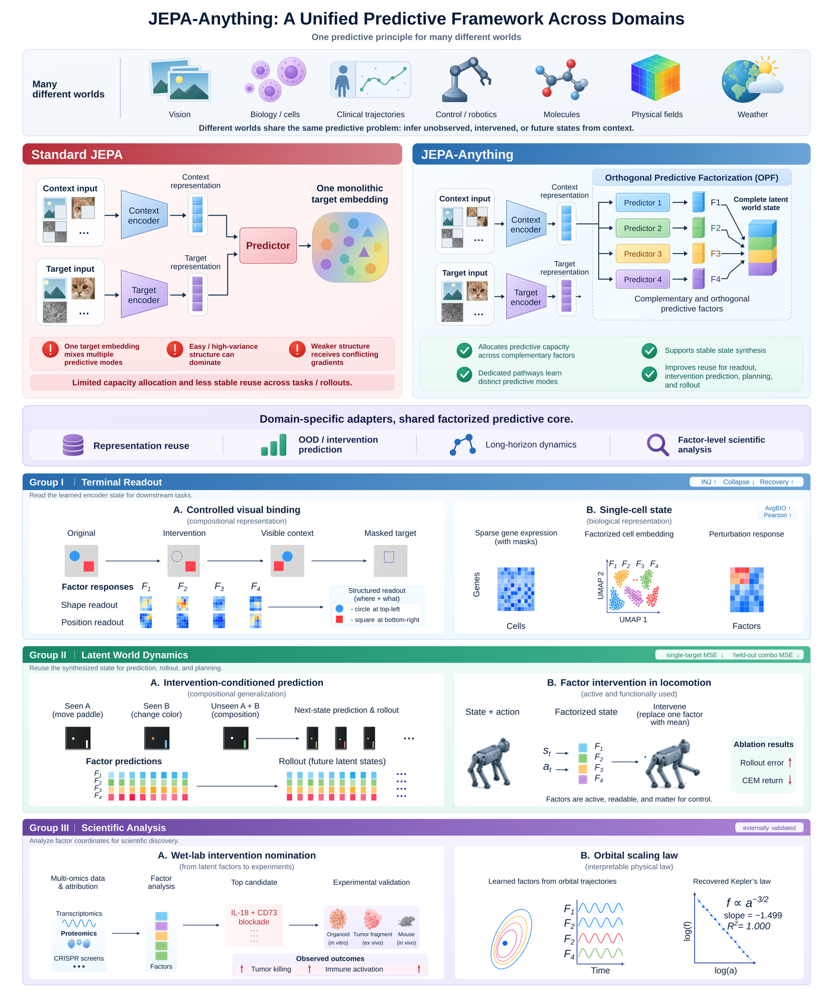<figcaption style="font-size:9pt;color:#52514e">图 17　JEPA-Anything：正交预测分解（图源：JEPA-Anything Fig. 1）</figcaption></figure><figure style="flex:1;margin:0;text-align:center">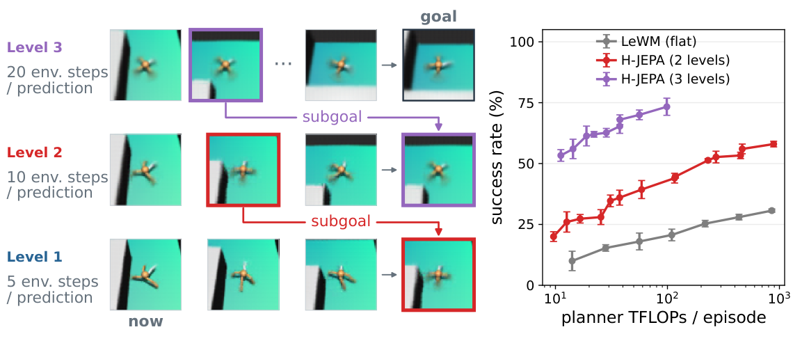<figcaption style="font-size:9pt;color:#52514e">图 18　H-JEPA：按时间分层的潜在世界模型（图源：H-JEPA Fig. 1）</figcaption></figure>

<figure style="text-align:center;margin:8pt 0">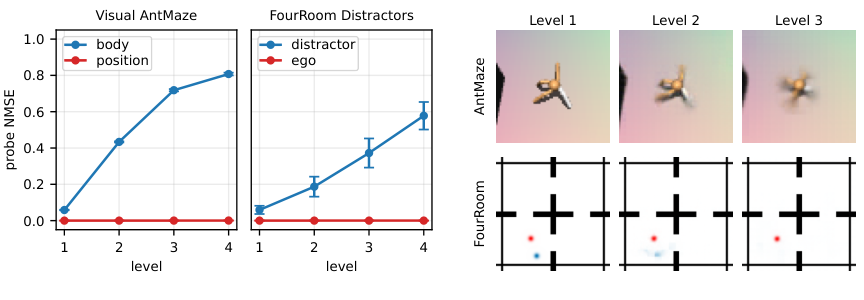<figcaption style="font-size:9pt;color:#52514e">图 19　H-JEPA：层级越高越丢弃快变特征（图源：H-JEPA Fig. 4）</figcaption></figure>

### 2.7 评测基准

- **OmniEEG-Bench**（arXiv 2606.00815）：与本赛事最接近的任务体系，以跨被试线性探测为主，另有全量微调分析。
- **NeuralBench**（arXiv 2605.08495）：多任务、多模型的统一评测，包含专用网络与基础模型。
- **AdaBrain-Bench**（arXiv 2507.09882）：包含跨被试、多被试、少样本设置，以及唯一的回归任务 SEED-VIG。

---

## 3 方法理解与比较

### 3.1 比较维度

我们从四个维度比较现有方法，每个维度对应 1.3 节的一个问题：

1. **输入统一**：如何处理不同的通道数、电极布局和时长（泛化问题）；
2. **预训练目标**：在什么空间里设监督信号，各频段得到的监督是否均衡（表征问题）；
3. **读出与适配**：下游用冻结表示还是全量微调，读出取哪一层、是否池化（读出瓶颈）；
4. **证据强度**：作者的主张中，哪些有受控消融支持，哪些只有不同协议下的分数比较（评测问题）。

### 3.2 主要方法的核心思路、适用条件与局限

| 方法 | 核心思路 | 已有较强证据支持的 | 局限 / 未被证明的 |
|---|---|---|---|
| EEGNet | 卷积实现滤波器组 + 空间滤波 | 参数极少；小数据、被试内表现好；部分任务上不输基础模型 | 通道数固定；无预训练；部分任务很弱（FAME 附录中 SSVEP 只有 8.5%） |
| LaBraM | 神经 tokenizer + 掩码码预测 | 在 TUEV 上码本目标优于直接重建 | TUAB 上结论相反；冻结表示弱；“越大越好”只在两个 TUH 数据集上 |
| CBraMod | 空间 / 时间注意力分离 + ACPE | 在同设置重新预训练的比较中，criss-cross 优于全注意力 | 需要全量微调；ACPE 相对普通 CPE 的增益很小；不同论文中数值不一致 |
| EEGPT | 掩码重建 + 动量编码器表示对齐 | 对齐损失有明确增益 | “线性探测”包含卷积和任务专用分支，与其他模型的线性探测不可比 |
| CSBrain | 多尺度 token 化 + 结构化稀疏注意力 | 16 个数据集宏平均高于 CBraMod | 多尺度消融只用 30% 数据且只有图；时间尺度为片段级，不处理 1 秒以内 |
| BrainOmni | 传感器编码器 + 潜在源 + RVQ | 去掉传感器嵌入明显下降 | 潜在源压缩的效果因任务而异；冻结在 TUEV 上大幅下降 |
| **REVE** | 4D Fourier 位置编码 + 块掩码 L1 重建 + 全局 token 辅助损失；6 万小时数据 | 可处理未见布局与更长输入；冻结表示较强；预训练对其帮助大（PhysioNet-MI 0.541 → 0.648） | 4D 位置编码相对可学习位置编码在已见配置上只高 0.006，价值主要在可扩展性；读出方式影响大；部分疾病任务落后专用网络 |
| **FAME** | 按频段标准化、等权的时频重建目标 | 受控小实验中各频段学习更均衡；13 任务平均略高于 REVE | 平均差距小，未证明显著；预训练数据不含 SSVEP；最佳层为中间层 |
| NeuroLM / UniMind / ECHO | 用 LLM 或通用解码器做多任务 / 上下文学习 | 一个模型可完成多个任务；UniMind 的连接器有清楚的逐步消融 | 依赖大型预训练解码器；未验证对未见被试的泛化；ECHO 测试时使用目标被试标签 |

【用户判断】在这些方法中，**REVE** 的数据处理方式兼顾了 EEG 数据的特点（任意布局、坐标化位置），整体最强；**FAME** 的训练方法最值得借鉴。但 FAME 与 REVE 的架构不同，两者的收益不能直接比较。

【助手推断】FAME 图 3(C) 中，REVE 的低频偏置在已评估模型中属于较低一档（目测读数约 13）。因此“REVE 的 L1 重建是否已部分缓解低频偏置”本身是一个需要实验回答的问题，不能直接假设 FAME 的目标会给 REVE 带来同样的增益。

### 3.3 为什么不直接比较公开分数

按评审细则，不能依据不可比的结果判断优劣。公开分数之间存在以下差异：

1. **划分**：被试内与跨被试（EEG Conformer 在 BCI IV-2a 上差 30 个百分点）；
2. **上下文**：ISRUC 使用 20 个连续片段的序列；
3. **适配方式**：线性探测与全量微调（REVE 在 OmniEEG-Bench 的 SSVEP 上相差 60 个百分点以上）；“线性探测”的定义也不统一（EEGPT）；
4. **模型选择**：是否在测试集上选模型（EEG Conformer 公开代码）；
5. **复现差异**：同一模型在不同论文中的数值不同（CBraMod）；
6. **额外信息**：是否使用目标被试的标签（ECHO）、是否用到下游训练集标签预训练（BIOT 常被引用的 TUAB/TUEV 数值来自用这两个数据集标签做过有监督预训练的版本）。

因此，本方案中所有“谁更好”的判断，都以**本赛题的统一协议**（被试 8:1:1、3 个固定种子、验证集 BACC 选权重）下的实验为准。公开分数只用于提出假设。

---

## 4 研究见解与研究问题（草稿，待用户定稿）

### 4.1 从调研中形成的见解

1. **下游表现差，未必全是表征的问题。**【用户判断】REVE 换读出方式后各任务差异明显；FAME 的最佳读出层在中间层；多个模型冻结后很弱，但全量微调后可用。下游表现差，可能有一部分来自**读出**。
2. **表征中有没有、有多少神经科学结构，目前没人能回答。**【用户判断】Neuro-KE 指出，模型可能保留了波形细节，却丢掉了有生理意义的结构；它同时证明，无需人工标注的 EEG 描述子既能用来**检查**表示，也能用来**监督**表示。
3. **EEG 的关键信息分布在不同频段和不同时间尺度上，但现有表征把它们混在一起。** FAME 证明了预训练目标对各频段的监督不均衡；CSBrain 证明了尺度的重要性；但没有一个模型的表征能告诉我们，某个任务用了哪个频段、哪个尺度的信息。
4. **频段与尺度相关但不等价。**【用户与合作者讨论的结论】同一频段（如 γ）的活动强度可以在秒级缓慢变化，所以尺度不应是一个独占的子空间，而是观察同一信息的范围。二者之间真实的约束是时间–频率不确定性：短窗口无法表示低频。
5. **贡献应来自方法，而不是推翻架构。**【用户判断】REVE 的数据处理方式（坐标式位置编码、任意布局）已兼顾 EEG 的特点，是最强的公开基础；改进应以“保留其权重、在其上拼接”的方式实现。

### 4.2 研究问题

由此提出一个总问题和三个可检验的子问题：

> **总问题：** 把 EEG 表征组织成“以频段为锚、在多个尺度上表达、由任务按需读取”的结构，能否在不牺牲通用性的前提下提高跨任务、跨被试的下游表现，并让表征可以被检查？

- **RQ1（表征）：** REVE 的各层表示，在哪些频段、哪些尺度上保留了可恢复的生理描述子？下游的差距有多少来自表征，有多少来自读出？
- **RQ2（方法）：** 在继续预训练中加入“频段锚定子空间 + 自由子空间”的混合结构，以及可变长度 patch 之间的跨尺度注意力，能否提高 14 个下游数据集的平衡准确率？锚定子空间与自由子空间各自贡献多少？
- **RQ3（任务）：** 不同任务学到的“频段 × 尺度”读取权重，是否与已知的神经生理规律一致（例如 SSVEP 偏高频、睡眠偏慢节律、运动想象偏 μ/β）？自由子空间是否学到了已知描述子解释不了的信息？

RQ1 是“诊断”，RQ2 是“改进”，RQ3 检验改进后的表征是否真的可解释。三者都可以在复赛中回答，回答结果决定决赛的设计（见 5.3、6.3）。

---

## 5 方法设计

### 5.1 整体框架

**一句话概括：** 保留 REVE 编码器，在其上拼接三个结构：（1）频段锚定与自由的混合正交子空间；（2）可变长度 patch 与零初始化的跨尺度注意力；（3）按任务读取“频段 × 尺度”的门控读出。所有新增模块都**零初始化或以门控残差接入**，使继续预训练的第 0 步与原版 REVE 完全一致。

<figure style="text-align:center;margin:8pt 0">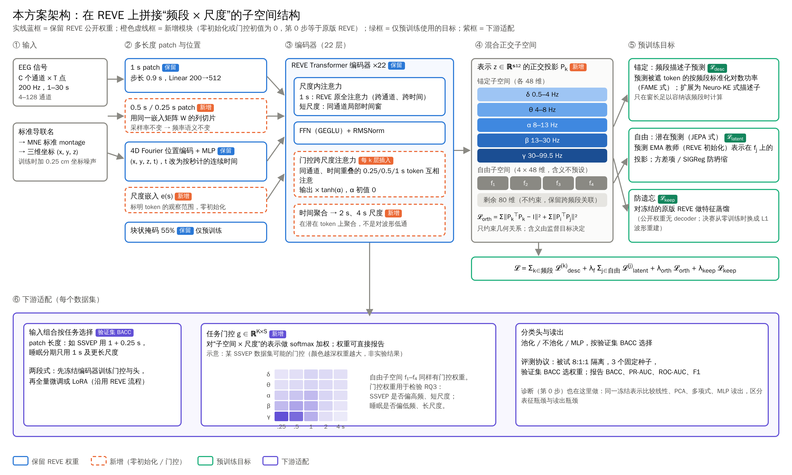<figcaption style="font-size:9pt;color:#52514e">图 20　本方案架构：保留 REVE 编码器，拼接多长度 patch、门控跨尺度注意力、混合正交子空间与任务门控读出</figcaption></figure>

**输入与通道处理。** 输入为 200 Hz 的 $C\times T$ EEG 和各通道的标准导联名；坐标取自 MNE 标准 montage（REVE 的位置库也按导联名查坐标）。【待确认】赛题接口是否提供导联名；双极导联需要单独的坐标映射规则。

**组件一：保留的 REVE 编码器。** 22 层、512 维、8 头的 Transformer，4D Fourier 位置编码，公开权重 MIT 许可。我们只做两处兼容性修改：时间坐标由 patch 序号改为按秒计的连续时间；增加一个零初始化的尺度嵌入。

**组件二：可变长度 patch 与跨尺度注意力。**

- 1 s patch 使用 REVE 原嵌入层；0.5 s、0.25 s 的 patch 使用原嵌入矩阵 $W\in\mathbb R^{512\times200}$ 中对应时长的列切片，相当于把短片段补零放进 1 s 窗口。这样采样率和频率语义不变，1 s 的预训练权重完全保留。（不能像图像中的 FlexiViT 那样插值缩放，否则频率会被错误地压缩。）
- 注意力分两类交替进行：**尺度内注意力**对 1 s 尺度就是 REVE 原来的全注意力；短尺度只在同一通道的局部时间窗内做，控制计算量。**跨尺度注意力**在同一通道、时间范围重叠的不同尺度 token 之间进行，每隔 $k$ 层插入一层，带 tanh 门控且初值为 0（借鉴 Flamingo）。
- 分工：1 s 尺度承担跨通道、跨时间的全局信息；短尺度提供时间细节，通过跨尺度注意力与 1 s 尺度交换。更长的尺度（2 s、4 s）通过在 1 s token 上做时间方向的聚合得到。

**组件三：混合正交子空间。** 在编码器输出 $z\in\mathbb R^{512}$ 上学习投影 $P_k\in\mathbb R^{512\times r}$，分两类：

- **锚定子空间**（$k\in\{\delta,\theta,\alpha,\beta,\gamma\}$）：每个子空间预测被遮 token 在对应频段的描述子。主干目标为按频段标准化的对数功率（FAME 式）；扩展目标为更多 Neuro-KE 式描述子。描述子只在物理上有意义的尺度上计算：窗口太短的尺度不挂低频段（如 0.25 s 不挂 δ）。
- **自由子空间**：不指定含义，只做 JEPA 式潜在预测——预测器根据可见 token，预测被遮 token 在 EMA 教师（以 REVE 初始化）表示中的投影。为防止坍缩，加方差约束或 SIGReg。
- **正交约束**：$\mathcal L_{orth}=\sum_k\|P_k^\top P_k-I_r\|_F^2+\sum_{i<j}\|P_i^\top P_j\|_F^2$（JEPA-Anything）。它保证各子空间几何上不重叠、不互相复制，**不**保证统计独立；子空间对应哪个频段，由监督目标决定。跨频段的真实关联保留在共享的 $z$ 中，下游可组合读取。
- 初始维度（待调）：$r=48$；5 个锚定子空间共 240 维，4 个自由子空间共 192 维，剩余 80 维不约束。

**预训练总损失：**

$$\mathcal L=\underbrace{\sum_{k\in\text{band}}\mathcal L^{(k)}_{\text{desc}}}_{\text{锚定}}+\lambda_f\underbrace{\sum_{j\in\text{free}}\mathcal L^{(j)}_{\text{latent}}}_{\text{自由}}+\lambda_{orth}\mathcal L_{orth}+\lambda_{keep}\mathcal L_{keep}$$

$\mathcal L_{keep}$ 用来防止继续预训练时遗忘 REVE 已学到的知识。REVE 的 decoder 没有公开，因此主方案用**对冻结的原版 REVE 做特征蒸馏**（不需要 decoder）；重建 decoder 并保留 L1 波形重建作为对照。

**组件四：任务门控读出。** 每个下游数据集学习一组门控权重 $g\in\mathbb R^{K\times S}$（$K$ 个子空间 × $S$ 个尺度，softmax 归一化），对子空间表示加权后送入分类头。读出方式（池化、不池化、MLP）和 patch 长度组合按验证集 BACC 选择。门控权重本身就是 RQ3 的分析对象。

### 5.2a 复赛：基于 REVE 公开权重的训练与适配

**第 0 步：诊断（不训练，回答 RQ1）。**

1. **可恢复性图**：用冻结的 REVE 抽取各层表示，以按频段、按尺度计算的描述子为目标训练线性探测，得到“层 × 频段 × 尺度”的可恢复性图（FAME 图 3 的频率可恢复性分析，加上尺度一维）。
2. **读出瓶颈**：在 14 个数据集上，对同一冻结表示比较不同复杂度的读出（线性、PCA 降维后线性、多项式、MLP，以及池化与不池化）。如果复杂读出大幅提高分数，说明信息在表征中但难以读出；否则说明表征本身不足。
3. **基线**：按 REVE 官方流程（先线性探测再全量微调、LoRA）在 14 个数据集 × 3 个种子上微调，作为分数基线。

**第 1 步：继续预训练（回答 RQ2）。**

- **数据**：主方案为 14 个下游数据集的**训练集被试**（不使用标签）。验证集、测试集被试**绝不**进入继续预训练；由于 3 个种子各自重新划分被试，必要时按种子分别做继续预训练。【待确认】种子与被试索引是否提供、能否使用其他公开语料。
- **阶段 1（热身）**：冻结 REVE 编码器，只训练新增模块（子空间投影、预测器、跨尺度门控、尺度嵌入）。
- **阶段 2（联合）**：解冻编码器，较小学习率并按层衰减；每个 batch 随机抽取 patch 长度组合（1 s；1 + 0.5 s；1 + 0.25 s）。
- 掩码沿用 REVE 的块状掩码（比例 0.55）。描述子目标对每个被遮 token 预先计算，不增加训练时的计算量。

**第 2 步：下游适配。** 沿用 REVE 的两段式流程：先冻结编码器训练门控与分类头，再全量微调（或 LoRA）。所有超参数（学习率、门控温度、读出方式、patch 长度组合）按验证集 BACC 选择。

**关键超参数的选择思路。** $\lambda_f$、$\lambda_{orth}$、$\lambda_{keep}$ 和子空间维度 $r$ 先在每个分赛道各取一个数据集（共 7 个）上做小范围搜索，确定后固定，再跑全部 14 个数据集，避免在测试集上间接调参。

<figure style="text-align:center;margin:8pt 0">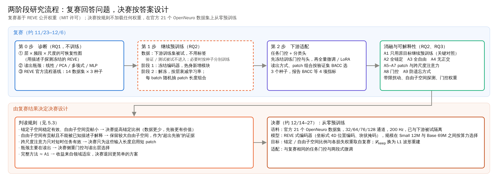<figcaption style="font-size:9pt;color:#52514e">图 21　两阶段研究流程：复赛回答 RQ1–RQ3，决赛按复赛结果设计</figcaption></figure>

### 5.2b 决赛：从零预训练与适配

- **规则**：不得加载任何预训练权重。因此 REVE 的权重不能用，能带入决赛的是复赛验证过的**目标、结构与比例**。
- **语料**：官方 21 个 OpenNeuro 数据集（32/64/76/128 通道，200 Hz，已与下游被试隔离）。通道配置多样，正好适合坐标式位置编码。
- **模型**：REVE 式编码器（坐标式 4D 位置编码、块状掩码），规模按语料时长和官方算力在 Small（12M）与 Base（69M）之间选择；可变长度 patch 与跨尺度注意力从一开始就加入。
- **目标**：从零训练时没有可蒸馏的原模型，$\mathcal L_{keep}$ 换成重建 decoder 的 L1 波形重建。锚定子空间与自由子空间的比例、各损失权重，按复赛结果设定（见 5.3）。
- **下游适配**：与复赛相同的门控读出与两段式微调。

### 5.3 设计依据与取舍

| 设计 | 对应的研究问题 | 为什么可能有效 | 代价 / 适用条件 |
|---|---|---|---|
| 保留 REVE 编码器，新模块零初始化接入 | 全部 | 起点就是当前最强的公开模型；“拼”与“不拼”的比较是受控的 | 只适用于复赛；决赛须从零训练 |
| 频段锚定子空间 | RQ1、RQ2 | 各频段得到与其功率无关的独立监督（FAME 的论点）；描述子目标已被证明能提高 BAcc（Neuro-KE +2.60） | 描述子需预先计算；短窗口无法表示低频 |
| 自由子空间 + 潜在预测 | RQ2、RQ3 | 给模型学习先验之外信息的空间；教师就是 REVE 本身，不需要 decoder | 有坍缩风险，需防坍缩项；含义需事后探测 |
| 正交约束 | RQ2 | 防止各子空间互相复制，使“哪个子空间被用到”可以解读 | 只约束几何关系，不保证纯粹；需要带限扰动实验检验 |
| 可变 patch + 跨尺度门控注意力 | RQ2 | 1 s 的 SSVEP 输入从 1 个时间 token 变为多个；短尺度补时间细节，1 s 尺度负责全局 | 短 patch 增加计算量，只在需要的任务上使用 |
| 任务门控读出 | RQ3 | 不同任务依赖不同频段与尺度；门控权重可直接报告 | 门控可能塌缩到单一子空间，需正则或温度控制 |
| 特征蒸馏防遗忘 | — | 继续预训练数据远少于原始 6 万小时，需防止覆盖已学知识 | 蒸馏太强会限制改进；用 $\lambda_{keep}$ 权衡 |

**复赛结果如何影响决赛设计：**

- 如果**锚定子空间**带来稳定提升，而**自由子空间**贡献很小：决赛语料更小，先验更有价值，提高锚定比例。
- 如果**自由子空间**贡献明显，且探测显示其信息不能被已知描述子解释：决赛保留较大的自由子空间，并在报告中作为“超出神经科学先验”的证据。
- 如果**跨尺度注意力**只在 SSVEP、运动想象等短时任务上有效：决赛只为这些输入长度启用短 patch，节省算力。
- 如果第 0 步的诊断显示瓶颈主要在**读出**：决赛把更多精力放在门控读出与读出层的选择，而不是更换预训练目标。
- 如果**只继续预训练、不加新目标**的对照与完整方法差不多：说明收益主要来自领域适应，决赛的目标设计不能以本方法为依据，需要回到更简单的方案。

---

## 6 实验与消融计划

### 6.1 整体实验设计

**统一协议（与赛题一致）：** 训练 / 验证 / 测试按被试 8:1:1 隔离；3 个指定随机种子各自重新划分；按验证集 BACC 选择权重；报告测试集 BACC 的三种子均值与标准差，并同时报告 PR-AUC、ROC-AUC 和 F1。每个配置需要 14 个数据集 × 3 个种子 = 42 次运行。

**基线：**

| 类别 | 模型 | 作用 |
|---|---|---|
| 从零有监督 | EEGNet、EEG Conformer（按 200 Hz 调整卷积核与池化长度） | 专用小模型参照；部分任务上可能很强 |
| 公开基础模型 | LaBraM、CBraMod、REVE（官方微调流程） | 当前公开模型的统一协议分数 |
| **关键对照** | **REVE + 只用原目标继续预训练**（同样数据、同样步数） | 区分“方法本身”与“多训练一段、领域适应” |
| 本方法 | REVE + 混合子空间 + 跨尺度注意力 + 任务门控 | — |

【待确认】FAME 的公开权重是否可用；若可用，加入 FAME 作为“频段平衡目标”的直接参照。

**每类任务的预期观察点（不预设结果，只说明看什么）：** SSVEP 看短 patch 是否带来提升；睡眠分期看长尺度与低频锚定子空间的门控权重；疾病诊断看 REVE 与专用网络之间的差距是否缩小。

### 6.2 消融与对照

| 编号 | 变体 | 检验的问题 | 控制的条件 |
|---|---|---|---|
| A0 | REVE 原版（不继续预训练） | 分数下限 | — |
| A1 | 只用原目标继续预训练 | 收益是否来自额外训练 | 数据、步数与完整方法相同 |
| A2 | 全锚定（无自由子空间） | 先验够不够 | 总子空间维度相同 |
| A3 | 全自由（无锚定，即 JEPA-Anything 式） | 先验是否必要 | 同上 |
| A4 | 混合，去掉正交约束 | 正交是否必要 | 同上 |
| A5 | 固定 1 s patch（无短 patch、无跨尺度注意力） | 可变 patch 的贡献 | 继续预训练步数相同 |
| A6 | 有短 patch，但不插跨尺度注意力 | 信息是否需要跨尺度共享 | 同上 |
| A7 | 全部尺度 token 做一次全注意力 | 跨尺度门控与代价上限的比较 | 同上，另报计算量 |
| A8 | 门控读出 → 普通池化读出 | 任务门控的贡献 | 同一预训练模型 |
| A9 | 特征蒸馏 → 重建 decoder 的 L1 | 防遗忘方式的选择 | 同上 |

**可解释性检验：**

- **带限扰动**：把输入的某一频段滤掉，检查对应锚定子空间的变化是否明显大于其他子空间。
- **自由子空间探测**：用 Neuro-KE 式描述子探测自由子空间。不能被已知描述子解释的方差比例，作为“超出先验”的度量。
- **门控权重**：与已知生理规律对照（RQ3）。

**算力受限时的优先级：** A1、A2、A3、A5 在全部 14 个数据集上运行；其余先在每个分赛道选一个数据集（7 个）上运行，结论明确后再扩展。

### 6.3 实验判读思路

- **支持假设**：完整方法相对 A1 在多数分赛道上提高 BACC，且提升超过三种子的标准差；A2、A3 都低于混合方案；门控权重与已知生理规律大体一致。
- **不支持假设**：完整方法与 A1 持平——收益来自领域适应而非方法；或可解释性检验失败（带限扰动后各子空间同等变化）——锚定子空间没有真正对应频段。
- **任务差异**：主赛道按分赛道排名计分。某个改进只在部分任务上有效时，不用 14 个数据集的平均值掩盖，而是按分赛道报告，并通过门控或按任务选择 patch 长度，只在有效的任务上启用。
- **波动**：三种子标准差大于方法差异时，不下结论，转而比较跨种子的一致性（几个种子上方向一致）。
- **评测层的补充分析**：【用户判断】运动想象等瞬时任务中，逐窗口预测容易出现标签“闪动”。若数据允许按试次重建连续窗口，额外报告相邻窗口预测的一致性，作为平衡准确率之外的诊断（不用于选模型）。
- **复赛出现什么结果时决赛如何调整**：见 5.3 的五条规则。

---

## 7 结果分析

暂无已完成实验结果。

---

## 8 算力需求（估算，待短测确认）

| 阶段 | 内容 | 估算 |
|---|---|---|
| 复赛 第 0 步 | 冻结表示的探测与读出对照 | 前向为主，约数十 GPU 小时 |
| 复赛 第 1 步 | 继续预训练（若按种子分别做，×3） | 取决于下游训练集总时长；REVE Base 完整预训练（6 万小时 × 17 轮）作者估算约 260 A100 小时，继续预训练的数据量与轮数远小于此 |
| 复赛 第 2 步 | 每个配置 42 次微调；主表约 5 个配置，消融约 10 个 | 单次微调时长待短测；总量 = 单次时长 × 42 × 配置数 |
| 决赛 | 21 个数据集上从零预训练 + 42 次微调 | 取决于语料时长与官方配额 |

GPU 型号、显存、卡数待官方算力公布后填写；存储需求主要来自预计算的描述子目标。

---

## 9 数据来源、复现说明

- **数据**：复赛只使用官方公开的 14 个下游数据集及公开预训练权重（REVE，MIT 许可）；决赛只使用官方 21 个预训练数据集，不加载任何权重。不使用未公开的私有数据。
- **防泄漏**：继续预训练只使用训练集被试；验证、测试被试不参与任何预训练或调参。
- **复现**：固定 3 个官方种子；所有超参数、继续预训练步数和选择规则写入配置文件；代码基于 REVE 官方仓库（elouayas/reve_eeg）修改，随复赛提交。

---

## 参考文献（起草用，正式版统一格式）

- Lawhern et al. EEGNet. J. Neural Eng. 2018. arXiv:1611.08024
- Song et al. EEG Conformer. IEEE TNSRE 2023. DOI 10.1109/TNSRE.2022.3230250
- Kostas et al. BENDR. Front. Hum. Neurosci. 2021.
- Yang et al. BIOT. NeurIPS 2023. arXiv:2305.10351
- Jiang et al. LaBraM. ICLR 2024. arXiv:2405.18765
- Wang et al. EEGPT. NeurIPS 2024.
- Wang et al. CBraMod. ICLR 2025. arXiv:2412.07236
- BrainOmni. arXiv:2505.18185
- CSBrain. arXiv:2506.23075
- REVE. arXiv:2510.21585
- FAME. arXiv:2608.01898
- NeuroLM. arXiv:2409.00101
- UniMind. arXiv:2506.18962
- ECHO. arXiv:2509.22556
- OmniEEG-Bench. arXiv:2606.00815
- NeuralBench. arXiv:2605.08495
- AdaBrain-Bench. arXiv:2507.09882
- JEPA-Anything. arXiv:2609.20800
- LocaLeJEPA. arXiv:2610.28458
- H-JEPA. arXiv:2610.06805
- Beyer et al. FlexiViT: One Model for All Patch Sizes. CVPR 2023. arXiv:2212.08013
- Chen et al. CrossViT. ICCV 2021. arXiv:2103.14899
- Alayrac et al. Flamingo. NeurIPS 2022. arXiv:2204.14198
- Ho et al. Axial Attention in Multidimensional Transformers. arXiv:1912.12180
- Chen et al. Neuro-KE: Knowledge-Guided Interfaces for Semantically Grounded EEG Foundation Models. NeurIPS 2026.

（作者姓名需逐条回查原文后补全；上面未写作者的条目不要直接提交。）
