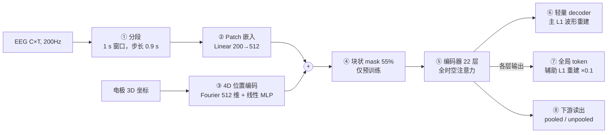

# REVE 改造地图：哪些保留、哪些修改、哪些新增

> 2026-11-14 晚。服务于用户的决定：复赛在 REVE 公开权重上**继续预训练**，按“频段、尺度、任务”三个维度改造。
> 依据：[REVE 笔记](../papers/REVE.md)（论文 v1 全文）。**未核对代码**：Hugging Face 在当前会话的网络中被拦截，`brain-bzh/reve-base` 的代码、config、许可证，以及**公开权重是否包含 decoder 和辅助头**都没有确认。
> 本文只列选项和代价，取舍由用户决定。【助手推断】处需用户判断。

## 1. REVE 的数据流（Base：22 层，8 头，512 维，69M 参数）

## 2. 逐个组件：保留、修改还是新增

“破坏权重”指改动后对应的预训练权重不能直接加载，需要重新初始化。

| # | 组件 | 现状 | 选项 | 破坏权重？ | 服务于 |
|---|---|---|---|---|---|
| ① | 分段 | 1 s 窗口，0.1 s 重叠 | **保留**；或改为更短的 patch（如 0.25 s），以便 1 s 输入也能分出时间尺度 | 改长度会使②失效 | 尺度 |
| ② | Patch 嵌入 | 线性层，直接作用于波形，没有频域输入 | **保留**；或并联一个滤波器组分支（每个频段一个线性层），**零初始化**后加到原嵌入上 | 并联分支不破坏 | 频段 |
| ③ | 4D 位置编码 | 坐标的函数，Fourier 维度 $2\times4^4=512$ 正好等于隐藏维 | **保留**；尺度信息另加一个“尺度嵌入”（零初始化），不要把尺度作为第 5 个坐标并入 Fourier 积（会变成 $2\times4^5=1024$ 维，与 512 不符） | 加第 5 个坐标会破坏；另加尺度嵌入不破坏 | 尺度 |
| ④ | 块状 mask | 空间 3 cm、时间 3 s 半径 | **保留**；粗尺度层可能需要自己的 mask 规则 | 否 | 尺度 |
| ⑤ | 编码器 | 22 层全注意力 | **保留，作为核心资产**；新结构加在它的输出上（或中间层，见 FAME 第 9 层最佳的发现） | 否 | — |
| ⑥ | decoder + L1 波形重建 | 仅预训练使用 | **保留为“锚”**，防止继续预训练时遗忘；同时新增频段目标 | 权重是否公开**未确认**；未公开则需新建 | 频段 |
| ⑦ | 全局 token 辅助头 | 跨层 attention pooling | 保留、去掉，或改造成**按尺度池化的 query** | 未确认是否公开 | 尺度 |
| ⑧ | 下游读出 | pooled 或 unpooled，LP→FT、LoRA、model soup | 新增**任务感知的门控**：每个数据集学习在各频段子空间、各尺度上的权重 | 否 | 任务 |

## 3. 新增部分的一种组合方式（助手推断，供讨论）

1. **频段正交子空间**：在编码器输出 $z\in\mathbb R^{512}$ 上，学习 $K$ 个投影 $P_k\in\mathbb R^{512\times r}$（δ、θ、α、β、γ 各一个，外加一个残差子空间），用 JEPA-Anything 的正交约束
   $\mathcal L_{orth}=\sum_k\|P_k^\top P_k-I_r\|_F^2+\sum_{i<j}\|P_i^\top P_j\|_F^2$。
   每个子空间预测被遮 token 在**该频段**上的目标。目标有两种选法：
   - FAME 式的按频段标准化对数功率：稳定，可解释；
   - EMA 教师（以 REVE 初始化）的潜在表示投影到同一子空间：JEPA 式，更抽象，但有坍缩风险，需要 SIGReg 或方差约束。
2. **尺度**：在时间方向把 token 按步长 2、4 池化，形成第 2、3 层；每层有自己的预测器（H-JEPA 式）。区分两种作用（按合作者 review 补充）：
   - **聚合**产生不同观察范围的表示，决定保留哪些细节、概括哪些变化；
   - **尺度嵌入**只告诉模型“这个 token 代表多大的范围”。所有 token 都来自同一个 1 s 窗口时，只加尺度数值不会产生多尺度信息。
   池化发生在潜在 token 上，不是对波形低通，因此**每个频段都可以出现在每个尺度上**：粗尺度层表达的是各频段活动的慢变化（例如 γ 强度在几秒内的走势），而不是只剩低频。（此处更正了 v1 中“粗尺度层只挂低频段子空间”的错误说法。）
3. **任务**：下游每个数据集学习一组门控权重 $g\in\mathbb R^{K\times L}$（$K$ 个频段 × $L$ 个尺度），对子空间表示加权后读出。门控权重本身就可以报告成“这个任务用了哪些频段、哪些尺度”，正好回应“表征缺乏可解释性”。
4. **总损失**：$\mathcal L=\mathcal L_{L1}+\lambda_{band}\sum_k\mathcal L^{(k)}_{pred}+\lambda_{orth}\mathcal L_{orth}$（+ 各尺度层的预测损失）。$\mathcal L_{L1}$ 保留为锚。

**正交的含义（按合作者 review 补充）。** $\mathcal L_{orth}$ 约束的是**投影参数**：各子空间在几何上互不重叠，避免冗余复制。它不保证各子空间的信息在统计上独立，也不保证每个子空间“纯粹”对应一个频段。子空间 $k$ 之所以对应频段 $k$，来自它的**监督目标**，不来自正交。真实存在的跨频段关联（如跨频耦合、宽带 1/f 变化）仍保留在共享的编码器表示 $z$ 中，并可由残差子空间和下游读出组合得到。“是否纯粹”需要用实验检验，例如对输入做带限扰动（滤掉 α 段），看 α 子空间的变化是否明显大于其他子空间。

**任务不占子空间。** 按用户确认的含义，任务是**读出方式**：频段子空间组织基本表征，各任务通过门控以不同组合读取“频段 × 尺度”，不同任务的读取可以重叠。

**设计原则：所有新增模块都零初始化或以残差方式接入。** 这样继续预训练的第 0 步就等于原始 REVE，“保留”与“新增”的比较是受控的。

## 4. 必须有的对照

- **“只继续预训练、不加新目标”**：在同样的数据、步数下，只用原来的 L1 损失。没有这个对照，任何提升都可能只是“多训练了一段”或“领域适应”带来的，而不是方法本身。
- 逐个去掉频段子空间、正交约束、尺度层、任务门控。
- 读出对照：同一表征用 pooled、unpooled、PCA、多项式读出，区分读出瓶颈与表征瓶颈。

## 5. 约束与待确认

1. **SSVEP 只有 1 s。** 1 s patch 下只有 1 个时间 token，尺度层在这个数据集上退化。要么接受，让 SSVEP 只靠频段子空间；要么改①，代价是 patch 嵌入要重训。
2. **复赛能用什么数据继续预训练。** 手册写的是“微调、线性探测或适配器”。用 14 个下游数据集的训练集做无标签继续预训练，大概率合规；用外部公开语料是否允许，需要向主办方确认。
3. **公开权重的内容。** 是否包含 decoder、辅助头；许可证；需要开放 huggingface.co 的网络访问后核对代码。
4. **算力。** REVE Base 完整预训练按作者估算约 260 A100 小时；继续预训练只能占其中一小部分，具体额度看复赛共享算力。

[返回文档入口](../README.md)
