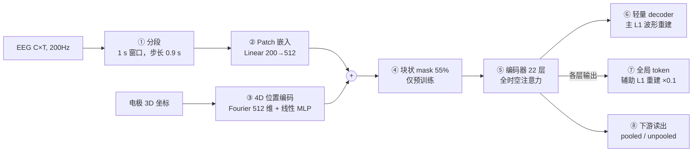

# REVE 改造地图：哪些保留、哪些修改、哪些新增

> 2026-11-14 晚。服务于用户的决定：复赛在 REVE 公开权重上**继续预训练**，按“频段、尺度、任务”三个维度改造。
> 依据：[REVE 笔记](../papers/REVE.md)（论文 v1 全文）。**代码已部分核对**（2026-11-14 晚，作者仓库 [elouayas/reve_eeg](https://github.com/elouayas/reve_eeg)，提交 06a7059，见第 6 节）。
> 本文只列选项和代价，取舍由用户决定。【助手推断】处需用户判断。

## 1. REVE 的数据流（Base：22 层，8 头，512 维，69M 参数）

## 2. 逐个组件：保留、修改还是新增

“破坏权重”指改动后对应的预训练权重不能直接加载，需要重新初始化。

| # | 组件 | 现状 | 选项 | 破坏权重？ | 服务于 |
|---|---|---|---|---|---|
| ① | 分段 | 1 s 窗口，0.1 s 重叠 | **保留**；或改为更短的 patch（如 0.25 s），以便 1 s 输入也能分出时间尺度 | 改长度会使②失效 | 尺度 |
| ② | Patch 嵌入 | 线性层，直接作用于波形，没有频域输入 | **保留**；或并联一个滤波器组分支（每个频段一个线性层），**零初始化**后加到原嵌入上 | 并联分支不破坏 | 频段 |
| ③ | 4D 位置编码 | 坐标的函数，Fourier 维度 $2\times4^4=512$ 正好等于隐藏维 | **保留**；尺度信息另加一个“尺度嵌入”（零初始化），不要把尺度作为第 5 个坐标并入 Fourier 积（会变成 $2\times4^5=1024$ 维，与 512 不符） | 加第 5 个坐标会破坏；另加尺度嵌入不破坏 | 尺度 |
| ④ | 块状 mask | 空间 3 cm、时间 3 s 半径 | **保留**；粗尺度层可能需要自己的 mask 规则 | 否 | 尺度 |
| ⑤ | 编码器 | 22 层全注意力 | **保留，作为核心资产**；新结构加在它的输出上（或中间层，见 FAME 第 9 层最佳的发现） | 否 | — |
| ⑥ | decoder + L1 波形重建 | 仅预训练使用 | **保留为“锚”**，防止继续预训练时遗忘；同时新增频段目标 | 权重是否公开**未确认**；未公开则需新建 | 频段 |
| ⑦ | 全局 token 辅助头 | 跨层 attention pooling | 保留、去掉，或改造成**按尺度池化的 query** | 未确认是否公开 | 尺度 |
| ⑧ | 下游读出 | pooled 或 unpooled，LP→FT、LoRA、model soup | 新增**任务感知的门控**：每个数据集学习在各频段子空间、各尺度上的权重 | 否 | 任务 |

## 3. 新增部分的一种组合方式（助手推断，供讨论）

1. **频段正交子空间**：在编码器输出 $z\in\mathbb R^{512}$ 上，学习 $K$ 个投影 $P_k\in\mathbb R^{512\times r}$（δ、θ、α、β、γ 各一个，外加一个残差子空间），用 JEPA-Anything 的正交约束
   $\mathcal L_{orth}=\sum_k\|P_k^\top P_k-I_r\|_F^2+\sum_{i<j}\|P_i^\top P_j\|_F^2$。
   每个子空间预测被遮 token 在**该频段**上的目标。目标有两种选法：
   - FAME 式的按频段标准化对数功率：稳定，可解释；
   - EMA 教师（以 REVE 初始化）的潜在表示投影到同一子空间：JEPA 式，更抽象，但有坍缩风险，需要 SIGReg 或方差约束。
2. **尺度**：在时间方向把 token 按步长 2、4 池化，形成第 2、3 层；每层有自己的预测器（H-JEPA 式）。区分两种作用（按合作者 review 补充）：
   - **聚合**产生不同观察范围的表示，决定保留哪些细节、概括哪些变化；
   - **尺度嵌入**只告诉模型“这个 token 代表多大的范围”。所有 token 都来自同一个 1 s 窗口时，只加尺度数值不会产生多尺度信息。
   池化发生在潜在 token 上，不是对波形低通，因此**每个频段都可以出现在每个尺度上**：粗尺度层表达的是各频段活动的慢变化（例如 γ 强度在几秒内的走势），而不是只剩低频。（此处更正了 v1 中“粗尺度层只挂低频段子空间”的错误说法。）
3. **任务**：下游每个数据集学习一组门控权重 $g\in\mathbb R^{K\times L}$（$K$ 个频段 × $L$ 个尺度），对子空间表示加权后读出。门控权重本身就可以报告成“这个任务用了哪些频段、哪些尺度”，正好回应“表征缺乏可解释性”。
4. **总损失**：$\mathcal L=\mathcal L_{L1}+\lambda_{band}\sum_k\mathcal L^{(k)}_{pred}+\lambda_{orth}\mathcal L_{orth}$（+ 各尺度层的预测损失）。$\mathcal L_{L1}$ 保留为锚。

**正交的含义（按合作者 review 补充）。** $\mathcal L_{orth}$ 约束的是**投影参数**：各子空间在几何上互不重叠，避免冗余复制。它不保证各子空间的信息在统计上独立，也不保证每个子空间“纯粹”对应一个频段。子空间 $k$ 之所以对应频段 $k$，来自它的**监督目标**，不来自正交。真实存在的跨频段关联（如跨频耦合、宽带 1/f 变化）仍保留在共享的编码器表示 $z$ 中，并可由残差子空间和下游读出组合得到。“是否纯粹”需要用实验检验，例如对输入做带限扰动（滤掉 α 段），看 α 子空间的变化是否明显大于其他子空间。

**任务不占子空间。** 按用户确认的含义，任务是**读出方式**：频段子空间组织基本表征，各任务通过门控以不同组合读取“频段 × 尺度”，不同任务的读取可以重叠。

**设计原则：所有新增模块都零初始化或以残差方式接入。** 这样继续预训练的第 0 步就等于原始 REVE，“保留”与“新增”的比较是受控的。

## 3.5 让 patch 长度可变（2026-11-14 晚，用户希望 patch 长度灵活变化；助手推断，待讨论）

**先例。**
- **FlexiViT**（Beyer et al., CVPR 2023, arXiv 2212.08013）：训练时随机抽取 patch 大小，把 patch 嵌入和位置编码按需缩放，一个模型可在多种 patch 大小下使用。
- **MOIRAI**（Woo et al., ICML 2024, arXiv 2402.02592）：时间序列基础模型，为不同 patch 大小准备多组输入投影层。
- **Pathformer**（Chen et al., ICLR 2024, arXiv 2402.05956）：自适应选择多尺度的 patch 划分。

**REVE 的有利条件。** 4D 位置编码是坐标的函数，时间坐标可以直接用 **patch 中心的秒数**（连续值），而不是 patch 序号。于是不同长度的 patch 都能得到一致的时间位置。

**EEG 与图像的关键区别。** FlexiViT 的缩放假设“patch 内容不变，只是分辨率变了”。EEG 中，0.25 s 的 patch 是**更短的时间片段**，不是 1 s 片段的低分辨率版本。如果像 FlexiViT 那样把 50 点的 patch 插值到 200 点再嵌入，等于把时间拉长 4 倍，40 Hz 会被当成 10 Hz，频率语义错乱。物理上一致的做法是：
- **短于 1 s**：取原嵌入矩阵 $W\in\mathbb R^{512\times200}$ 中对应时长的**列切片**（例如中间 50 列），等价于把短 patch 补零到 1 s 窗口内的对应位置。采样率不变，频率语义不变，1 s 时的权重完全保留。
- **长于 1 s**：用多个 1 s patch 的 token 聚合，即第 3 节的尺度层。

**patch 长度就是真正的“尺度”。** 不同长度的 patch 有不同的观察范围，尺度嵌入（patch 长度的函数）标明这一点。这正好符合合作者 review 的区分：差异由不同的观察范围产生，尺度编码只负责标明。

**频段与尺度的真实耦合：时间–频率不确定性。** 一个长 $L$ 秒的窗口，频率分辨率约 $1/L$，且至少要容纳几个周期。0.25 s 的 patch 无法可靠表示 δ（<4 Hz）。所以“频段 × 尺度”网格并非每格都有意义：**短 patch 只挂高频段的描述子，长窗口才挂低频段**。这是物理约束，与之前更正掉的“池化即低通”是两回事。

**训练与使用。**
- 继续预训练时，每个 batch 随机抽取 patch 长度（如 0.25 / 0.5 / 1 s），让模型适应可变长度（FlexiViT 的做法）；
- 下游按任务选择 patch 长度，或在验证集上选：SSVEP 用短 patch，使 1 s 输入有多个时间 token；睡眠分期保留 1 s。这也是“任务”维度的一部分。

**代价。** token 数与 patch 长度成反比，全注意力的计算量与 token 数平方成正比：0.25 s patch 的计算量约为 1 s 的 16 倍。62 ch × 10 s 用 0.25 s patch 会有约 2,480 个 token，代价很高。所以短 patch 只在需要的任务上用。

## 3.6 不同长度的 patch 通过交替注意力共享信息（用户想法，2026-11-14 晚）

**用户判断：** 不同长度的 patch 理论上可以通过交替注意力共享信息。

**为什么成立（助手补充）。** 交替注意力的连通性与轴向注意力相同：先在 A 组内、再在 B 组内各做一次注意力，两层之后任意两个 token 之间都有路径。EEG 中已有先例：CBraMod 的空间 / 时间注意力，CSBrain 的 CST / SSA 交替。通用领域的先例有：
- 轴向注意力（Ho et al., arXiv 1912.12180）；
- CrossViT（Chen et al., ICCV 2021, arXiv 2103.14899）：小 patch 与大 patch 两个分支之间做交叉注意力；
- Flamingo（Alayrac et al., NeurIPS 2022, arXiv 2204.14198）：在冻结的预训练层之间插入**门控交叉注意力层**，门控初始化为 0，使插入后第 0 步的输出与原模型相同。

**在 REVE 上的一种做法（助手推断）。** token 记为（通道 $c$，尺度 $s$，时间 $t$），$s\in\{0.25, 0.5, 1\}$ s。
- **A：尺度内注意力**：同一尺度的 token 之间做注意力。对 1 s 尺度，这**正是 REVE 原来的全注意力**，权重原样复用。短尺度的 token 数多，可以限制在同一通道或邻近时间的局部窗口内，控制计算量。
- **B：跨尺度注意力**：同一通道、时间范围重叠的不同尺度 token 之间做注意力。每组只有几个 token，代价很小。
- **“拼”而不“改”**：不替换 REVE 的 22 层，而是每隔 $k$ 层插入一个 B 层，门控初始化为 0（Flamingo 的做法）。第 0 步等于原版 REVE；继续预训练中，模型自己学会从短 patch 取多少细节。
- **分工**：1 s 尺度承担全局（跨通道、跨时间）的信息；短尺度只看局部细节，通过 B 与 1 s 尺度交换。这样既保留了短 patch 的时间分辨率，又避免对所有短 patch 做全注意力带来的约 16 倍计算量。

**实现上的便利（代码核对）。** REVE 的注意力不使用 mask，token 按“通道 × 时间”展平。A、B 都可以像 CBraMod 那样，通过 reshape 把分组放到 batch 维实现，同一套 Q/K/V 权重可以直接用。

## 4. 必须有的对照

- **“只继续预训练、不加新目标”**：在同样的数据、步数下，只用原来的 L1 损失。没有这个对照，任何提升都可能只是“多训练了一段”或“领域适应”带来的，而不是方法本身。
- 逐个去掉频段子空间、正交约束、尺度层、任务门控。
- 可变 patch 对照：固定 1 s vs 可变长度（同样的继续预训练步数）。
- 跨尺度信息共享对照：多尺度 token 各自独立（不插 B 层）vs 插入门控 B 层 vs 所有尺度 token 做一次全注意力（代价上限）。
- 读出对照：同一表征用 pooled、unpooled、PCA、多项式读出，区分读出瓶颈与表征瓶颈。

## 5. 约束与待确认

1. **SSVEP 只有 1 s。** 1 s patch 下只有 1 个时间 token，尺度层在这个数据集上退化。要么接受，让 SSVEP 只靠频段子空间；要么改①，代价是 patch 嵌入要重训。
2. **复赛能用什么数据继续预训练。** 手册写的是“微调、线性探测或适配器”。用 14 个下游数据集的训练集做无标签继续预训练，大概率合规；用外部公开语料是否允许，需要向主办方确认。
3. **公开权重的内容。** 已核对（第 6 节）：只有编码器与 `cls_query_token`，MIT 许可。
4. **算力。** REVE Base 完整预训练按作者估算约 260 A100 小时；继续预训练只能占其中一小部分，具体额度看复赛共享算力。

## 6. 代码核对结果（[elouayas/reve_eeg](https://github.com/elouayas/reve_eeg)，提交 06a7059，MIT 许可）

| 问题 | 代码中的事实 | 位置 |
|---|---|---|
| 许可证 | MIT | `LICENSE` |
| 公开权重包含什么 | Hugging Face 版只有**编码器 + `cls_query_token`**（注意力池化的 query）；`from_pretrained` 取出 `cls_query_token` 后以 `strict=True` 加载编码器。**decoder（4 层）和辅助重建头 `cls_to_pixels` 不在公开权重中** | `src/models/encoder.py`，`hf/reve-base/modeling_reve.py` |
| 继续预训练的含义 | 需要**重新初始化** decoder 和辅助头；可先冻结编码器、只训 decoder 热身，再解冻 | 助手推断 |
| patch 数 | `eeg.unfold(size=200, step=180)`：只计完整窗口，$p=\lfloor(T-200)/180\rfloor+1$，与 REVE 笔记中按此推算的表一致 | `encoder.py` `forward` |
| 时间坐标 | patch **序号** $0..p-1$；Fourier 部分乘以 0.1，MLP 部分用原始序号。不是秒。可变 patch 时需改成按秒计的连续时间 | `FourierEmb4D.add_time_patch`、`forward` |
| Fourier 维度 | freqs=4，四维笛卡尔积 $4^4=256$，cos/sin 后 512 | `FourierEmb4D` |
| 坐标噪声 | `noise_ratio=0.0025`（坐标单位推测为米，即 0.25 cm） | `configs/encoder/base.yaml` |
| 编码器 | 22 层，8 头 × 64 维，RMSNorm，GEGLU（比例 2.66），无 bias，注意力**不支持 mask**（FlashAttention varlen 或 SDPA） | `models/backbone.py` |
| Patch 嵌入 | `nn.Linear(200, 512)`，带 bias | `encoder.py` |
| mask | `MAE.forward` 默认随机 mask；块状 mask 由数据加载器生成后传入（`use_block: True`，比例 0.55） | `models/mae.py`，`utils/data_loading.py` |
| 辅助损失 | 各层输出拼接后，以 `cls_query_token` 做注意力池化，复制到被遮位置，经 2 层 MLP 重建，L1 | `models/mae.py` |
| 电极坐标 | 单独的位置库 `reve-positions`（`positions.json`），按电极名查坐标 | `hf/reve-positions/` |

[返回文档入口](../README.md)
